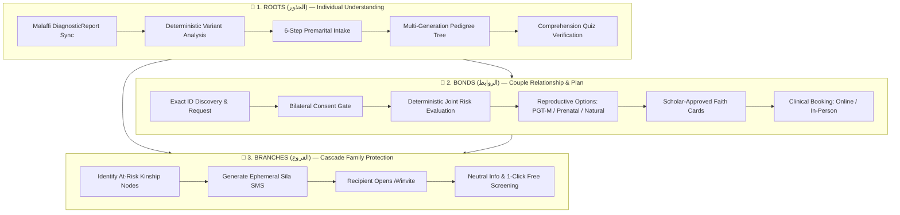
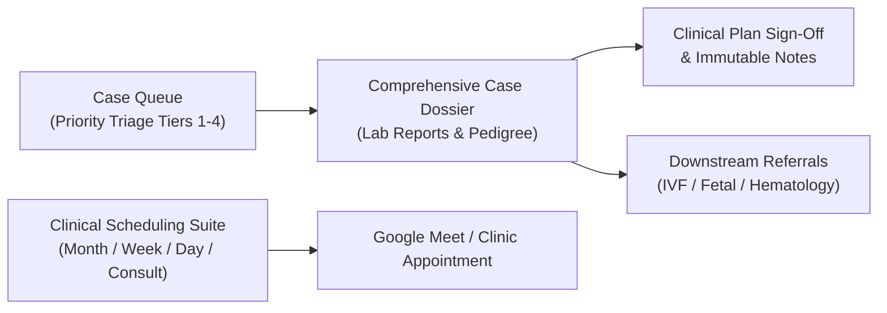

# DaNA — Complete Application Features & Technical Specification
**Platform Identity:** DaNA · دانة (*Know your roots. Protect your future.* · *اعرف جذورك… واحمِ مستقبلك*)  
**Challenge Track:** Future Health Digital Innovation Challenge 2026 — Fertility Theme (Statement 3: *Understanding and Reducing Inherited Disease Risk*)  
**Version:** Production Baseline (November 2026)  
**Status:** Validated, Tested (95/95 Passing Automated Tests), and Production Build Verified  

---

## 1. Executive Summary & Healthcare Mission

### 1.1 The Clinical & Social Backdrop
Since October 2024, the Department of Health (DoH) Abu Dhabi has mandated premarital genetic screening covering **570 genes** for all Emirati couples. Pilot cohorts reveal that approximately **1 in 10 couples** carry at least one high-risk shared recessive or X-linked disease variant. In historical premarital screening programs, prohibitive framing ("you are incompatible") led to stigma and fear, yet over 80% of identified at-risk couples still married—often without clinical counseling or reproductive planning.

Simultaneously, the United Arab Emirates champions the **National Family Growth Agenda 2031** and the **Year of Family 2026**, emphasizing healthy marriages, reproductive confidence, and population growth. 

### 1.2 The DaNA Core Philosophy: "Compatible, with a Plan"
DaNA resolves this tension by eliminating binary marriage gating. The platform operates on four foundational healthcare principles:
1. **Zero Marriage Denials:** DaNA never issues prohibitive rulings ("do not marry") and never withholds marriage clearances.
2. **"Compatible, with a Plan":** Couples carrying shared pathogenic variants are provided with clear, non-stigmatizing options (IVF with PGT-M, early prenatal testing, or informed natural conception) alongside immediate access to licensed genetic counselors.
3. **Cascade Family Protection (Sila Alerts):** Extends genetic discovery from a single couple to the entire kinship group before future marriages occur, guided by the Islamic value of *Silat al-Rahim* (صلة الرحم).
4. **Deterministic Clinical Rigor:** All risk probabilities originate from a deterministic, versioned genetics engine and clinical benchmarks—**never from generative AI**. AI is strictly bounded to explaining clinician- and scholar-approved guidance.

---

## 2. System Architecture & Technology Stack

```
+----------------------------------------------------------------------------------------------------+
|                                    PRESENTATION LAYER                                              |
|   Landing Page (Motion/3D)  │  Couple App (Roots/Bonds/Branches)  │  Counsellor Portal  │  DoH Hub |
+-------------------------------------------------+--------------------------------------------------+
                                                  │
                                                  ▼
+----------------------------------------------------------------------------------------------------+
|                                  SECURITY & GATEWAY LAYER                                          |
|  Simulated UAE PASS OIDC  │  Authorization Engine (ABAC/ReBAC/CBAC)  │  Append-Only Audit Guard    |
+-------------------------------------------------+--------------------------------------------------+
                                                  │
                                                  ▼
+----------------------------------------------------------------------------------------------------+
|                                    CORE APPLICATION ENGINES                                        |
|  Genetics Rules Core (AR/XL)    │ Connections & Relationship Service │ Priority Triage (Tiers 1-4) |
|  Clinical Benchmarks Evaluator  │ Pedigree Tree Kinship Generator    │ Ephemeral Sila Dispatcher   |
+-------------------------------------------------+--------------------------------------------------+
                                                  │
                                                  ▼
+----------------------------------------------------------------------------------------------------+
|                                      DATA & STORAGE LAYER                                          |
|  PostgreSQL 16+ Database (28 Migrations) │ Row-Level Security (RLS) │ Fast-API FHIR Ingestion Gate |
+----------------------------------------------------------------------------------------------------+
```

### 2.1 Technology Specifications
* **Frontend Web Application:** React 18.3.1 with Vite 6.0.7 build toolchain (`web/`).
* **Motion & Experiential UI:** Framer Motion 11.15.0, Lenis 1.1.20 smooth scroll, Three.js 3D landing visuals, Lucide React icons.
* **Styling & Design System:** Tailored healthcare design system (`app.css`, `styles.css`) featuring neutral stone (`#F6F7F5`), UAE Green (`#00843D`), UAE Red (`#CE1126`), and clinical amber warnings (`#B26A00`).
* **Bilingual Arabic/English RTL Architecture:** Dynamic full-layout right-to-left (RTL) switching powered by Tajawal and Outfit typography with native Arabic clinical phrasing.
* **Client-Side Reactive State:** Zero-latency external store (`useSyncExternalStore`) in `web/src/app/shared/store.js` backed by browser local persistence (`dana-demo-v1`) and real-time Supabase subscription sync.
* **Backend API (FastAPI):** Python 3.11+ ASGI microservice (`api/app/main.py`) delivering FHIR DiagnosticReport parsing, lab validation, benchmark cross-checks, and $k$-anonymity analytics.
* **Database & Security:** Supabase PostgreSQL 16+ with 28 structured database migrations, Row-Level Security (RLS), security-definer stored procedures, and audit triggers.

---

## 3. Product Pillars & User Workflows

The application is structured around the **Three Product Pillars**: **Roots**, **Bonds**, and **Branches**.



---

### Pillar 1: Roots (الجذور) — Individual Genetic Discovery

The Roots module empowers individuals to understand their personal genetic heritage, family health history, and individual carrier risks without jargon or blame.

#### Key Features:
1. **Malaffi Health Information Exchange (HIE) Sync:**
   - Simulated integration with Malaffi FHIR R4 DiagnosticReports.
   - Enforces user consent verification prior to reading medical records.
   - Parses gene symbols, HGVS cDNA/protein nomenclatures, zygosity (heterozygous/homozygous), and ClinVar clinical significance.
2. **Deterministic Genetic Explanations (Zero AI Hallucinations):**
   - Formulated under versioned clinical guidelines (`explain-v2`).
   - Plain-language interpretations: clearly distinguishes between being a healthy carrier and having a medical condition.
   - Explicitly explains residual risk and screening coverage limitations (screened 570 genes vs. entire genome).
3. **Comprehensive 6-Step Premarital Screening Intake:**
   - **Step 1 (User Info):** Name, unique DaNA ID, national ID hash, sex, contact details (supports UAE PASS auto-fill and manual registration).
   - **Step 2 (Health History):** Chronic conditions, prior hemoglobinopathy screens, iron deficiency markers, G6PD history.
   - **Step 3 (Family History):** Consanguinity declaration (first cousin, second cousin, unrelated), inherited family conditions, affected children.
   - **Step 4 (Compliance & Identity):** UAE residency confirmation, identity verification.
   - **Step 5 (Granular Consent Selection):** Malaffi data access, counselor data sharing, partner data processing.
   - **Step 6 (Verify & Submit):** Complete summary with digital submission and automatic family tree generation.
4. **Interactive Multi-Generational Pedigree Family Tree:**
   - 4-Generation relational hierarchy: Grandparents (-2), Parents/Aunts/Uncles (-1), Self/Partner/Siblings/Cousins (0), Children (+1).
   - Dynamic kinship grouping across paternal and maternal lineages.
   - Visual lineage tracking (*bloodline pathing*) highlighting carrier transmission.
   - Dynamic member management: add relatives, edit kinship relations, mark deceased status, and initiate Sila alerts.
5. **Comprehension Quizzes (Educational Guardrails):**
   - 30-second 3-question True/False interactive quizzes validating user understanding.
   - Prevents misconceptions (e.g., verifying that carriers do not suffer from the recessive disorder).
   - Records comprehension metrics to Supabase to inform public health communication standards.

---

### Pillar 2: Bonds (الروابط) — Couple Relationship & Shared Assessment

The Bonds module manages the mutual partnership between two individuals, providing joint reproductive counseling, deterministic risk calculation, and actionable family planning.

#### Key Features:
1. **Privacy-Preserving Connections Hub:**
   - **Zero Public User Directory:** To comply with UAE PDPL, users cannot browse or enumerate other users.
   - **Exact Matching Only:** Connection requires searching by exact Username or Unique DaNA ID (e.g. `DANA-KHALID`).
   - **External Invite Generation:** One-click custom invitations for unregistered partners via **WhatsApp** and **Gmail**.
   - **Bidirectional Request Management:** Real-time incoming and outgoing request queues with personal notes, acceptance, rejection, and cancellation.
   - **Relationship Severance & Blocklist:** Instant connection termination and user blocking, immediately severing all shared data channels.
2. **Strict Multi-User Privacy & Consent Separation:**
   - Accepting a connection **NEVER** automatically reveals raw genetic variants, carrier statuses, or medical reports to the partner.
   - Partners independently grant permission to the **Genetic Intelligence Engine** to compute joint couple risk.
3. **Deterministic Joint Mendelian Risk Assessment:**
   - Evaluates both partners' screening data against Mendelian inheritance rules:
     * **Autosomal Recessive (AR) Shared Match:** 25% chance child affected, 50% chance healthy carrier, 25% chance clear (e.g. *HBB* Beta-thalassaemia pair).
     * **X-Linked Recessive (XL):** 50% chance of affected sons, 50% chance of carrier daughters when the female partner carries an X-linked variant (e.g. *G6PD*).
     * **Single Carrier / Low Couple Risk:** 50% chance carrier child, 0% chance affected child; child risk matches general population.
     * **Both Clear:** Reassuring explanation with transparent notes on residual risk and test limitations.
     * **Variant of Uncertain Significance (VUS):** Flags findings requiring expert clinical review before assigning risk.
4. **Reproductive Pathway Decision Aids:**
   - Side-by-side balanced clinical option cards:
     * **IVF with Pre-implantation Genetic Testing (PGT-M):** Test embryos before pregnancy; only unaffected embryos transferred.
     * **Early Prenatal Diagnosis:** Natural conception followed by chorionic villus sampling (CVS, weeks 11–14) or amniocentesis (weeks 15–18).
     * **Informed Natural Conception:** Full knowledge without invasive procedures, preparing pediatric care teams from day one.
5. **Scholar-Reviewed Faith & Value Guidance Cards:**
   - Addresses sensitive religious and cultural considerations regarding IVF, embryo testing, and prenatal decisions.
   - Pre-reviewed and approved by authorized Islamic scholars; AI is strictly barred from providing religious rulings (*fatwas*).
6. **Multi-Modality Genetic Counselor Booking:**
   - Direct integration with licensed genetics clinics (e.g., Cleveland Clinic Abu Dhabi, DoH Partner Clinics).
   - Supports **Online Google Meet video consultations** and **In-Person clinic visits**.

---

### Pillar 3: Branches (الفروع) — Cascade Family Screening & Sila Alerts

The Branches module extends preventive healthcare to the wider family network through private, culturally respectful cascade screening invitations.

#### Key Features:
1. **Sila Alerts (صلة الرحم):**
   - Grounded in the Arab and Islamic tradition of kinship care (*Silat al-Rahim*).
   - When a carrier variant is confirmed, the family tree calculates the probability of relatives carrying the same variant (e.g., 50% for full siblings, 25% for first cousins).
   - Users can dispatch anonymous SMS alerts with a single tap.
2. **Ephemeral Contact Buffer (UAE PDPL Compliance):**
   - Relatives' phone numbers are held in volatile memory only for dispatch to the telecommunications gateway.
   - Contact numbers are permanently erased immediately after delivery; zero phone numbers are stored in the database.
3. **The Relative Portal Experience (`/#/invite`):**
   - Recipient receives a private SMS link with a cryptographically hashed, one-time token expiring in 14 days.
   - **Zero Identity Leakage:** The relative is never told who sent the invite, what condition was detected, or any family details.
   - Delivers neutral, welcoming public health information explaining free UAE premarital screening.
   - **One-Click Free Screening Booking:** Relatives can schedule their screening directly without creating an account.

---

## 4. Clinical Counsellor Portal & Scheduling Suite

The Counsellor Portal (`/app/counsellor`) provides specialized tools for licensed genetic counselors and medical teams.



### 4.1 Features:
1. **Priority Case Triage Queue:**
   - Automatically prioritizes couples using deterministic clinical criteria:
     * **Tier 1 (Urgent):** Pregnant couples with shared pathogenic variants (immediate intervention SLA).
     * **Tier 2 (High):** Non-pregnant couples with shared recessive or X-linked variants.
     * **Tier 3 (Moderate):** Couples with VUS findings, single carriers, or consanguineous unions.
     * **Tier 4 (Routine):** Negative/clear screening results.
2. **Comprehensive Case Dossier:**
   - Side-by-side lab reports for both partners.
   - Integrated family pedigree display with consanguinity indicators.
   - Real-time review of couple's declared reproductive plan.
3. **Immutable Clinical Notes System:**
   - Draft clinical notes during or after consultations.
   - "Approve and Lock" feature: creates tamper-proof clinical records complying with Abu Dhabi ADHICS standards.
4. **Specialist Downstream Referrals:**
   - Direct digital referral generation to:
     * In-Vitro Fertilization & PGT-M Centers
     * Fetal Medicine & Maternal-Fetal Specialists
     * Clinical Hematology Clinics
     * Advanced Genomic Sequencing Laboratories
5. **Interactive Clinical Scheduling Suite (`Schedule.jsx`):**
   - Comprehensive multi-view calendar: **Month**, **Week**, **Day**, **List**, and **Live Consultation Workspace**.
   - Multi-clinician management (Dr. Mariam Al Hosani, Dr. Tariq Al Nuaimi, Dr. Fatima Al Zaabi).
   - Integrated online video consultation links (Google Meet) and in-person room management (Cleveland Clinic Abu Dhabi).
   - Deep-link consultation review handler (`?review=<id>`).

---

## 5. Department of Health (DoH) Admin & Analytics Hub

Designed for public health officials and program administrators to monitor population-level screening efficacy without compromising citizen privacy.

### 5.1 Features:
1. **Public Health Analytics & Population Insights:**
   - Real-time tracking of couples screened, carrier frequencies, high-risk unions identified, and Sila alert cascade uptake.
   - Interactive monthly screening volume visualizations with table toggle.
2. **Guaranteed $k$-Anonymity Privacy Safeguard ($k \ge 5$):**
   - To eliminate re-identification risks in small communities, cohorts with fewer than 5 individuals are strictly suppressed from charts and API responses.
3. **Scholar Content Review Pipeline:**
   - Review and approval workflow for religious and ethical faith cards.
   - Ensures educational content receives certified scholar verification before release.
4. **Append-Only ADHICS Forensic Audit Log:**
   - Comprehensive system audit tracking: user logins, Malaffi sync events, consent grants/revocations, case reviews, and plan approvals.
   - Fully immutable audit log with actor attribution, timestamps, and resource IDs.

---

## 6. Clinical Security Administration & Governance Console

The platform includes a dedicated 8-tab Security Console (`/app/security`) accessible to Platform Administrators and Clinical Supervisors:

| Tab | Route | Capability |
| :--- | :--- | :--- |
| **Security Overview** | `/app/security` | Real-time posture score, active sessions, consent metrics, threat alerts |
| **Users & Roles** | `/app/security/users` | Account governance across 6 system roles, account suspension, credential status |
| **Permissions** | `/app/security/permissions` | Granular permission inspection, RBAC evaluation, privilege escalation barriers |
| **Consents Governance** | `/app/security/consents` | Global oversight of purpose-specific consent grants, revocations, and expiry |
| **Partner Governance** | `/app/security/relationships` | Inspection of couple connection edges, status validation, emergency disconnect |
| **Clinical Assignments** | `/app/security/clinical-assignments`| Case assignment distribution, counselor caseload limits, triage SLA monitoring |
| **Access History** | `/app/security/audit` | Filterable forensic audit explorer tracking every data read and authorization event |
| **Threat Monitoring** | `/app/security/threat-monitoring` | Detection of IDOR probes, suspicious rate anomalies, unauthorized data queries |

---

## 7. Clinical Benchmarks & Gene Panel Administration

Located at `/app/settings`, this module enables clinical leaders to configure medical thresholds and gene panels with complete audit traceability.

### 7.1 Risk Benchmarks Engine (`Benchmarks.jsx`)
- **Sex-Specific Hematology & Infection Markers:**
  * Hemoglobin (Hb min g/dL), MCV (min fL), MCH (min pg)
  * HbA2 carrier threshold (%) and HbA2 review limit (%)
  * HbF review threshold (%)
  * Serum Ferritin and inflammation threshold ($\mu$g/L)
  * G6PD deficiency and intermediate thresholds (%)
  * Rubella IgG immunity threshold (IU/mL)
  * RhD negative status check
  * Infectious disease screening panel (HIV, Hepatitis B, Hepatitis C, Syphilis)
- **Immutable Snapshotting & Rollback:**
  * Any threshold update requires an audit reason ($\ge 10$ characters).
  * Optimistic concurrency control via `expected_version` prevents overwrite collisions.
  * Complete point-in-time snapshot restoration with non-destructive version bumping.

### 7.2 Configurable 570-Gene Panel (`GenePanel.jsx`)
- Interprets variants against accredited gene records.
- Attributes tracked: Gene Symbol, Condition Name, Inheritance Pattern (AR/XL), HGNC ID, NCBI Gene ID, Reference Transcript (e.g. `NM_000558.5`), Source Citation, Source URL, Active Status, and Clinical Review Status (*Needs expert review*, *Verified*, *Retired*).
- Deprecated genes are marked `retired` rather than deleted, guaranteeing that historical reports remain valid.

---

## 8. Experiential Landing Page & Motion Storytelling

DaNA features a world-class landing page demonstrating the care journey through physics-based motion and 3D renders:

1. **The Pearl Drops Intro (`Intro.jsx`):** A natural pearl drops into the Arabic letter ن (*Noon*), producing physical water ripples before springing the D·a·N·A wordmark into view.
2. **Scroll-Driven Tree Growth (`GrowSection.jsx`):** As the visitor scrolls, an interactive seed germinates into roots, rises into a trunk, expands into branches, blossoms leaves, and yields family pearls.
3. **Scroll-Driven Walking Emirati Couple (`JourneyWalk.jsx` & `Walker.jsx`):** 
   - Side-view animated Emirati couple moving with a natural walking gait synchronized with scroll velocity.
   - Guides visitors through 7 milestones: **Engagement → Screening Results → "Compatible, with a Plan" → Wedding → Genetic Counselor Meeting → Newborn Baby → Fully Protected Family**.
4. **Sila Live Cascade Visualization:** Demonstrates private alerts traversing family tree nodes, lighting up relatives in real time.
5. **Instant Bilingual RTL/LTR Toggle:** Seamless one-tap switching between English and Arabic layouts.

---

## 9. Comprehensive Authorization & Role Matrix

DaNA enforces multi-layered authorization combining **Role-Based (RBAC)**, **Attribute-Based (ABAC)**, **Relationship-Based (ReBAC)**, and **Consent-Based (CBAC)** access controls across **6 system roles**:

| Feature / Resource | Couple / Patient | Counsellor | Clinical Supervisor | DoH Admin | Content Reviewer | DoH Viewer | Sila Invitee |
| :--- | :---: | :---: | :---: | :---: | :---: | :---: | :---: |
| **View Own Report** | ✓ | — | — | — | — | — | ✓ (Once linked) |
| **Search by DaNA ID** | ✓ | ✓ | ✓ | ✓ | — | — | — |
| **Send/Accept Connection** | ✓ | — | — | — | — | — | — |
| **View Partner Carrier Gene** | **Consent** | **Consent** | **Consent** | ✕ (Stripped) | ✕ | ✕ | ✕ |
| **View Couple Assessment** | **Authorized**| **Assigned**| **Supervisor** | ✕ (De-ident) | ✕ | ✕ | ✕ |
| **Review Case Queue** | ✕ | ✓ (Assigned)| ✓ (All cases) | ✕ | ✕ | ✕ | ✕ |
| **Approve Clinical Notes** | ✕ | ✓ (Licensed)| ✓ (Licensed) | ✕ | ✕ | ✕ | ✕ |
| **Access Security Console** | ✕ | ✕ | ✓ (Governance)| ✓ (Full Console)| ✕ | ✓ (Audit only)| ✕ |
| **Review Faith Content** | ✕ | ✕ | ✕ | ✓ | ✓ | ✕ | ✕ |
| **Edit Clinical Benchmarks** | ✕ | ✕ (Read only)| ✕ (Read only)| ✓ (Versioned)| ✕ | ✕ | ✕ |
| **Aggregate Analytics** | ✕ | ✕ | ✕ | ✓ ($k \ge 5$) | ✕ | ✓ ($k \ge 5$) | ✕ |
| **Open Sila Invite Link** | — | — | — | — | — | — | ✓ (Token only) |

---

## 10. Verification, Automated Testing & Compliance

### 10.1 Automated Test Suite (95/95 Tests Passing)
Execution command: `npm.cmd --prefix web test`

```
✔ DaNA Healthcare Authorization & Consent Test Suite (18 Scenarios)
  - User A reads own report (Allowed)
  - User A reads User B report (Denied)
  - Connected partner accesses authorized assessment (Allowed)
  - Partner reads raw report even after connection (Denied)
  - Processing without consent (Denied)
  - Consent revocation cuts off access immediately (Verified)
  - Assigned vs. unassigned counselor case access (Verified)
  - IDOR and privilege escalation defense (Verified)

✔ DaNA Comprehensive 10-Area Authorization Security Test Suite
  - Area 1: Authentication and Session State (3/3 passed)
  - Area 2: Role-Based Access Control (7/7 passed)
  - Area 3: Resource Ownership & IDOR Protection (6/6 passed)
  - Area 4: Consent-Based Access Control (5/5 passed)
  - Area 5: Relationship-Based Access Control (4/4 passed)
  - Area 6: Counselor & Clinical Access Management (5/5 passed)
  - Area 7: Genetic Intelligence Engine Authorization (3/3 passed)
  - Area 8: API & Database Row-Level Security Boundaries (5/5 passed)
  - Area 9: Audit Logs & Security Monitoring (2/2 passed)
  - Area 10: Client-Side PHI Purging on Logout (2/2 passed)

✔ Connections & Risk Processing Engine Unit Tests (13/13 passed)
  - Zero-public directory browsing enforcement
  - Exact DaNA ID matching
  - Mutual connection resolution
  - WhatsApp & Gmail invite generation
  - Immediate assessment triggering upon connection acceptance
  - Blocking and connection severing

✔ DaNA Security Administration Console & Governance Test Suite (10/10 passed)
  - Administrator forensic audit access
  - Administrator blocked from raw genetic variants (Zero-Knowledge)
  - Clinical supervisor case access
  - Suspended account denial across all routes
  - Emergency consent revocation and relationship severance

Total: 95 tests passing across all test suites (421ms execution time).
```

### 10.2 Production Build Verification
Execution command: `npm.cmd --prefix web run build`  
- Output: `✓ 2252 modules transformed.`  
- Vite build completed with zero errors, validating all JSX syntax, CSS design tokens, and route linkages.

### 10.3 Regulatory & Governance Compliance Matrix
| Regulation / Standard | Platform Implementation |
| :--- | :--- |
| **UAE Federal Law No. 2 of 2019 (Health ICT)** | 100% UAE data residency; Malaffi remains the authoritative system of record. |
| **UAE Federal Decree-Law No. 49 of 2023 (Human Genome)** | Explicit, purpose-specific, revocable consent gates every read and processing of genomic data. |
| **UAE Personal Data Protection Law (PDPL)** | Data minimization; ephemeral memory buffering for relatives' phone numbers with zero persistence. |
| **Abu Dhabi ADHICS Standard** | AES-256 / TLS 1.3 encryption, Row-Level Security, immutable append-only audit trail. |
| **DoH Responsible AI Standard** | Zero generative AI risk scoring; 100% deterministic Mendelian rules; human clinical oversight. |
| **Public Health $k$-Anonymity** | Aggregate reporting suppresses cohort cell sizes where $k < 5$ to prevent re-identification. |

---

## 11. Complete Directory & Route Map

```
c:/Hackathons/DaNA/
├── api/                             # FastAPI Python Backend
│   ├── app/
│   │   ├── auth.py                  # JWT & User Context Resolution
│   │   ├── benchmark.py             # Risk Benchmark Evaluation Engine
│   │   ├── config.py                # Environment Configuration
│   │   ├── db.py                    # Service & User Client Connection
│   │   ├── fhir.py                  # FHIR R4 DiagnosticReport Parser
│   │   ├── invite.py                # Partner Invite Email Dispatcher
│   │   ├── main.py                  # API Endpoints (Health, Reports, Ingest, Benchmarks, Analytics)
│   │   ├── panel.py                 # Gene Panel Ingestion & Cache
│   │   ├── sample_bundle.py         # Synthetic Malaffi FHIR Bundles
│   │   └── scenarios.py             # 10 Clinical Demonstration Scenarios
│   └── tests/                       # Pytest Suite
├── database/                        # PostgreSQL Production Schema
│   ├── schema.sql                   # 19 Relational Tables with Constraints
│   └── seed.sql                     # Baseline Clinical Seeds
├── docs/                            # Engineering Documentation
│   ├── engineering/                 # Architecture, API Reference, Auth Rules, DB Schema
│   └── images/                      # Renders, Visuals & Architecture Diagrams
├── supabase/                        # 28 Supabase SQL Migrations
│   ├── 001 to 028 migrations        # Incremental schema evolution
│   └── schema.sql                   # Consolidated Supabase Schema
├── test/                            # Node.js Automated Test Suites (95 tests)
└── web/                             # React 18 + Vite 6 Frontend Application
    ├── src/
    │   ├── App.jsx                  # Motion Landing Page
    │   ├── Root.jsx                 # Client-Side Hash Router
    │   ├── routes.jsx               # Role Menus & Page Resolver
    │   ├── app/
    │   │   ├── admin/               # DoH Dashboard (Overview, Content, Audit)
    │   │   │   └── security/        # Security Administration Console (8 sub-consoles)
    │   │   ├── counsellor/          # Case Queue, Case View, Schedule Suite
    │   │   ├── couple/              # Home, Roots, Bonds, Connections, Family Tree, Privacy, Screening
    │   │   ├── settings/            # Risk Benchmarks & 570-Gene Panel Admin
    │   │   └── shared/              # Data, Genetics Engine, Store, UI Kit, Auth Guards
    │   ├── styles.css               # Landing Page & Design System Tokens
    │   └── i18n.js                  # Bilingual English/Arabic Dictionaries
```

### Application URL Routing Cheat Sheet:
* `/#/` — Animated Bilingual Landing Page (English / Arabic RTL)
* `/#/login` — UAE PASS & Supabase Authentication Portal
* `/#/invite` — Anonymous Sila Cascade Screening Portal for Relatives
* `/#/app` — Role-Specific Home Dashboard (Couple / Counsellor / Admin / Supervisor)
* `/#/app/result` — Roots: Individual Genetic Screening Results
* `/#/app/screening` — Roots: 6-Step Premarital Health Intake Form
* `/#/app/familytree` — Roots / Branches: Interactive 4-Generation Pedigree Tree
* `/#/app/connections` — Bonds: Partner Discovery, Requests, and Consents
* `/#/app/bonds` — Bonds: Joint Assessment & Reproductive Options
* `/#/app/roots` — Branches: Sila Alert Kinship Dispatcher
* `/#/app/counsellor` — Couple Counsellor Appointment Booking
* `/#/app/privacy` — Consent Governance & "Who Saw My Data" Audit Access
* `/#/app/schedule` — Counsellor Multi-Doctor Scheduling Suite
* `/#/app/case/:id` — Counsellor Clinical Dossier & Plan Approval
* `/#/app/security` — Clinical Security Administration Console (8 views)
* `/#/app/settings` — Clinical Benchmarks & 570-Gene Panel Administration
