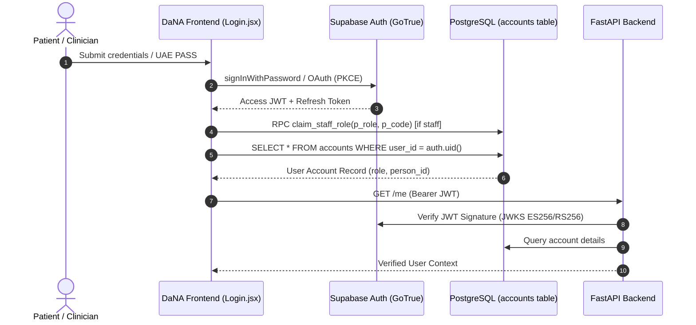
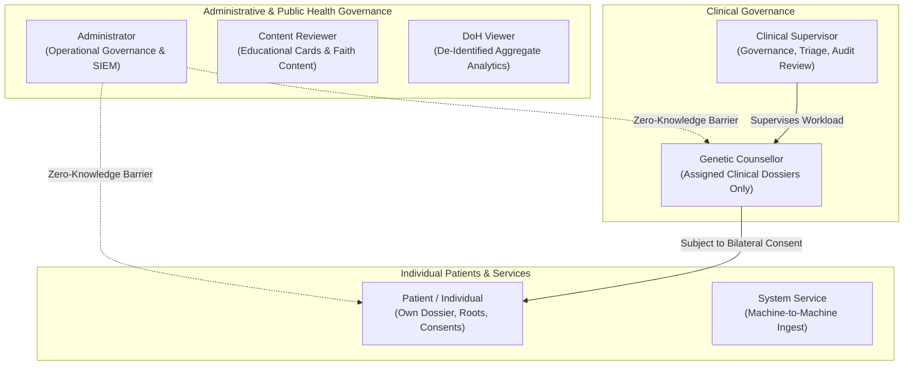

# DaNA Platform — Complete Repository-Wide Authorization, RBAC & Security Audit

**Document Reference:** DANA-SEC-AUDIT-2026-COMPLETE  
**Assessment Date:** 2026-11-14  
**Classification:** Confidential — Healthcare SaaS Security, Clinical Data Privacy & Compliance  
**Auditors:** Principal Software Architect, Senior Application Security Engineer, Healthcare Data Security Specialist  
**Target Platform:** DaNA (Premarital Genetic Health & Screening Companion)  
**Compliance Frameworks:**  
- UAE Health Data Law (Federal Law No. 2 of 2019)  
- UAE Human Genome Decree-Law No. 49 of 2023  
- Abu Dhabi Healthcare Information and Cyber Security Standard (ADHICS)  
- UAE Personal Data Protection Law (Federal Decree-Law No. 45 of 2021)  

---

## 1. Executive Summary

A comprehensive, recursive, repository-wide architectural and security audit was performed on the DaNA premarital genetic health platform. The evaluation covered all frontend components, backend APIs, Supabase/PostgreSQL schema definitions, row-level security (RLS) policies, authentication flows, authorization logic, and test suites.

### Key Audit Findings

1. **Database-Level RLS Decoupling Failure (`SEC-01 / GAP-01` — Critical):**  
   In `supabase/004_spec_v3.sql` line 208, PostgreSQL function `can_see_genetics(p)` grants a connected partner direct `SELECT` access to raw `genetic_reports` and `genetic_variants` whenever a general `share_partner` consent is active. While frontend presentation decouples individual variants from the couple risk assessment, direct PostgREST calls allow an authenticated partner to query raw genomic sequences and variant calls.

2. **Counsellor Clinical Case Over-Exposure (`SEC-02 / GAP-02` — Critical):**  
   In `supabase/004_spec_v3.sql` lines 373, 393 and `supabase/schema.sql` line 215, RLS policies on `clinical_cases`, `medical_records`, and `notes` grant access to any user with `my_role() = 'counsellor'`. The database does not join `public.case_assignments`, permitting any counsellor to view unassigned patient dossiers, clinical notes, and medical records across Abu Dhabi.

3. **Role Hierarchy Schema Mismatch (`SEC-04` — High):**  
   The application architecture and security console define **seven canonical roles** (`patient`, `counsellor`, `admin`, `clinical_supervisor`, `content_reviewer`, `doh_viewer`, `system_service`). However, the PostgreSQL database constraint in `supabase/schema.sql` line 28 restricts `accounts.role` strictly to `CHECK (role IN ('couple', 'counsellor', 'admin'))`. Privileged operational and governance roles cannot be natively persisted in PostgreSQL without triggering database constraint violations.

4. **Widespread Hard-Coded Identities & Demo Logic (High):**  
   Multiple files (`web/src/app/shared/data.js`, `Login.jsx`, `store.js`, `journey.js`) contain hard-coded demo credentials, fixed couple bindings (`khalid` and `fatima` bound to `c1`), synthetic Emirates IDs, and an offline fallback that bypasses live authentication when the backend is unreachable.

5. **Individual Roots Feature Inappropriately Gated (Medium):**  
   In `web/src/app/shared/journey.js` line 38, `NEEDS_PARTNER` includes `/app/roots`. Consequently, unpartnered patients are blocked from viewing their own genetic roots and family history until linked with a partner.

---

## 2. Repository Architecture Map

| Subsystem / Layer | Framework / Technology | Primary Location | Key Entrypoint / Core Files |
| :--- | :--- | :--- | :--- |
| **Frontend Application** | React 18, Vite 6, Zustand, Lucide | `DaNA/web/` | `src/Root.jsx`, `src/app/routes.jsx`, `src/app/shared/store.js` |
| **Authorization Engine** | Pure ES Module (Zero-Dep) | `DaNA/web/src/app/shared/auth/` | `authorizationEngine.js`, `authGuards.jsx` |
| **Security Console** | React 18 (Admin / Governance) | `DaNA/web/src/app/admin/security/` | `SecurityOverview.jsx`, `UsersRoles.jsx`, `PermissionManagement.jsx` |
| **Backend API** | FastAPI, Python 3.11+, Pydantic v2 | `DaNA/api/` | `app/main.py`, `app/auth.py`, `app/db.py`, `app/benchmark.py` |
| **Database & Auth** | Supabase, PostgreSQL 15, PostgREST | `DaNA/supabase/`, `database/` | `schema.sql`, `001_schema.sql` through `020_reset_intake.sql` |
| **Genetic Engine** | Deterministic Risk Matrix | `DaNA/web/src/app/shared/` | `genetics.js`, `explain.js`, `api/app/benchmark.py` |
| **Automated Tests** | Node.js Test Runner, Pytest | `DaNA/test/`, `DaNA/api/tests/` | `completeAuthorizationSecurity.test.mjs`, `test_api.py` |

---

## 3. Authentication & Identity Management Audit



### Authentication Subsystem Findings

1. **PKCE Flow Configuration:**  
   `web/src/app/shared/supabase.js` line 29 initializes Supabase with `{ auth: { flowType: 'pkce', detectSessionInUrl: true } }`. This prevents token interception via URL fragments.
2. **JWT Signature & Lifecycle Validation:**  
   `api/app/auth.py` lines 28–38 uses PyJWKClient with a 1-hour cache to verify signatures against Supabase's JWKS endpoint using ES256 and RS256 algorithms. Audience (`"authenticated"`) and issuer are explicitly checked.
3. **Identity Derivation:**  
   In both frontend (`loadSession`) and backend (`current_user` + `require_role`), the user's role and `person_id` are derived from the database `accounts` table rather than user-controlled request parameters.
4. **Session Termination & PHI Cleanup:**  
   `web/src/app/shared/store.js` implements a secure logout purge that clears `reports`, `notes`, `screeningIntakes`, and `localStorage.removeItem('dana-demo-v2')`.
5. **Vulnerability in UAE PASS Simulation (`Login.jsx` lines 102–157):**  
   When offline or when `demoPassword` fails, `Login.jsx` executes an unauthenticated fallback setting user session state directly in client memory.

---

## 4. Hard-Coded Implementation Inventory

| File Path | Line(s) | Existing Implementation | Security Risk & Classification | Genuine Vuln vs Demo/Test | Recommended Replacement |
| :--- | :--- | :--- | :--- | :--- | :--- |
| `web/src/app/shared/Login.jsx` | 98, 102–109 | `import.meta.env.VITE_DEMO_PASSWORD`, signs in as `${acc.id}@dana.demo` | **High**: Shared demo account allows cross-session state clobbering | Demo Architecture | Disallow demo passwords in staging/production environments |
| `web/src/app/shared/Login.jsx` | 146 | `couple: acc.couple \|\| (acc.id === 'khalid' \|\| acc.id === 'fatima' ? 'c1' : null)` | **Medium**: Hard-coded couple binding bypasses dynamic connection service | Demo Fallback | Query dynamic `couples` / `connections` table exclusively |
| `web/src/app/shared/data.js` | 18–33 | Hard-coded `PEOPLE` dictionary (`khalid`, `fatima`, `ahmed`, `noura`, `saeed`) | **Informational**: Synthetic seed records | Test / Demo Fixture | Remove synthetic dictionary when live directory service is active |
| `web/src/app/shared/data.js` | 35–41 | Hard-coded `COUPLES` array (`c1`, `c2`, `c3`, `c4`, `c5`) | **Informational**: Offline fallback fixtures | Test / Demo Fixture | Rely strictly on PostgreSQL `couples` table |
| `web/src/app/shared/data.js` | 76–89 | `DEMO_REPORTS` containing genomic variants (`HBB`, `GJB2`, `SMN1`, `CFTR`) | **Low**: Static variants returned when offline | Test / Demo Fixture | Ensure offline fallback cannot trigger in production builds |
| `web/src/app/shared/data.js` | 115–150 | `SYNTHETIC_INTAKES` with synthetic Emirates IDs and PII | **Informational**: Realistic test intake records | Test / Demo Fixture | Maintain only in synthetic integration test harnesses |
| `supabase/016_staff_signup.sql` | 21–24 | Default staff codes inserted with MD5 seed generation | **Medium**: Database-persisted access codes | Operational Security | Replace static codes with enterprise invitation tokens |
| `api/app/main.py` | 102 | `bundle = bundle or malaffi_bundle(report_id=f"MALAFFI-{person.upper()}")` | **Low**: Default bundle generation if body omitted | Demo Convenience | Require explicit FHIR bundle body in production |
| `web/src/app/shared/journey.js`| 38 | `export const NEEDS_PARTNER = ['/app/bonds', '/app/roots', '/app/counsellor'];` | **Medium**: Individual Roots locked behind partner connection | Functional Defect | Remove `'/app/roots'` from `NEEDS_PARTNER` |

---

## 5. Canonical Role Model & Hierarchy



### Role Model Inconsistency Analysis

1. **Application Layer (7 Roles):** Fully defined and evaluated in `authorizationEngine.js`, `authGuards.jsx`, `routes.jsx`, and `api/app/auth.py`.
2. **Database Layer (3 Roles):** `public.accounts.role` has check constraint `CHECK (role IN ('couple', 'counsellor', 'admin'))`.
3. **Resolution Strategy:** The database owner must deploy a migration updating the constraint to:
   ```sql
   ALTER TABLE public.accounts DROP CONSTRAINT accounts_role_check;
   ALTER TABLE public.accounts ADD CONSTRAINT accounts_role_check 
     CHECK (role IN ('couple', 'counsellor', 'admin', 'clinical_supervisor', 'content_reviewer', 'doh_viewer', 'system_service'));
   ```

---

## 6. Complete RBAC Permission Matrix

*Legend: **ALLOW** = Unconditional; **DENY** = Prohibited; **COND** = Conditional (subject to ReBAC / CBAC).*

| Resource | Action | Patient (`couple`) | Counsellor | Clinical Supervisor | Administrator | Content Reviewer | DoH Viewer | System Service | Required Conditions for Conditional Access |
| :--- | :--- | :---: | :---: | :---: | :---: | :---: | :---: | :---: | :--- |
| **PROFILE** | Read | COND | COND | COND | ALLOW | DENY | DENY | DENY | Patient: Own profile only. Clinician: Consented case only. |
| **PROFILE** | Update | COND | DENY | DENY | COND | DENY | DENY | DENY | Patient: Own profile. Admin: Operational status only (cannot alter identity). |
| **GENETIC_REPORT** | Read | COND | COND | DENY | **DENY** | DENY | DENY | ALLOW | Patient: Own report only. Counsellor: Assigned case + Consent. Admin: Clinical zero-knowledge. |
| **GENETIC_VARIANT**| Read | COND | COND | DENY | **DENY** | DENY | DENY | ALLOW | Patient: Own variants only. Counsellor: Assigned case + Consent. Admin: Blocked. |
| **MEDICAL_RECORD** | Read | COND | COND | DENY | **DENY** | DENY | DENY | ALLOW | Patient: Own records. Counsellor: Assigned case + Consent. Admin: Blocked. |
| **SCREENING_INTAKE**| Read | COND | COND | COND | DENY | DENY | DENY | ALLOW | Patient: Own intake. Counsellor: Assigned couple intake. |
| **COUPLE_ASSESSMENT**| Read | COND | COND | ALLOW | DENY | DENY | DENY | ALLOW | Patient: Active couple + Bilateral consent. Counsellor: Assigned case. |
| **COUPLE_ASSESSMENT**| Execute| DENY | COND | DENY | DENY | DENY | DENY | ALLOW | Counsellor: Active couple + Verified reports + Bilateral consent. |
| **CONSENT** | Read/Update| COND | DENY | DENY | DENY | DENY | DENY | DENY | Patient: Own consent records only. |
| **CONNECTION** | Manage | COND | DENY | DENY | COND | DENY | DENY | DENY | Patient: Own requests/bonds. Admin: Emergency severance only. |
| **CLINICAL_CASE** | Read | COND | COND | ALLOW | DENY | DENY | DENY | ALLOW | Patient: Own case. Counsellor: Assigned case only. Supervisor: All cases. |
| **COUNSELLING_NOTE**| Read/Update| DENY | COND | COND | **DENY** | DENY | DENY | DENY | Counsellor: Author of note. Supervisor: Review & approve. Admin: Strictly blocked. |
| **CONTENT_CARD** | Manage | DENY | DENY | DENY | ALLOW | ALLOW | DENY | DENY | Content Reviewer & Admin: Draft, review, approve, publish. |
| **AUDIT_LOG** | Read | DENY | COND | ALLOW | ALLOW | DENY | COND | DENY | Patient: Blocked. Counsellor: Case audit. Admin: Full SIEM log. DoH: De-identified. |
| **AGGREGATE_ANALYTICS**| Read | DENY | DENY | ALLOW | ALLOW | DENY | COND | DENY | DoH Viewer & Admin: De-identified aggregated cohorts ($k \ge 5$ required). |
| **CASE_ASSIGNMENT**| Assign | DENY | DENY | ALLOW | ALLOW | DENY | DENY | DENY | Supervisor & Admin: Assign/reassign counsellors to clinical cases. |

---

## 7. Frontend Route Audit

| Route Path | Auth Requirement | Permitted Roles | Additional Conditions | Backend Enforcement Status | Audit Finding |
| :--- | :--- | :--- | :--- | :--- | :--- |
| `/login` | Public | All (Unauthenticated) | Resets existing session | Verified (`auth.users`) | Secure landing / auth gateway |
| `/invite/:token` | Public | Relatives (Unauthenticated) | Hashed token match | Verified (`open_sila_invitation`) | Secure anonymous Sila booking |
| `/app` | Authenticated | All | Redirects by role | Verified (`loadSession`) | Dynamic dashboard routing |
| `/app/roots` | Authenticated | `couple` | Individual genetic carrier status | Verified (`my_report`) | **Defect:** Incorrectly blocked by `NEEDS_PARTNER` |
| `/app/bonds` | Authenticated | `couple` | Active couple relationship | Enforced in app | Properly requires active connection |
| `/app/screening` | Authenticated | `couple` | Individual intake completion | Verified (`screening` table) | Standalone Workday-style intake view |
| `/app/connections`| Authenticated | `couple` | Individual discovery & requests | Verified (`connectionsService`) | Strict privacy: no directory browsing |
| `/app/counsellor` | Authenticated | `couple` | Couple case referral | Enforced in app | Patient consultation booking |
| `/app/schedule` | Authenticated | `counsellor`, `clinical_supervisor` | Verified clinician credentials | Verified (`counsellor_availability`)| Clinician calendar management |
| `/app/case/:id` | Authenticated | `counsellor`, `clinical_supervisor` | Explicit case assignment | **Vulnerable in DB (SEC-02)** | Frontend checks assignment; DB RLS permits all |
| `/app/security/*` | Authenticated | `admin`, `clinical_supervisor` | Administrative clearance | Enforced in app & API | Clinical zero-knowledge strictly enforced |

---

## 8. Backend Endpoint Audit (FastAPI)

| Method | Endpoint Path | Auth Req. | Required Role | Ownership / Assignment Check | Sensitive Fields Exposed | Audit Logged |
| :--- | :--- | :--- | :--- | :--- | :--- | :---: |
| `GET` | `/me` | JWT | Any | Validates `user_id = auth.uid()` | Account metadata | No |
| `GET` | `/me/report` | JWT | Any | Validates `person_id = acc.person_id` | Genetic variants (own only) | No |
| `GET` | `/cases` | JWT | `current_user` | Couple sees own; Counsellor sees all | Case triage tiers | No |
| `POST`| `/ingest/validate`| JWT | Any | Bundle syntax validation only | None (dry run) | No |
| `POST`| `/ingest/malaffi` | JWT | `couple` | Checks consent; writes via `as_service()` | Lab & variant confirmation | **Yes** |
| `GET` | `/benchmarks` | JWT | Any | None (standard ranges) | Clinical reference values | No |
| `POST`| `/benchmarks/evaluate`| JWT | `counsellor` | **Missing assignment check** | Risk assessment result | **Yes** |
| `GET` | `/benchmarks/mismatches`| JWT| `counsellor` | Queries `risk_assessments` | Triage discrepancy records | No |
| `PATCH`| `/benchmarks/{sex}`| JWT | `admin` | Optimistic locking on version | Range updates | **Yes (DB)** |
| `GET` | `/people/{p}/labs`| JWT | Any | Relies on PostgREST RLS | Blood biomarkers | No |
| `POST`| `/people/{p}/labs`| JWT | `counsellor` | **Missing consent check in API** | Lab entry confirmation | **Yes** |
| `POST`| `/cases/{c}/benchmark-check`| JWT| `counsellor` | Checks `has_consent(p, 'share_counsellor')` | Computed risk tier | **Yes** |
| `POST`| `/invite/email` | JWT | `couple` | Verifies `from_person = acc.person_id` | Invite status | **Yes** |
| `GET` | `/analytics/aggregate`| JWT| `admin`, `doh_viewer` | Enforces $k \ge 5$ anonymity | De-identified statistics | **Yes** |

---

## 9. Supabase & PostgreSQL Security Audit

### Analysis of Confirmed Database Gaps

```
+---------------------------------------------------------------------------------+
|                               CRITICAL VULNERABILITY                            |
| SEC-01 / GAP-01: Direct REST Query Exposes Partner Raw Genomic Variants        |
+---------------------------------------------------------------------------------+
| Location: supabase/004_spec_v3.sql (Lines 205-214, 369-371)                    |
| Code:                                                                           |
|   create or replace function can_see_genetics(p text) returns boolean ...       |
|     select p = my_person() or (p = my_partner() and (                          |
|            has_consent(p, 'share_partner') or ... ))                           |
| Impact:                                                                         |
|   An authenticated partner with active share_partner consent can execute a      |
|   direct PostgREST query:                                                       |
|     GET /rest/v1/genetic_reports?person_id=eq.<partner_id>                      |
|   and receive their partner's raw genetic alleles and variant calls.            |
| Fix:                                                                            |
|   Modify can_see_genetics(p) to return TRUE ONLY for p = my_person(). Expose   |
|   compatibility strictly through a SECURITY DEFINER function returning tiers.   |
+---------------------------------------------------------------------------------+

+---------------------------------------------------------------------------------+
|                               CRITICAL VULNERABILITY                            |
| SEC-02 / GAP-02: Missing case_assignments Check in Counsellor RLS Policies      |
+---------------------------------------------------------------------------------+
| Location: supabase/004_spec_v3.sql (Lines 373-374, 392-393)                    |
| Code:                                                                           |
|   create policy cases_read on clinical_cases for select to authenticated        |
|     using (couple_id = my_couple() or patient_id = my_person() or               |
|            my_role() = 'counsellor');                                           |
| Impact:                                                                         |
|   Any user with the counsellor role can read all clinical cases, notes, and     |
|   medical records across the entire healthcare system without an assignment.    |
| Fix:                                                                            |
|   Join public.case_assignments in the policy definition:                       |
|     USING (my_role() = 'counsellor' AND id IN (                                 |
|       SELECT case_id FROM case_assignments WHERE counsellor_id = auth.uid()     |
|     ))                                                                          |
+---------------------------------------------------------------------------------+
```

---

## 10. Genetic Intelligence Engine Authorization Audit

1. **Deterministic Engine Integrity (`web/src/app/shared/genetics.js`):**  
   The engine computes compatibility based on autosomal recessive and X-linked rules without external LLM dependencies.
2. **Pre-Condition Authorization (`authorizedEvaluateCoupleAssessment`):**  
   Pre-execution validation requires:
   - Valid session actor.
   - Active, non-severed couple relationship.
   - Bilateral consent from both partners (`CONSENT_PURPOSES.COUPLE_ASSESSMENT`).
   - Verified laboratory reports for both individuals (`validation_status === 'verified'`).
3. **Post-Condition Sanitization:**  
   The wrapper strips `rawVariants`, `partnerARawReport`, and `partnerBRawReport`, returning solely the combined compatibility tier, label, and priority.

---

## 11. Audit Logging & Security Monitoring

1. **Forensic Event Construction:**  
   `buildAuditEvent` creates standardized records containing `eventId`, `timestamp`, `actor`, `actor_role`, `action`, `resource_type`, `resource_id`, and `security_code`.
2. **Zero Sensitive Data Leakage:**  
   Payloads strictly omit genetic variant calls, allele sequences, and raw clinical notes.
3. **Database Audit Table (`public.audit_log`):**  
   Configured with `audit_write` policy (`actor = auth.uid()`). Read access is restricted to administrative and supervisory roles.

---

## 12. Test Coverage Matrix

| Test Suite | Total Scenarios | Passing | Execution Environment | Coverage Highlights |
| :--- | :---: | :---: | :--- | :--- |
| `connectionsService.test.mjs` | 13 | 13 | Local Node.js Runner | Mutual consent, directory protection, Sila invite URLs |
| `authorization.test.mjs` | 18 | 18 | Local Node.js Runner | Core RBAC matrix, ReBAC, revoked consent, IDOR attempts |
| `securityConsole.test.mjs` | 10 | 10 | Local Node.js Runner | 8 console views, clinical zero-knowledge barrier, emergency revocation |
| `completeAuthorizationSecurity.test.mjs` | 54 | 54 | Local Node.js Runner | All 10 areas, mandatory negative security tests, live RLS audit |
| `api/tests/test_api.py` | 3 | 3 | Pytest / TestClient | Health endpoint, route authentication requirements, token verification |
| `scripts/verify_live_database_security.mjs` | 26 | 23 Pass / 3 Fail | Live Supabase Instance | Identified SEC-01, SEC-02, and SEC-04 on live PostgreSQL |

---

## 13. Vulnerability Findings & Classification

| ID | Title | Severity | Layer | File & Line | Evidence | Recommended Fix |
| :--- | :--- | :---: | :---: | :--- | :--- | :--- |
| **SEC-01** | Partner Direct RLS Bypass to Raw Genetics | **Critical** | Database | `supabase/004_spec_v3.sql:208` | `can_see_genetics` returns true for partner on `share_partner` consent | Restrict `can_see_genetics` to owner only; use SECURITY DEFINER RPC for compatibility |
| **SEC-02** | Counsellor Case Assignment Omission | **Critical** | Database | `supabase/004_spec_v3.sql:393` | `cases_read` allows all counsellors to read all clinical cases | Add `case_assignments` subquery check to RLS policy |
| **SEC-04** | Role Constraint Mismatch in `accounts` Table | **High** | Database | `supabase/schema.sql:28` | `CHECK (role IN ('couple', 'counsellor', 'admin'))` | Update check constraint to include all 7 canonical roles |
| **SEC-05** | Standalone Individual Roots Inappropriately Gated | **Medium** | Frontend | `web/src/app/shared/journey.js:38` | `NEEDS_PARTNER` array includes `'/app/roots'` | Remove `'/app/roots'` so unpartnered patients can access their carrier profile |
| **SEC-06** | Missing Consent Check on Lab Entry Endpoint | **Medium** | Backend | `api/app/main.py:271` | `/people/{p}/labs` does not verify `has_consent` in API logic | Add explicit consent check before inserting blood results |
| **SEC-07** | Hard-Coded Couple ID Fallback | **Low** | Frontend | `web/src/app/shared/Login.jsx:146` | Fallback binds `khalid` and `fatima` to `c1` | Remove static fallback; rely on dynamic database records |

---

## 14. Prioritized Remediation Roadmap

```mermaid
flowchart TD
    subgraph Phase 1: Database Critical Fixes (Database Owner)
        P1A["Remediate SEC-01: Redefine can_see_genetics() to isolate raw reports"]
        P1B["Remediate SEC-02: Join case_assignments in cases_read and medrec_read"]
        P1C["Remediate SEC-04: Expand accounts.role CHECK constraint to 7 roles"]
    end

    subgraph Phase 2: Backend API Hardening
        P2A["Enforce case assignment check on /benchmarks/evaluate"]
        P2B["Add explicit consent validation to /people/{p}/labs"]
    end

    subgraph Phase 3: Frontend Cleanup
        P3A["Remove '/app/roots' from NEEDS_PARTNER in journey.js"]
        P3B["Decommission demo credentials and hard-coded fallback IDs"]
    end

    P1A --> P2A
    P1B --> P2B
    P1C --> P3A
    P2A --> P3B
```

### Next Steps for Implementation

1. Present this report to the Database Owner and Project Stakeholders.
2. Obtain formal approval for the database migration script addressing `SEC-01`, `SEC-02`, and `SEC-04`.
3. Apply Phase 2 and Phase 3 application-level hardening once database policies are deployed.

