<p align="center">
  <a href="README.md">English</a> &nbsp;·&nbsp; <b>العربية</b>
</p>

<p align="center">
  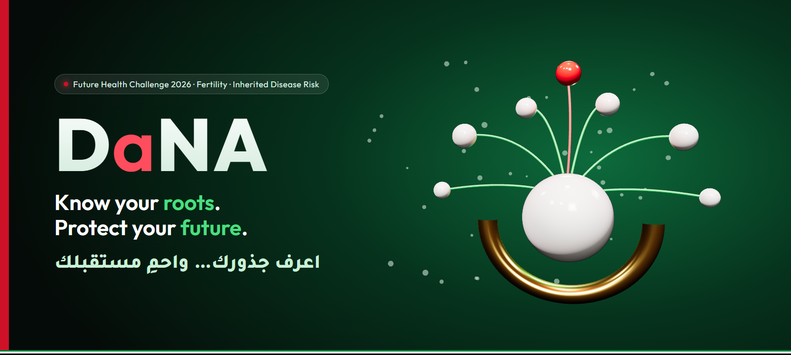
</p>

<p align="center">
  
  
  
</p>

<div dir="rtl">

<h3 align="center">فحصٌ واحد… يحمي عائلةً بأكملها</h3>
<p align="center"><b>One test. A whole family protected.</b></p>

---

**«دانة»** تساعد الأزواج في دولة الإمارات على تحويل نتيجة الفحص الجيني قبل الزواج إلى **فهمٍ واضح**، و**خطةٍ مشتركة** لإنجاب أطفال أصحاء، و**حمايةٍ خاصة** للعائلة بأكملها.

صُمم المشروع لـ **[تحدي مستقبل الصحة للابتكار الرقمي 2026](https://hack2skill.com/event/futurehealthchallenge/)**، محور الخصوبة، التحدي الثالث: *فهم مخاطر الأمراض الوراثية والحد منها*.

> **لماذا هذا الاسم؟** «الدانة» هي أثمن لؤلؤة في الخليج، الكنز الذي حلم به الغواصون. وإذا تأملت حروف **D-a-N-A** وجدت فيها **DNA**، أثمن ما تورّثه العائلة.

## شاهدها تتحرك

<table>
  <tr>
    <td width="50%" align="center">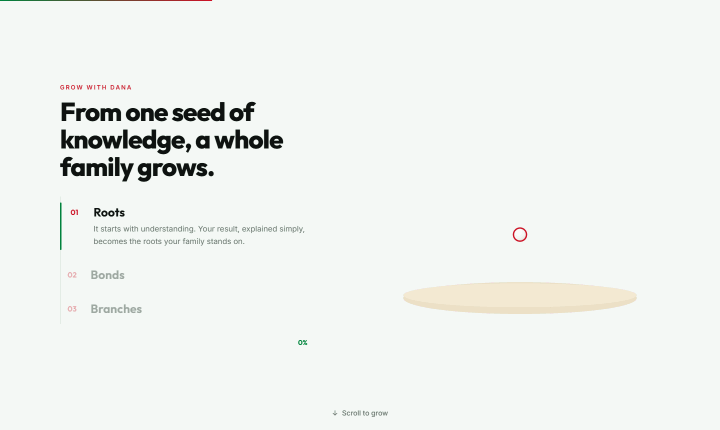<br><b>انمُ مع دانة</b><br><sub>مرّر الصفحة فتصبح البذرة شجرة عائلة: الجذور ← الروابط ← الفروع</sub></td>
    <td width="50%" align="center">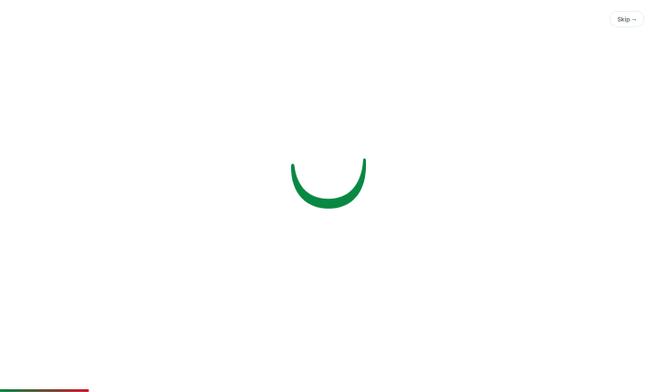<br><b>سقوط اللؤلؤة</b><br><sub>لؤلؤة تسقط في صدفة «ن» فتتموج المياه ويظهر اسم دانة حرفًا حرفًا</sub></td>
  </tr>
  <tr>
    <td width="50%" align="center">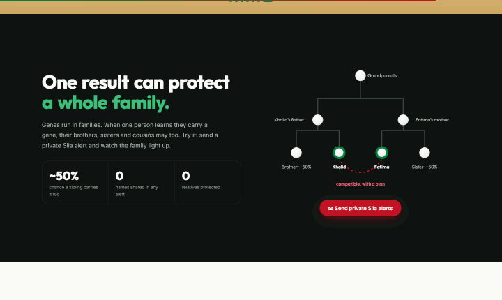<br><b>تنبيهات «صلة» مباشرة</b><br><sub>لمسة واحدة ترسل تنبيهات خاصة فتضيء العائلة</sub></td>
    <td width="50%" align="center">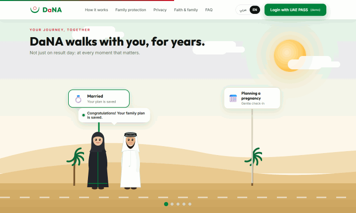<br><b>رحلتكم معًا</b><br><sub>من الخطوبة إلى عائلة محمية: سبع محطات، ومستشارة ترحب بهما، وطفل ينضم إليهما</sub></td>
  </tr>
</table>

## المحتويات

- [شاهدها تتحرك](#شاهدها-تتحرك)
- [المشكلة](#المشكلة)
- [فكرتنا: الجذور · الروابط · الفروع](#فكرتنا-الجذور--الروابط--الفروع)
- [تنبيهات «صلة»: نتيجة واحدة تحمي العائلة](#تنبيهات-صلة-نتيجة-واحدة-تحمي-العائلة)
- [ما الذي يميّز «دانة»](#ما-الذي-يميز-دانة)
- [شاهدها](#شاهدها)
- [البنية التقنية](#البنية-التقنية)
- [السلامة والخصوصية والامتثال](#السلامة-والخصوصية-والامتثال)
- [التشغيل محليًا](#التشغيل-محليًا)
- [خارطة الطريق](#خارطة-الطريق)

## المشكلة

تفحص أبوظبي جينات كل زوجين من المواطنين قبل الزواج. لكن ما ينقص هو ما يحدث **بعد النتيجة**.

| | |
|---|---|
| 🧬 **٥٧٠ جينًا** | تُفحص في برنامج أبوظبي الإلزامي قبل الزواج منذ أكتوبر 2024 |
| 👫 **نحو ١ من كل ١٠** | من الأزواج في المرحلة التجريبية يحملون متغيرًا مسببًا للمرض |
| 💍 **٦٣ من ٧٩** | من الأزواج المعرضين للخطر في برنامج دبي تزوجوا رغم ذلك. هذا حقهم، لكن غالبًا دون خطة. |
| 🌳 **الأقارب** | إخوة الحاملين وأبناء عمومتهم لا يعرفون غالبًا حتى خطوبتهم |

ولدى الدولة هدفان قد يتعارضان: **تقليل الأمراض الوراثية**، و**زيادة الزواج والإنجاب** (عام الأسرة 2026، والأجندة الوطنية لنمو الأسرة 2031). الفحص المخيف يضر بالهدف الثاني، و**«دانة» تخدم الهدفين معًا.**

## فكرتنا: الجذور · الروابط · الفروع

<p align="center">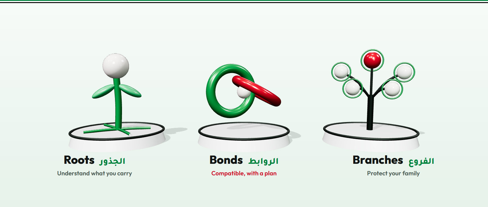</p>

| الرحلة | الوعد | ماذا يحدث |
|---|---|---|
| 🌱 **الجذور** | افهم ما تحمله | تُشرح النتيجة بلطف بالعربية والإنجليزية مع صور ورسائل صوتية. الأرقام يحسبها محرك قواعد، لا الذكاء الاصطناعي. |
| 🤝 **الروابط** | متوافقون، بخطة | يرى الزوجان كل الخيارات جنبًا إلى جنب (أطفال الأنابيب مع فحص الأجنة، الفحص أثناء الحمل، أو المضي بوعي كامل) ويقرران معًا. **«دانة» لا تقول أبدًا «تزوجوا» أو «لا تتزوجوا».** |
| 🌳 **الفروع** | احمِ عائلتك | شجرة عائلة من اللآلئ تبيّن من قد يحمل الجين، وتنبيهات **«صلة»** الخاصة تدعو الأقارب للفحص **قبل** زواجهم. |

لكل نتيجة رحلتها: **سليمان معًا**، و**حامل بخطورة منخفضة**، و**متوافقون بخطة** (الجين نفسه). أما الحالات عالية الخطورة والحوامل فتذهب مباشرة إلى مستشار وراثي.

## تنبيهات «صلة»: نتيجة واحدة تحمي العائلة

<p align="center">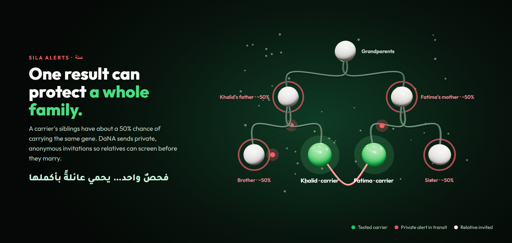</p>

اسم «صلة» مستوحى من **صلة الرحم**. عندما يعرف خالد أنه حامل للجين، يكون احتمال أن يحمله أخوه نحو ٥٠٪. وبلمسة واحدة، وبموافقته فقط، ترسل «دانة» دعوة مجهولة المصدر: *«شخصٌ يهتم بك يوصيك بإجراء فحص جيني مجاني.»* دون أسماء أو ذكر للحالة أو تفاصيل عائلية.

## ما الذي يميّز «دانة»

| | النهج المعتاد | «دانة» |
|---|---|---|
| الصياغة | «أنتما غير متوافقين» | **«متوافقون، بخطة»** |
| الزمن | يوم النتيجة فقط | **رفيقٌ لسنوات** عند كل قرار حمل |
| النطاق | زوجان فقط | **العائلة كلها**، بما فيها الجيل القادم |
| الإيمان | مُهمَل، أو ذكاء اصطناعي يفتي | **بطاقات يراجعها علماء**، والذكاء الاصطناعي لا يفتي أبدًا |
| أصحاب القرار | الزوجان فقط | الزوجان + **الوالدان وكبار العائلة** |
| النشر | تطبيق جديد | مصممة **كوحدة داخل تطبيق «صحتنا»** مع الهوية الرقمية وسجلات «ملفي» |
| التوافق مع السياسات | هدف واحد | **أمراض وراثية أقل *و* أسر أكثر ثقة** |

## شاهدها

| العربية (من اليمين لليسار) | English |
|---|---|
| 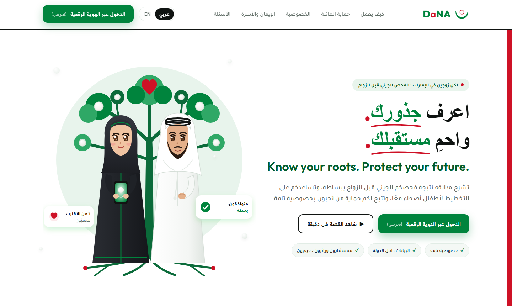 | 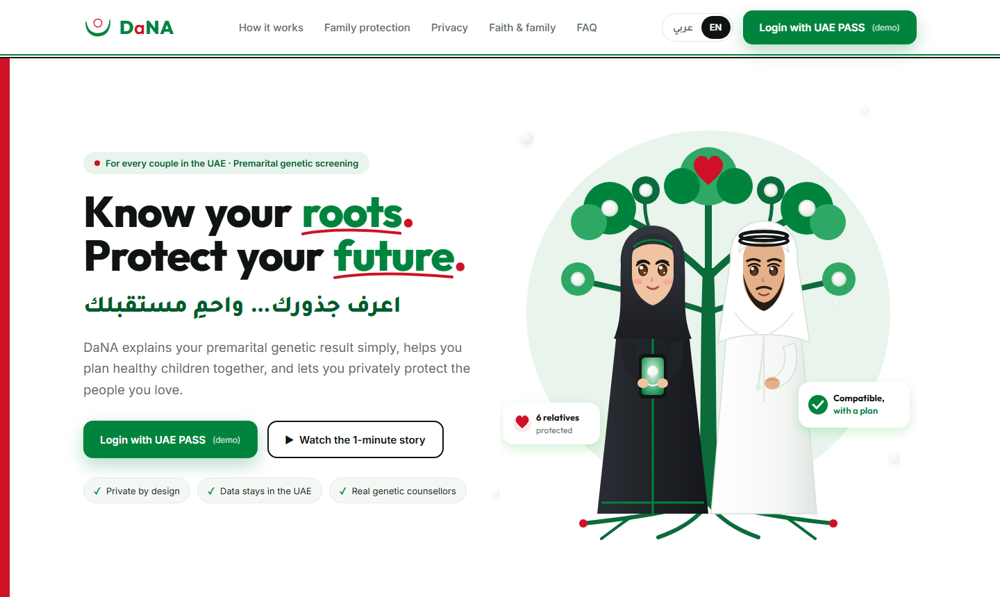 |

| رحلتكم معًا | انمُ مع دانة |
|---|---|
| 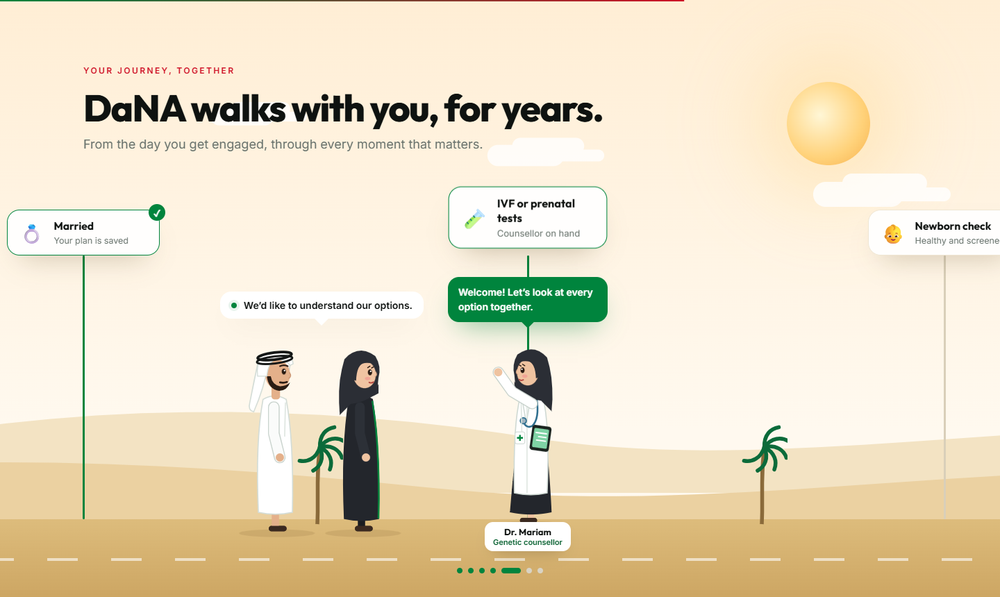 | 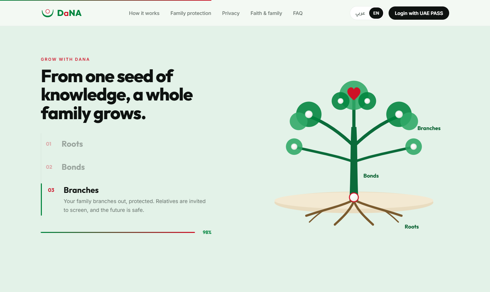 |

**التصميم الحركي باختصار**

| اللحظة | ما الذي يتحرك |
|---|---|
| 🦪 المقدمة | لؤلؤة تسقط في صدفة «ن» وترتد وتتموج المياه، ثم يظهر الاسم حرفًا حرفًا |
| 🌀 في كل الصفحة | تمرير ناعم (Lenis)، والعناوين تنزلق من خلف قناع، وشريط التنقل يختفي عند النزول ويعود عند الصعود |
| 🌳 الواجهة | العنوان يظهر كلمة كلمة، والشجرة ترسم نفسها، والقلب يخفق؛ ومع التمرير يرتفع النص ويبتعد الزوجان بهدوء |
| 〰️ الشريط المتحرك | يتسارع ويعكس اتجاهه مع سرعة التمرير |
| 💬 الرسالة | تضيء كلمة كلمة أثناء القراءة |
| 🃏 الرحلات | بطاقات الجذور والروابط والفروع تثبت وتتراكم مع التمرير |
| 🌱 النمو | بالتمرير: بذرة ← جذور ← جذع ← فروع ← أوراق ← لآلئ العائلة ← قلب، متزامنة مع خطوات القصة |
| 🚶 المسير | مشية مرتبطة بالتمرير (الركبتان تنثنيان، والذراعان تتأرجحان، والقدمان ثابتتان على الأرض) عبر سبع محطات: **الخطوبة ← النتيجة ← متوافقون بخطة ← الزواج ← المستشارة ← المولود ← عائلة محمية**. يمشيان فقط أثناء التمرير، ويستديران عند الرجوع، ويحافظان على مسافة لائقة حتى الزفاف، ويتوقفان للقاء د. مريم التي تلوّح وترحب بهما |
| ✉️ صلة | القسم الداكن يتسع إلى كامل العرض، وتنبيهات حمراء تعبر شجرة العائلة، ويضيء الأقارب، ويتحدث العدّاد |
| 🔚 التذييل | اسم DaNA الكبير يرتفع مع نهاية الصفحة |
| 🌐 اللغة | لمسة واحدة تبدّل بين العربية والإنجليزية مع اتجاه كامل من اليمين لليسار |

## البنية التقنية

<p align="center">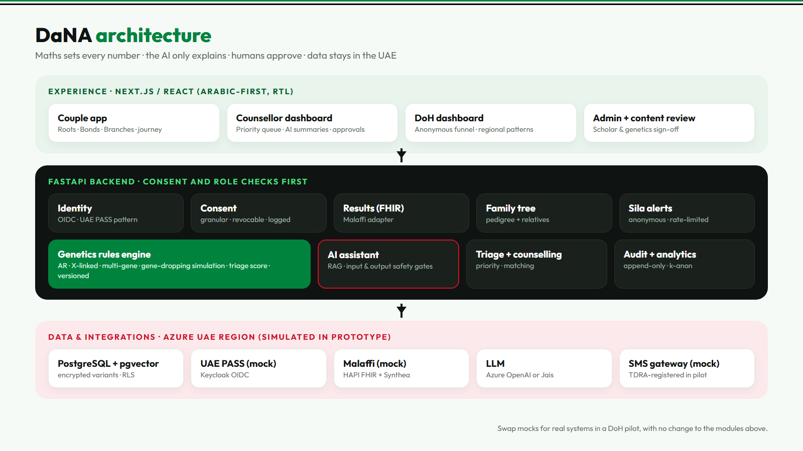</p>

**مبادئ التصميم**

1. **الرياضيات تحسب، والذكاء الاصطناعي يشرح.** كل رقم يأتي من محرك قواعد وراثي ثابت ومُرقّم الإصدارات.
2. **الإنسان يعتمد.** المستشارون يعتمدون الخطط، والعلماء وخبراء الوراثة يعتمدون المحتوى.
3. **الموافقة قبل البيانات.** كل قراءة أو مشاركة أو تنبيه يحتاج موافقة مسجلة يمكن سحبها.
4. **البيانات داخل الدولة.** استضافة داخل الإمارات، وأرقام هواتف الأقارب تُحذف بعد الإرسال.
5. **استبدال لا إعادة بناء.** الهوية الرقمية و«ملفي» والرسائل خلف محوّلات: محاكاة الآن، وحقيقية في التجربة الميدانية.

## السلامة والخصوصية والامتثال

| المتطلب | كيف تلتزم «دانة» |
|---|---|
| القانون الاتحادي رقم ٢ لسنة ٢٠١٩ (تقنية المعلومات في الصحة) | بقاء البيانات في الدولة، و«ملفي» يبقى السجل الرسمي |
| المرسوم بقانون اتحادي رقم ٤٩ لسنة ٢٠٢٣ (الجينوم البشري) | موافقة صريحة قبل قراءة أي بيانات وراثية |
| قانون حماية البيانات الشخصية | أقل قدر من البيانات، وأرقام الهواتف تُستخدم مرة ثم تُحذف |
| معيار أبوظبي لأمن المعلومات الصحية (ADHICS) | تشفير، وصلاحيات حسب الدور، وسجل تدقيق غير قابل للتعديل |
| معيار الذكاء الاصطناعي المسؤول لدائرة الصحة | محرك قواعد للأرقام، وإشراف بشري، ووسم إجابات الذكاء الاصطناعي |
| الجاهزية كجهاز طبي | ممارسات ISO 14971 وIEC 62304، والتصنيف قبل التجربة الميدانية |

> ⚠️ «دانة» تدعم وتشرح، و**لا تشخّص**. يستخدم هذا النموذج **بيانات تجريبية فقط**، والربط مع الهوية الرقمية و«ملفي» و«صحتنا» **محاكاة**، و«دانة» غير تابعة لأي جهة حكومية ولا معتمدة منها.

## التشغيل محليًا

</div>

```bash
cd web
npm install
npm run dev
```

<div dir="rtl">

افتح **http://localhost:5173**، أو **http://localhost:5173/?lang=ar** للنسخة العربية، أو أضف **?nointro** لتخطي المقدمة.

**التقنيات:** React 18 · Vite 6 · Framer Motion 11 · Lenis · خطوط Outfit وInter وTajawal. أما الصور ثلاثية الأبعاد في هذا الملف فهي مشاهد three.js حقيقية (المصادر في [`docs/assets-src`](docs/assets-src)).

## خارطة الطريق

- [x] الفكرة والبحث والتوافق مع السياسات
- [x] الهوية والشعار وصفحة رئيسية متحركة ثنائية اللغة
- [x] سرد قصصي بالتمرير: شجرة تنمو وعائلة تمشي
- [ ] محرك القواعد الوراثية مع اختبارات كاملة
- [ ] محاكي العائلات (أكثر من ٥٠٠ عائلة مع زواج الأقارب)
- [ ] تطبيق الزوجين: الجذور والروابط والفروع وشجرة اللآلئ
- [ ] «اسأل دانة»: ذكاء اصطناعي مستند إلى مصادر موثوقة مع بوابات أمان
- [ ] لوحتا المستشار ودائرة الصحة
- [ ] محاكاة الهوية الرقمية (Keycloak) و«ملفي» (HAPI FHIR)
- [ ] اختبارات المستخدمين وحزمة وثائق السلامة

</div>

---

<p align="center">
  <br>
  <b>DaNA · دانة</b><br>
  <sub>اعرف جذورك… واحمِ مستقبلك · Know your roots. Protect your future.</sub>
</p>
