<p align="center">
  <a href="README.md">English</a> &nbsp;·&nbsp; <b>العربية</b>
</p>

<p align="center">
  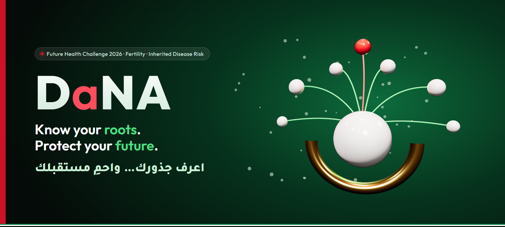
</p>

<p align="center">
  
  
  
</p>
<p align="center">
  
  
  
  
</p>

<div dir="rtl">

<h3 align="center">فحصٌ واحد… يحمي عائلةً بأكملها</h3>
<p align="center">
  <b>خطة الإنتاج</b> &nbsp;&nbsp; <b>Microsoft Azure &middot; الإمارات الشمال والوسط</b>
</p>
<p align="center">
       
</p>
<p align="center"><sub>خطة ترحيل مقترحة ولم تُنفَّذ بعد: النموذج الأولي يعمل اليوم على Vercel وRender وSupabase. Azure علامة تجارية لشركة Microsoft، ودانة غير تابعة لها ولا معتمدة منها.</sub></p>

<p align="center"><b>One test. A whole family protected.</b></p>

---

**«دانة»** تساعد الأزواج في دولة الإمارات على تحويل نتيجة الفحص الجيني قبل الزواج إلى **فهمٍ واضح**، و**خطةٍ مشتركة** لإنجاب أطفال أصحاء، و**حمايةٍ خاصة** للعائلة بأكملها.

صُمم المشروع لـ **[تحدي مستقبل الصحة للابتكار الرقمي 2026](https://hack2skill.com/event/futurehealthchallenge/)**، محور الخصوبة، التحدي الثالث: *فهم مخاطر الأمراض الوراثية والحد منها*.

### جرّبها الآن

| | |
|---|---|
| 🌐 **التطبيق المباشر** | **https://dana-gamma-seven.vercel.app** ← «الدخول عبر الهوية الرقمية» (محاكاة) |
| ⚙️ **واجهة البرمجة** | https://dana-api-589n.onrender.com/docs (FastAPI مع توثيق تفاعلي) |
| 🎬 **الفيديو التوضيحي** | مقدمة الصفحة الرئيسية (١:١٢) + الرحلة الكاملة من البداية للنهاية (٢:٢٦)، مسجّلة مباشرة من التطبيق |

> **لماذا هذا الاسم؟** «الدانة» هي أثمن لؤلؤة في الخليج، الكنز الذي حلم به الغواصون. وإذا تأملت حروف **D-a-N-A** وجدت فيها **DNA**، أثمن ما تورّثه العائلة.

## شاهدها تتحرك

<table>
  <tr>
    <td width="50%" align="center">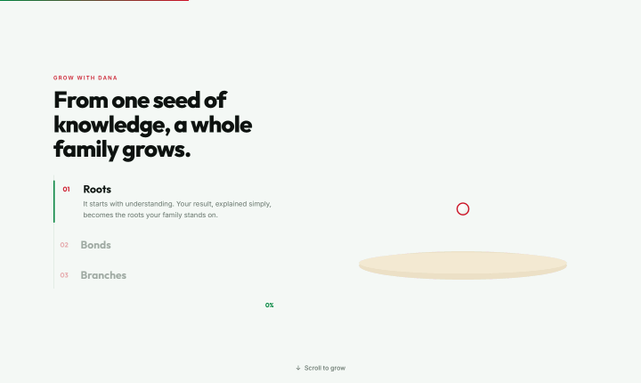<br><b>انمُ مع دانة</b><br><sub>مرّر الصفحة فتصبح البذرة شجرة عائلة: الجذور ← الروابط ← الفروع</sub></td>
    <td width="50%" align="center">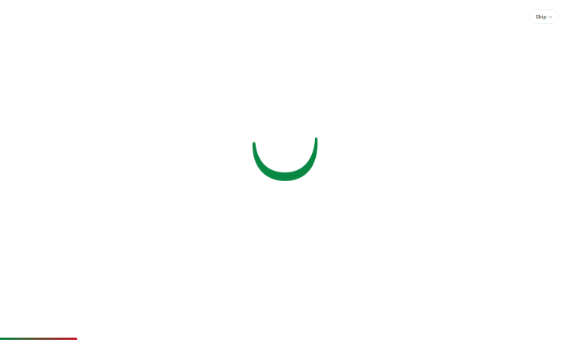<br><b>سقوط اللؤلؤة</b><br><sub>لؤلؤة تسقط في صدفة «ن» فتتموج المياه ويظهر اسم دانة حرفًا حرفًا</sub></td>
  </tr>
  <tr>
    <td width="50%" align="center">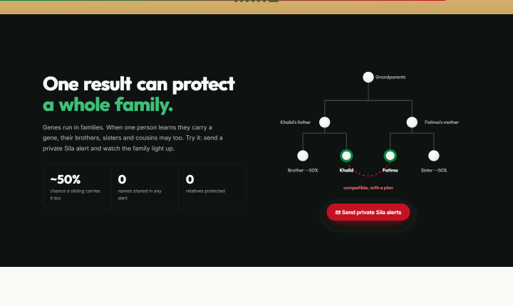<br><b>تنبيهات «صلة» مباشرة</b><br><sub>لمسة واحدة ترسل تنبيهات خاصة فتضيء العائلة</sub></td>
    <td width="50%" align="center">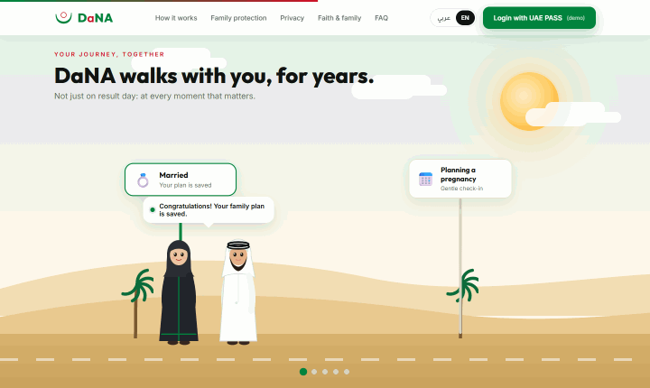<br><b>رحلتكم معًا</b><br><sub>من الخطوبة إلى عائلة محمية: سبع محطات، ومستشارة ترحب بهما، وطفل ينضم إليهما</sub></td>
  </tr>
</table>

## المحتويات

- [شاهدها تتحرك](#شاهدها-تتحرك)
- [كيف تجيب «دانة» عن التحدي](#كيف-تجيب-دانة-عن-التحدي)
- [الرحلة الكاملة، تعمل اليوم](#الرحلة-الكاملة-تعمل-اليوم)
- [المشكلة](#المشكلة)
- [فكرتنا: الجذور · الروابط · الفروع](#فكرتنا-الجذور--الروابط--الفروع)
- [تنبيهات «صلة»: نتيجة واحدة تحمي العائلة](#تنبيهات-صلة-نتيجة-واحدة-تحمي-العائلة)
- [ما الذي يميّز «دانة»](#ما-الذي-يميز-دانة)
- [شاهدها](#شاهدها)
- [البنية التقنية](#البنية-التقنية)
- [السلامة والخصوصية والامتثال](#السلامة-والخصوصية-والامتثال)
- [قياس ما يهم](#قياس-ما-يهم)
- [التشغيل محليًا](#التشغيل-محليًا)
- [خارطة الطريق](#خارطة-الطريق)

## كيف تجيب «دانة» عن التحدي

يطلب التحدي الثالث ستة أمور، وكلها مبنية وتعمل في التطبيق المباشر.

| # | ما يطلبه التحدي | ما تفعله «دانة» | أين تراه |
|---|---|---|---|
| ١ | **شرح الخطر** بلغة بسيطة غير وصمية، مع عدم اليقين والفرق بين الخطر والتشخيص | لكل نوع نتيجة شرح هادئ خاص به: *«أنت بصحة جيدة. الحامل ليس مريضًا.»* تُعرض نتيجة الزوجين بأشكال أطفال لكل حمل (٣ من ٤ أصحاء). النتائج غير المؤكدة لا تُعطى **أي رقم** قبل مراجعة أخصائي. وعبارة *«الاحتمال ليس تشخيصًا»* حاضرة في كل نتيجة. | **نتيجتي**، **الروابط** |
| ٢ | **قرارات واعية تحترم القيم** دون توجيه أو ضغط | ثلاثة مسارات مقبولة جنبًا إلى جنب (أطفال الأنابيب مع فحص الأجنة، الفحص أثناء الحمل، المضي بمعرفة كاملة): *«لا إجابة صحيحة واحدة، ولا موعد نهائي.»* «دانة» لا تقول أبدًا «تزوجوا» أو «لا تتزوجوا». والبطاقات الدينية اختيارية ويراجعها علماء. | **الروابط**، **الخصوصية** |
| ٣ | **استشارة بشرية مؤهلة** للحالات المعقدة، وحد واضح بين التثقيف والنصيحة | نتائج الجين المشترك والمرتبط بالكروموسوم X والحمل وغير المؤكدة **تُحال تلقائيًا إلى مستشار وراثي معتمد** (*«سيتواصل معك مستشار وراثي»*). والشاشة توضح الحد: *«دانة يشرح نتيجتك. أما النصيحة الطبية فتأتي من مستشارك فقط.»* يحجز الزوجان، ويقبل المستشار في تقويمه. | **الرئيسية**، **المستشار**، **جدول** المستشار |
| ٤ | **مسارات عائلية تحفظ الخصوصية**: موافقة، وصلاحيات حسب الدور، وتقليل البيانات، وتدقيق | موافقة لكل مجموعة بيانات قبل قراءة أي شيء. الربط بين الشريكين برقم **«دانة»** الكامل فقط (لا بحث بالاسم ولا قائمة أعضاء). كل اطّلاع من الموظفين يُسجَّل ويُعرض للشخص (*من اطّلع على بياناتي*). يمكن سحب الموافقة مع الحذف اختياريًا. ويتلقى الأقارب تنبيهات **مجهولة المصدر**. وكل ذلك يُفرض داخل قاعدة البيانات. | **الإعداد**، **الاتصالات**، **الخصوصية**، **الجذور** |
| ٥ | **ربط آمن بالخدمات**: مسار يمكن تتبعه إلى الاستشارة والفحص التأكيدي والرعاية التخصصية | **مسار رعاية** (النتيجة ← الاستشارة ← الفحص التأكيدي ← الإحالة التخصصية) بحالة وتاريخ لكل خطوة، يحدّثه المستشار ويراه الزوجان. و**متابعة شخصية** من ٧ مراحل تستمر عبر التخطيط والحمل والولادة وفحص المولود. | **الرئيسية**، **المتابعة الشخصية**، **ملف الحالة** لدى المستشار |
| ٦ | **قياس الفهم والوصول**، بعدالة بين اللغات ومستويات القراءة | اختبار فهم في ٣٠ ثانية بعد كل نتيجة. ولوحة **مؤشرات النتائج** لدائرة الصحة: الفهم، والعبارات الأكثر إرباكًا، والإقبال على الاستشارة، والوقت حتى المستشار، و**الفارق بين اللغات**. أي مجموعة أقل من ٥ أشخاص تُخفى. ولا يُحتسب إتمام الزواج نجاحًا أو فشلًا **أبدًا**. | اختبار **نتيجتي**، **مؤشرات النتائج** للمسؤول |

## الرحلة الكاملة، تعمل اليوم

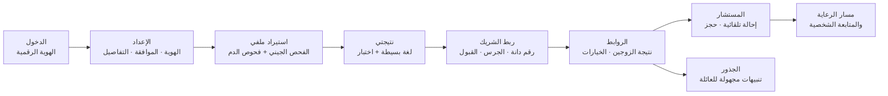

| الخطوة | ماذا يحدث |
|---|---|
| 🔐 **الدخول والإعداد** | الهوية الرقمية (محاكاة) تملأ البيانات الموثقة. يختار الشخص بالضبط ما يمكن لـ«دانة» استخدامه، ويضيف ما لا يحتفظ به «ملفي» (الحالة الاجتماعية، الحمل، التاريخ العائلي)، ثم تُستورد النتائج. **لا يدخل أحد التطبيق قبل إتمام ذلك.** |
| 🧬 **سجل «ملفي»** | فحص الحامل الجيني (لوحة ٥٧٠ جينًا) وفحوص الدم قبل الزواج، كما وصلت تمامًا، مع ما هو طبيعي وما يحتاج إلى نقاش. |
| 💬 **نتيجتي** | نتيجة بلغة بسيطة في شاشة واحدة، وإجابات للمخاوف الشائعة (*هل أنا مريض؟ هل أخطأت في شيء؟ هل يمكننا الزواج؟*)، واختبار فهم سريع. |
| 💍 **الربط** | تشارك فاطمة رقم «دانة» الخاص بها، ويرسل خالد طلبًا، **فيضيء جرسها**، وتقبل. عندها فقط تُقارن نتيجتاهما بموافقتهما معًا. ويمكن لأيٍّ منهما فك الارتباط أو الحظر من الطرفين. |
| 🤝 **الروابط** | نتيجة الزوجين، واحتمال كل حمل، والخيارات الثلاثة جنبًا إلى جنب، وتقرير مشترك قابل للتنزيل. |
| 👩‍⚕️ **المستشار** | النتائج المعقدة تُحال تلقائيًا. يحجز الزوجان جلسة، ويقبلها المستشار في تقويمه، ثم يسجلها مكتملة وينشئ الإحالات. |
| 🗺️ **مسار الرعاية والمتابعة** | النتيجة ← الاستشارة ← الفحص التأكيدي ← الخدمات التخصصية، بحالة وتاريخ لكل خطوة؛ ثم التخطيط والحمل والولادة والمولود. |
| 🌳 **الجذور وشجرة العائلة** | من قد يحمل الجين أيضًا، مع دعوات خاصة مجهولة للفحص. دون أسماء أو ذكر للحالة. |
| 🤖 **مرشد «دانة»** | مساعد عائم يجيب من نتيجة الشخص نفسه: بلمسة أو كتابة أو صوت. كل إجابة بـ**العربية والإنجليزية والأردية** مع زر **استمع** (الصوت العربي والأردي عبر Gemini من الخادم). يشرح ولا ينصح. |
| 🌐 **ثلاث لغات** | لمسة واحدة تحوّل التطبيق كله إلى **العربية** أو **الأردية**، من اليمين لليسار، بخطوط عربية ونستعليق. |
| 🔒 **الخصوصية** | الموافقات، و*من اطّلع على بياناتي*، وسحب الموافقة (مع حذف النتائج المستوردة اختياريًا). |
| 📊 **مسؤول دائرة الصحة** | مؤشرات النتائج؛ المستشارون والمناطق (اعتماد، إيقاف)؛ لوحة الأمان؛ مراجعة المحتوى؛ سجل تدقيق غير قابل للتعديل؛ معايير لوحة الجينات مع سجل الإصدارات. |

## المشكلة

تفحص أبوظبي جينات كل زوجين من المواطنين قبل الزواج. لكن ما ينقص هو ما يحدث **بعد النتيجة**.

| | |
|---|---|
| 🧬 **٥٧٠ جينًا** | تُفحص في برنامج أبوظبي الإلزامي قبل الزواج منذ أكتوبر 2024 |
| 👫 **نحو ١ من كل ١٠** | من الأزواج في المرحلة التجريبية يحملون متغيرًا مسببًا للمرض |
| 💍 **٦٣ من ٧٩** | من الأزواج المعرضين للخطر في برنامج دبي تزوجوا رغم ذلك. هذا حقهم، لكن غالبًا دون خطة. |
| 🌳 **الأقارب** | إخوة الحاملين وأبناء عمومتهم لا يعرفون غالبًا حتى خطوبتهم |

ولدى الدولة هدفان قد يتعارضان: **تقليل الأمراض الوراثية**، و**زيادة الزواج والإنجاب** (عام الأسرة 2026، والأجندة الوطنية لنمو الأسرة 2031). الفحص المخيف يضر بالهدف الثاني، و**«دانة» تخدم الهدفين معًا.**

## فكرتنا: الجذور · الروابط · الفروع

<p align="center">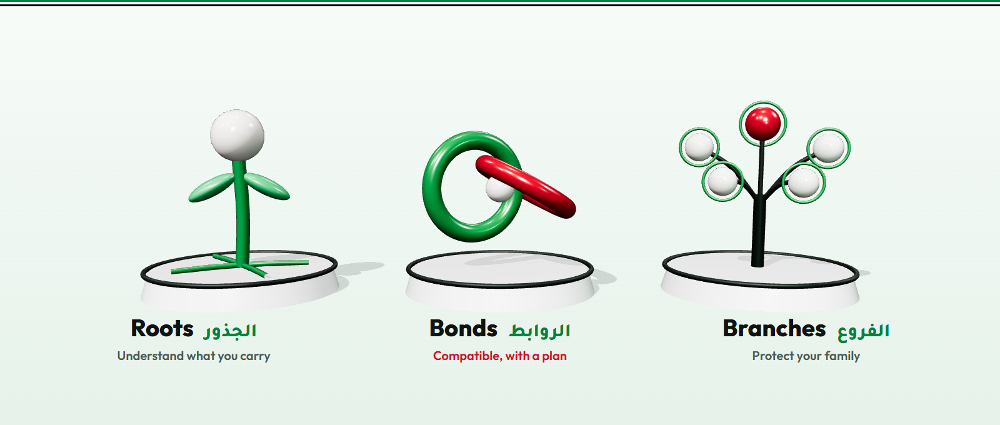</p>

| الرحلة | الوعد | ماذا يحدث |
|---|---|---|
| 🌱 **الجذور** | افهم ما تحمله | تُشرح النتيجة بلطف بالعربية والإنجليزية والأردية، مع صور وصوت. الأرقام يحسبها محرك قواعد، لا الذكاء الاصطناعي. |
| 🤝 **الروابط** | متوافقون، بخطة | يرى الزوجان كل الخيارات جنبًا إلى جنب (أطفال الأنابيب مع فحص الأجنة، الفحص أثناء الحمل، أو المضي بوعي كامل) ويقرران معًا. **«دانة» لا تقول أبدًا «تزوجوا» أو «لا تتزوجوا».** |
| 🌳 **الفروع** | احمِ عائلتك | شجرة عائلة من اللآلئ تبيّن من قد يحمل الجين، وتنبيهات **«صلة»** الخاصة تدعو الأقارب للفحص **قبل** زواجهم. |

لكل نتيجة رحلتها: **سليمان معًا**، و**حامل بخطورة منخفضة**، و**متوافقون بخطة** (الجين نفسه). أما الحالات عالية الخطورة والحوامل فتذهب مباشرة إلى مستشار وراثي.

## تنبيهات «صلة»: نتيجة واحدة تحمي العائلة

<p align="center">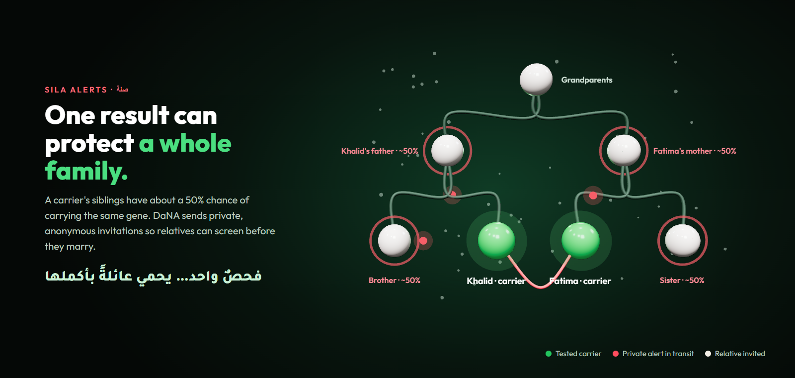</p>

اسم «صلة» مستوحى من **صلة الرحم**. عندما يعرف خالد أنه حامل للجين، يكون احتمال أن يحمله أخوه نحو ٥٠٪. وبلمسة واحدة، وبموافقته فقط، ترسل «دانة» دعوة مجهولة المصدر: *«شخصٌ يهتم بك يوصيك بإجراء فحص جيني مجاني.»* دون أسماء أو ذكر للحالة أو تفاصيل عائلية.

## ما الذي يميّز «دانة»

| | النهج المعتاد | «دانة» |
|---|---|---|
| الصياغة | «أنتما غير متوافقين» | **«متوافقون، بخطة»** |
| الزمن | يوم النتيجة فقط | **رفيقٌ لسنوات** عند كل قرار حمل |
| النطاق | زوجان فقط | **العائلة كلها**، بما فيها الجيل القادم |
| الإيمان | مُهمَل، أو ذكاء اصطناعي يفتي | **بطاقات يراجعها علماء**، والذكاء الاصطناعي لا يفتي أبدًا |
| أصحاب القرار | الزوجان فقط | الزوجان + **الوالدان وكبار العائلة** |
| النشر | تطبيق جديد | مصممة **كوحدة داخل تطبيق «صحتنا»** مع الهوية الرقمية وسجلات «ملفي» |
| التوافق مع السياسات | هدف واحد | **أمراض وراثية أقل *و* أسر أكثر ثقة** |

## شاهدها

| العربية (من اليمين لليسار) | English |
|---|---|
| 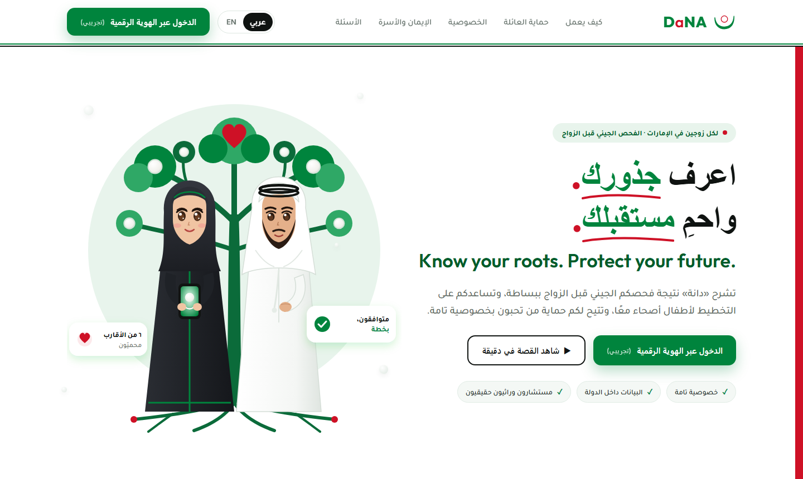 | 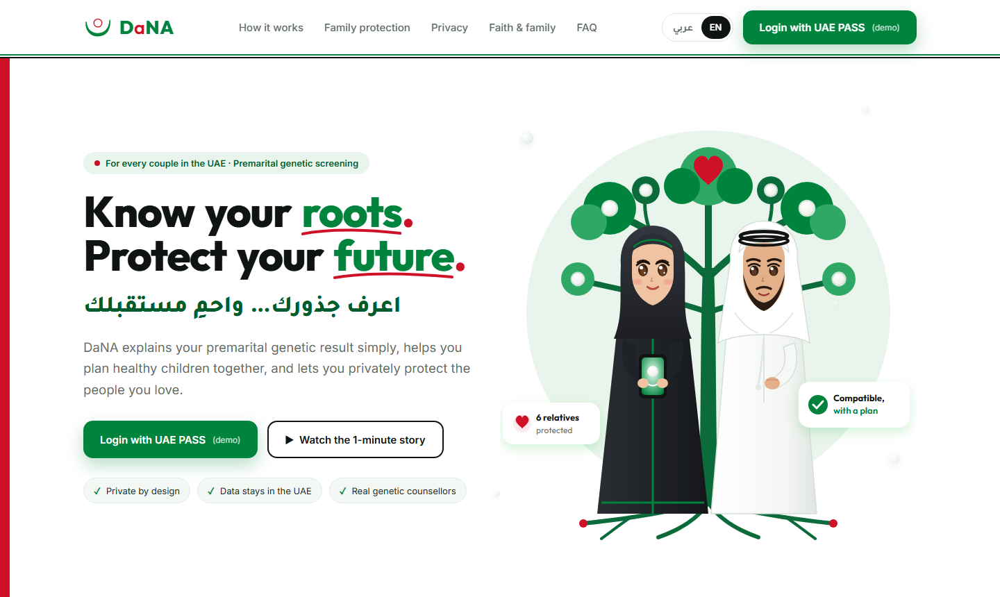 |

| رحلتكم معًا | انمُ مع دانة |
|---|---|
| 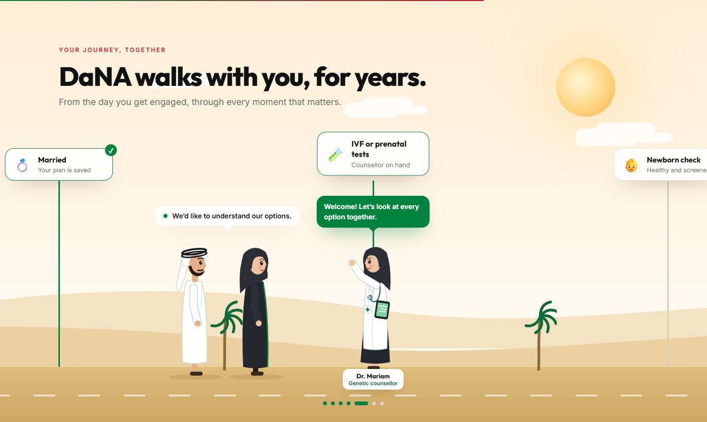 | 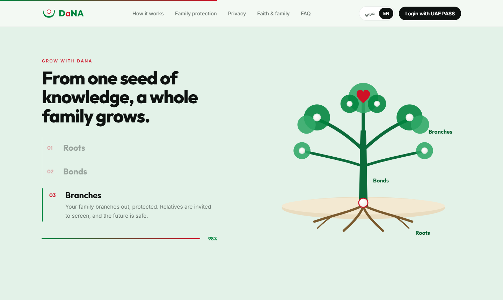 |

**التصميم الحركي باختصار**

| اللحظة | ما الذي يتحرك |
|---|---|
| 🦪 المقدمة | لؤلؤة تسقط في صدفة «ن» وترتد وتتموج المياه، ثم يظهر الاسم حرفًا حرفًا |
| 🌀 في كل الصفحة | تمرير ناعم (Lenis)، والعناوين تنزلق من خلف قناع، وشريط التنقل يختفي عند النزول ويعود عند الصعود |
| 🌳 الواجهة | العنوان يظهر كلمة كلمة، والشجرة ترسم نفسها، والقلب يخفق؛ ومع التمرير يرتفع النص ويبتعد الزوجان بهدوء |
| 〰️ الشريط المتحرك | يتسارع ويعكس اتجاهه مع سرعة التمرير |
| 💬 الرسالة | تضيء كلمة كلمة أثناء القراءة |
| 🃏 الرحلات | بطاقات الجذور والروابط والفروع تثبت وتتراكم مع التمرير |
| 🌱 النمو | بالتمرير: بذرة ← جذور ← جذع ← فروع ← أوراق ← لآلئ العائلة ← قلب، متزامنة مع خطوات القصة |
| 🚶 المسير | مشية مرتبطة بالتمرير (الركبتان تنثنيان، والذراعان تتأرجحان، والقدمان ثابتتان على الأرض) عبر سبع محطات: **الخطوبة ← النتيجة ← متوافقون بخطة ← الزواج ← المستشارة ← المولود ← عائلة محمية**. يمشيان فقط أثناء التمرير، ويستديران عند الرجوع، ويحافظان على مسافة لائقة حتى الزفاف، ويتوقفان للقاء د. مريم التي تلوّح وترحب بهما |
| ✉️ صلة | القسم الداكن يتسع إلى كامل العرض، وتنبيهات حمراء تعبر شجرة العائلة، ويضيء الأقارب، ويتحدث العدّاد |
| 🔚 التذييل | اسم DaNA الكبير يرتفع مع نهاية الصفحة |
| 🌐 اللغة | لمسة واحدة تبدّل بين العربية والإنجليزية مع اتجاه كامل من اليمين لليسار |

## البنية التقنية

<p align="center">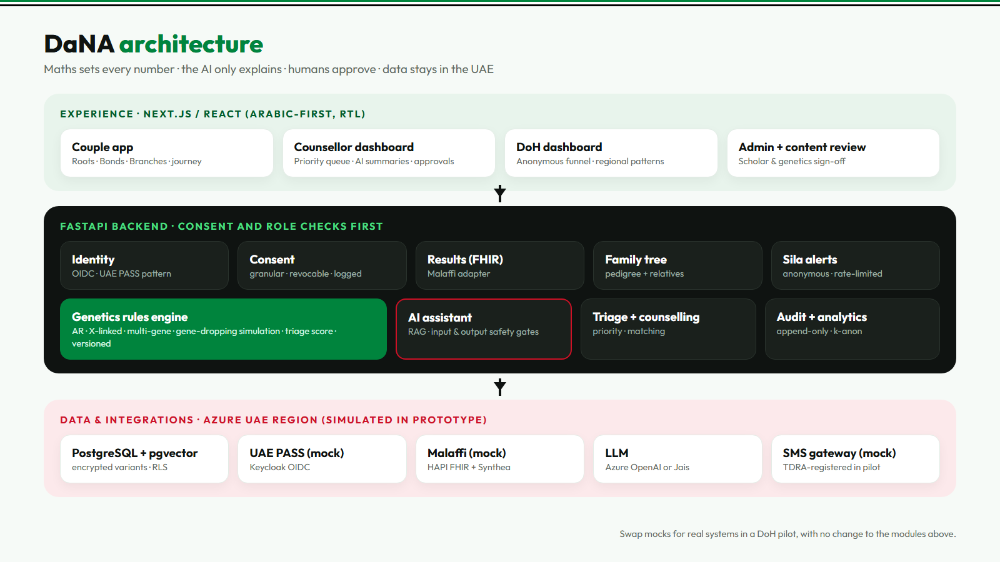</p>

**مبادئ التصميم**

1. **الرياضيات تحسب، والذكاء الاصطناعي يشرح.** كل رقم يأتي من محرك قواعد وراثي ثابت ومُرقّم الإصدارات.
2. **الإنسان يعتمد.** المستشارون يعتمدون الخطط، والعلماء وخبراء الوراثة يعتمدون المحتوى.
3. **الموافقة قبل البيانات.** كل قراءة أو مشاركة أو تنبيه يحتاج موافقة مسجلة يمكن سحبها.
4. **البيانات داخل الدولة.** استضافة داخل الإمارات، وأرقام هواتف الأقارب تُحذف بعد الإرسال.
5. **استبدال لا إعادة بناء.** الهوية الرقمية و«ملفي» والرسائل خلف محوّلات: محاكاة الآن، وحقيقية في التجربة الميدانية.

| الطبقة | التقنية | الدور |
|---|---|---|
| تطبيق الويب | React 18 · Vite 6 · Framer Motion · على **Vercel** | الصفحة الرئيسية، وتطبيق الزوجين، وبوابة المستشار، ولوحة دائرة الصحة؛ بثلاث لغات مع اتجاه كامل من اليمين لليسار |
| قاعدة البيانات | **Supabase** (Postgres) · أمان على مستوى الصف · دوال محمية | كل قاعدة تحدد من يرى ماذا موجودة **داخل قاعدة البيانات** لا في المتصفح |
| واجهة البرمجة | **FastAPI** (Python) على **Render** | استيراد سجلات «ملفي» (FHIR) وتحليلها، ومحرك القواعد، ومعايير الجينات، والصوت |
| محرك القواعد | ثابت ومُرقّم الإصدارات (`rules-v0.2`) | مستوى الأولوية ١–٤ وكل رقم للاحتمال. دون ذكاء اصطناعي. |
| الصوت | صوت المتصفح (الإنجليزية) · **Gemini TTS** (العربية والأردية) عبر الخادم | المفتاح يبقى على الخادم؛ للمستخدمين المسجلين فقط، مع حد للاستخدام وذاكرة مؤقتة |
| الاختبارات | **١٢٩ اختبارًا** لواجهة البرمجة (pytest) | تحليل FHIR، والقواعد، والمعايير، ولوحة الجينات، ومسارات الخصوصية |

## السلامة والخصوصية والامتثال

| المتطلب | كيف تلتزم «دانة» |
|---|---|
| القانون الاتحادي رقم ٢ لسنة ٢٠١٩ (تقنية المعلومات في الصحة) | بقاء البيانات في الدولة، و«ملفي» يبقى السجل الرسمي |
| المرسوم بقانون اتحادي رقم ٤٩ لسنة ٢٠٢٣ (الجينوم البشري) | موافقة صريحة قبل قراءة أي بيانات وراثية |
| قانون حماية البيانات الشخصية | أقل قدر من البيانات، وأرقام الهواتف تُستخدم مرة ثم تُحذف |
| معيار أبوظبي لأمن المعلومات الصحية (ADHICS) | تشفير، وصلاحيات حسب الدور، وسجل تدقيق غير قابل للتعديل |
| معيار الذكاء الاصطناعي المسؤول لدائرة الصحة | محرك قواعد للأرقام، وإشراف بشري، ووسم إجابات الذكاء الاصطناعي |
| الجاهزية كجهاز طبي | ممارسات ISO 14971 وIEC 62304، والتصنيف قبل التجربة الميدانية |

**مطبّق في النظام العامل اليوم**

- **أمان على مستوى الصف في كل جدول**: يرى الزوجان بياناتهما فقط وبيانات الشريك (بموافقته)، ويرى الموظفون ما يسمح به دورهم فقط.
- **الإجراءات الحساسة تمر عبر دوال تتحقق من الدور**: الربط، والموافقة، وتحديث مسار الرعاية، واعتماد المستشارين. ولا يستطيع أحد تغيير دوره بنفسه.
- **البحث عن الشريك برقم «دانة» الكامل فقط**، مع حد لعدد المحاولات وإخفاء الأسماء: لا يستطيع الغرباء العثور على أحد.
- **سجل تدقيق غير قابل للتعديل.** كل اطّلاع من الموظفين على الحالة يُسجَّل ويظهر للشخص نفسه.
- **المؤشرات مجهولة الهوية**: مجاميع فقط، وأي مجموعة أقل من ٥ أشخاص تُخفى.
- **لا أسرار في المتصفح**: مفاتيح Gemini ومفاتيح الخدمة على الخادم فقط.

> ⚠️ «دانة» تدعم وتشرح، و**لا تشخّص**. يستخدم هذا النموذج **بيانات تجريبية فقط**، والربط مع الهوية الرقمية و«ملفي» و«صحتنا» **محاكاة**، و«دانة» غير تابعة لأي جهة حكومية ولا معتمدة منها.

## قياس ما يهم

صفحة **مؤشرات النتائج** لدائرة الصحة تحوّل المتطلب السادس في التحدي إلى أرقام حية:

| المؤشر | كيف يُقاس |
|---|---|
| **الفهم** | الدرجة من المحاولة الأولى في اختبار الأسئلة الثلاثة، حسب نوع النتيجة |
| **ما يربك الناس** | العبارات الأكثر خطأً (مثل *«إذا كان طفلنا الأول مصابًا فلن يكون التالي مصابًا»*) لتحسين الصياغة |
| **الوصول إلى الاستشارة** | الأزواج الذين يحتاجون استشارة ← حجزوا ← خلال ٧ أيام، ومتوسط الأيام من النتيجة إلى الحجز |
| **العدالة بين اللغات** | الفهم والإقبال جنبًا إلى جنب للعربية والإنجليزية والأردية، مع إبراز الفارق |
| **حماية الخصوصية** | الموافقات الممنوحة والمسحوبة، واطّلاعات الموظفين المسجلة، وحالات الحظر |

> النجاح يعني أن **يفهم** الناس، و**يصلوا إلى مستشار بسرعة**، ويحصلوا على **الجودة نفسها بكل لغة**. إتمام الزواج أو إلغاؤه ليس مقياسًا للنجاح أبدًا.

## التشغيل محليًا

</div>

```bash
# تطبيق الويب
cd web
npm install
npm run dev            # http://localhost:5173

# واجهة البرمجة (لاستيراد «ملفي» والصوت العربي والأردي)
cd api
python -m venv .venv && .venv/Scripts/activate      # macOS/Linux: source .venv/bin/activate
pip install -r requirements.txt
uvicorn app.main:app --reload --port 8000           # http://localhost:8000/docs
pytest                                               # 129 tests
```

<div dir="rtl">

افتح **http://localhost:5173**، أو **http://localhost:5173/?lang=ar** للنسخة العربية، أو أضف **?nointro** لتخطي المقدمة.

**قاعدة البيانات:** أنشئ مشروع Supabase وشغّل `supabase/schema.sql` ثم الملفات المرقّمة في `supabase/` بالترتيب (انظر [supabase/SETUP.md](supabase/SETUP.md)). المفاتيح توضع في `web/.env.local` و`api/.env` ولا تُرفع أبدًا.

**الدخول التجريبي:** اضغط «الدخول عبر الهوية الرقمية» واختر حسابًا: الزوجان (خالد وفاطمة)، أو المستشارة الوراثية (د. مريم)، أو فريق دائرة الصحة. الأقارب لا يحتاجون حسابًا، بل يصلهم رابط دعوة خاص.

**التقنيات:** React 18 · Vite 6 · Framer Motion 11 · Lenis · Supabase · FastAPI · خطوط Outfit وInter وTajawal وNoto Nastaliq Urdu. أما الصور ثلاثية الأبعاد في هذا الملف فهي مشاهد three.js حقيقية (المصادر في [`docs/assets-src`](docs/assets-src)).

## خارطة الطريق

**مكتمل ويعمل**
- [x] صفحة رئيسية متحركة ثنائية اللغة والهوية البصرية
- [x] بوابة الإعداد: الهوية الرقمية، والموافقة لكل مجموعة بيانات، والتفاصيل، واستيراد «ملفي» (محاكاة)
- [x] نتائج بلغة بسيطة لكل نوع نتيجة، مع اختبار للفهم
- [x] ربط الشريك برقم «دانة» مع الإشعارات والقبول وفك الارتباط والحظر من الطرفين
- [x] نتيجة الزوجين، واحتمالات الأطفال، والخيارات الثلاثة جنبًا إلى جنب، وتقرير الزوجين
- [x] إحالة تلقائية إلى المستشار، والحجز، وتقويم المستشار، ومسار الرعاية والإحالات
- [x] متابعة شخصية من ٧ مراحل من الفحص حتى المولود
- [x] مرشد «دانة» بالصوت؛ والتطبيق كاملًا بالعربية والإنجليزية والأردية
- [x] مركز الخصوصية: الموافقات، ومن اطّلع على بياناتي، وسحب الموافقة
- [x] مؤشرات النتائج لدائرة الصحة، وإدارة المستشارين، وسجل التدقيق، ومعايير لوحة الجينات
- [x] محرك قواعد ثابت و١٢٩ اختبارًا لواجهة البرمجة

**التالي، للتجربة الميدانية**
- [ ] ربط حقيقي بالهوية الرقمية و«ملفي» (FHIR) بدل المحاكاة
- [ ] مراجعة دورية مع ClinVar وClinGen ترصد إعادة تصنيف المتغيرات لمراجعة الخبراء
- [ ] مراجعة سريرية لكل الصياغات العربية والأردية من متحدثين أصليين
- [ ] اختبارات استخدام مع الأزواج والمستشارين، وحزمة وثائق السلامة

</div>

---

<p align="center">
  <br>
  <b>DaNA · دانة</b><br>
  <sub>اعرف جذورك… واحمِ مستقبلك · Know your roots. Protect your future.</sub>
</p>
