<p align="center">
  <b>English</b> &nbsp;·&nbsp; <a href="README.ar.md">العربية</a>
</p>

<p align="center">
  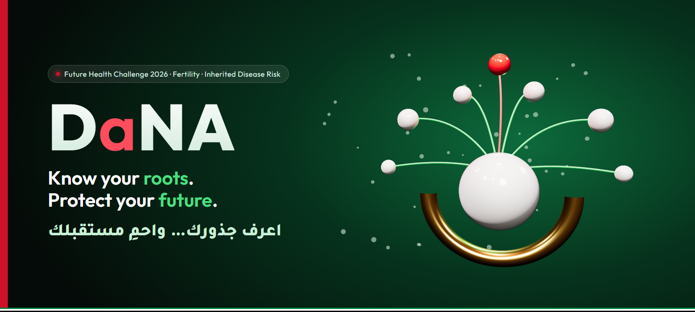
</p>

<p align="center">
  
  
  
</p>
<p align="center">
  
  
  
  
  
  
  
</p>

<p align="center">
  <b>Production plan</b> &nbsp;&nbsp; <b>Microsoft Azure &middot; UAE North &amp; UAE Central</b>
</p>
<p align="center">
       
</p>
<p align="center"><sub>Planned migration, not yet deployed: today the prototype runs on Vercel, Render and Supabase. Azure is a trademark of Microsoft; DaNA is not affiliated with or endorsed by Microsoft.</sub></p>

<h3 align="center">One test. A whole family protected.</h3>
<p align="center"><b>فحصٌ واحد… يحمي عائلةً بأكملها</b></p>

---

**DaNA** helps couples in the UAE turn a premarital genetic test result into understanding, a shared plan for healthy children, and private protection for their whole family.

Built for the **[Future Health Digital Innovation Challenge 2026](https://hack2skill.com/event/futurehealthchallenge/)**, Fertility theme, Statement 3: *Understanding and Reducing Inherited Disease Risk*.

### Try it now

| | |
|---|---|
| 🌐 **Live app** | **https://dana-gamma-seven.vercel.app** → *Login with UAE PASS* (simulated) |
| ⚙️ **API** | https://dana-api-589n.onrender.com/docs (FastAPI, interactive docs) |
| 🎬 **Demo video** | Landing intro (1:12) + full end-to-end journey (2:26), recorded straight from the live app |

> **Why the name?** *Dana* (دانة) is the Gulf's most precious pearl, the treasure pearl divers dreamed of. Look closer and **D-a-N-A** holds **DNA**, the most precious thing a family passes on.

## Watch it move

<table>
  <tr>
    <td width="50%" align="center">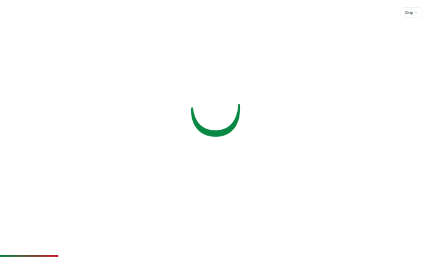<br><b>The pearl drops</b><br><sub>A pearl falls into the ن shell, ripples, and D·a·N·A springs in</sub></td>
    <td width="50%" align="center">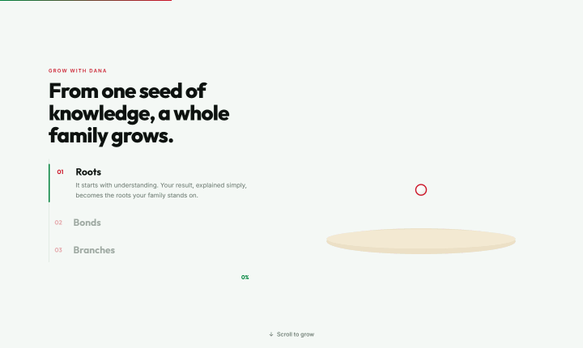<br><b>Grow with DaNA</b><br><sub>Scroll and a seed becomes a family tree: Roots → Bonds → Branches</sub></td>
  </tr>
  <tr>
    <td width="50%" align="center">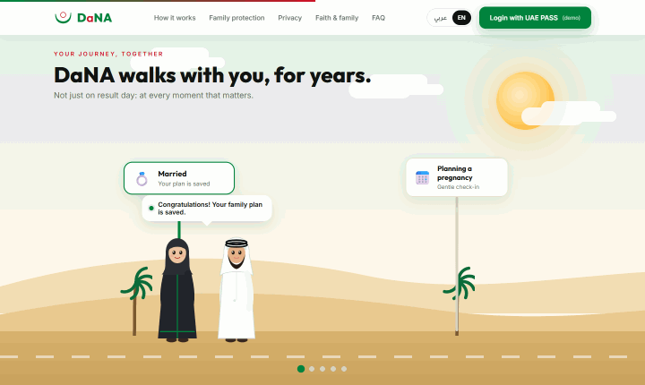<br><b>Your journey, together</b><br><sub>From engagement to a protected family: seven stops, a counsellor who greets them, and a child who joins</sub></td>
    <td width="50%" align="center">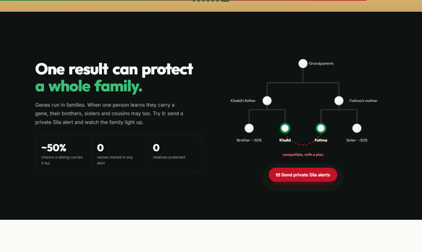<br><b>Sila alerts, live</b><br><sub>One tap sends private alerts and the family lights up</sub></td>
  </tr>
</table>

## Contents

- [Watch it move](#watch-it-move)
- [How DaNA answers the challenge](#how-dana-answers-the-challenge)
- [The complete journey, working today](#the-complete-journey-working-today)
- [The problem](#the-problem)
- [Our idea: Roots · Bonds · Branches](#our-idea-roots--bonds--branches)
- [Sila alerts: one result, a whole family protected](#sila-alerts-one-result-a-whole-family-protected)
- [What makes DaNA different](#what-makes-dana-different)
- [See it](#see-it)
- [Architecture](#architecture)
- [Safety, privacy and compliance](#safety-privacy-and-compliance)
- [Measuring what matters](#measuring-what-matters)
- [Run it locally](#run-it-locally)
- [Project structure](#project-structure)
- [Roadmap](#roadmap)

## How DaNA answers the challenge

Statement 3 asks for six things. Each one is built and running in the live app.

| # | The challenge asks for | What DaNA does | Where to see it |
|---|---|---|---|
| 1 | **Risk explanation** in plain, non-stigmatising language, with uncertainty and *risk vs diagnosis* | Every result type has its own calm explanation: *"You are healthy. A carrier is not a patient."* The couple result shows the chance for each pregnancy as child figures (3 in 4 healthy). Uncertain findings (VUS) get **no number** until a specialist reviews them. *"A chance is not a diagnosis"* appears on every result. | **My result**, **Bonds** |
| 2 | **Informed, values-sensitive choices**, never directive or coercive | Three accepted paths side by side (IVF with embryo testing, testing in pregnancy, going ahead fully informed): *"No right answer, no deadline."* DaNA never says "marry" or "don't marry". Faith cards are optional and scholar-reviewed. | **Bonds**, **Privacy** |
| 3 | **Qualified human counselling** for complex findings, and a clear line between education and advice | Same-gene, X-linked, pregnant and uncertain results are **automatically flagged to an accredited genetic counsellor** (*"A genetic counsellor will contact you"*). The screen states the boundary: *"DaNA explains your result. Medical advice comes only from your counsellor."* Couples book; counsellors accept in their calendar. | **Home**, **Counsellor**, counsellor **Schedule** |
| 4 | **Privacy-preserving family workflows**: consent, role-based access, minimisation, audit | Consent per data group before anything is read. Partners link only by an exact **DaNA ID** (no name search, no member list). Every staff view is logged and shown to the person (*Who saw my data*). Consent can be withdrawn, with optional deletion. Relatives get **anonymous** alerts. Postgres row-level security enforces it all in the database. | **Set-up**, **Connections**, **Privacy**, **Roots** |
| 5 | **Safe linkage to services**: a traceable path to counselling, confirmatory testing and specialist care | A **care path** (result → counselling → confirmatory test → specialist referral) with a status and date at every step, updated by the counsellor and visible to the couple. A 7-stage **Personal Tracker** continues through planning, pregnancy, birth and newborn screening. | **Home**, **Personal Tracker**, counsellor **Case view** |
| 6 | **Measurable comprehension and access**, equitable across languages and literacy | A 30-second *check your understanding* after every result. An **Outcome metrics** dashboard for the DoH: understanding, most-misunderstood statements, counselling uptake, time to counsellor, and the **gap between languages**. Groups under 5 people are hidden. A marriage going ahead is **never** counted as success or failure. | **My result** quiz, admin **Outcome metrics** |

## The complete journey, working today

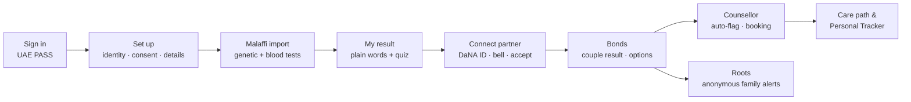

| Step | What happens |
|---|---|
| 🔐 **Sign in and set up** | UAE PASS (simulated) fills in verified identity. The person ticks exactly what DaNA may use, adds what Malaffi does not hold (marital status, pregnancy, family history), then results are imported. **Nobody enters the app until this is done.** |
| 🧬 **Malaffi record** | The genetic carrier test (570-gene panel) and premarital blood tests, shown exactly as received, with what is normal and what to discuss. |
| 💬 **My result** | A one-screen, plain-language result; common worries answered (*Am I sick? Did I do something wrong? Can we still marry?*); a quick understanding check. |
| 💍 **Connect** | Fatima shares her private DaNA ID, Khalid sends a request, **her bell lights up**, she accepts. Only then are their results compared, with both consents. Either can disconnect or block, on both sides. |
| 🤝 **Bonds** | The couple result, the chance for each pregnancy, three options side by side, and a downloadable couple report. |
| 👩‍⚕️ **Counsellor** | Complex results are escalated automatically. The couple books a session; the counsellor accepts it in their calendar, marks it done and creates referrals. |
| 🗺️ **Care path and Tracker** | Result → counselling → confirmatory test → specialist services, each with a status and date; then planning, pregnancy, birth and newborn. |
| 🌳 **Roots and Family Tree** | Who may also carry it, with private, anonymous invitations to screen. No names or condition shared. |
| 🤖 **DaNA guide** | A floating helper answers from the person's own result: tap, type or ask by voice. Every answer in **English, Arabic and Urdu**, with **Listen** (Arabic and Urdu voice by Gemini, server-side). It explains; it never advises. |
| 🌐 **Three languages** | One tap switches the whole app to **العربية** or **اردو**, right to left, with Arabic and Nastaliq fonts. |
| 🔒 **Privacy** | Consents, *who saw my data*, withdraw consent (optionally delete fetched results). |
| 📊 **DoH admin** | Outcome metrics; counsellors and areas (verify, pause); security console; content review; append-only audit log; gene-panel benchmarks with version history. |

## The problem

Abu Dhabi already screens every Emirati couple's genes before marriage. What's missing is what happens **after the result**.

| | |
|---|---|
| 🧬 **570 genes** | screened in Abu Dhabi's mandatory premarital programme since October 2024 |
| 👫 **~1 in 10** | couples in the pilot carried at least one disease-causing variant |
| 💍 **63 of 79** | at-risk couples in Dubai's programme still married. That's their right, but often without a plan. |
| 🌳 **Relatives** | carriers' siblings and cousins usually never find out until their own engagement |

The UAE also has two goals that can pull apart: **fewer genetic diseases**, and **more marriages and births** (Year of Family 2026, National Family Growth Agenda 2031). Screening that frightens couples works against the second. **DaNA serves both.**

## Our idea: Roots · Bonds · Branches

<p align="center">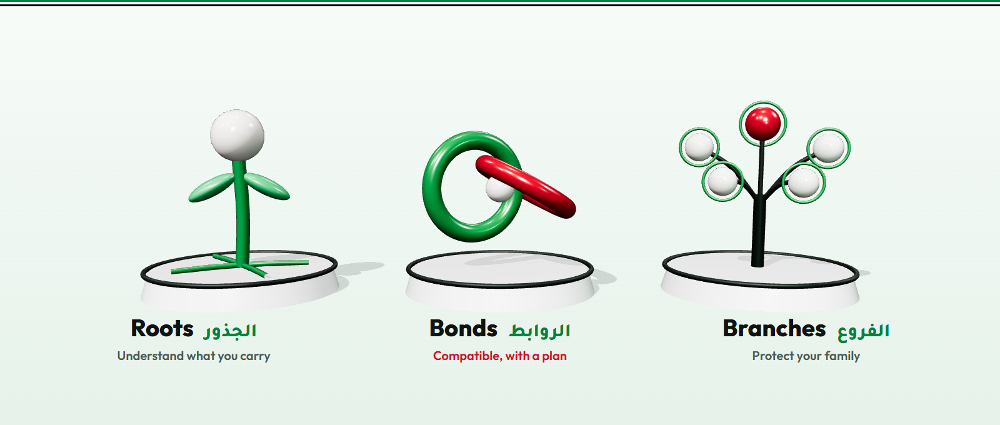</p>

| Journey | Promise | What happens |
|---|---|---|
| 🌱 **Roots** · الجذور | Understand what you carry | The result is explained gently in Arabic and English, with visuals and voice notes. Risk numbers come from a rules engine, never from AI. |
| 🤝 **Bonds** · الروابط | Compatible, with a plan | The couple sees every option side by side (IVF with embryo testing, prenatal testing, or proceeding fully informed) and decides together. **DaNA never says "marry" or "don't marry".** |
| 🌳 **Branches** · الفروع | Protect your family | A pearl family tree shows who may also carry the gene, and private **Sila alerts** invite relatives to screen *before* they marry. |

Every result type has a journey: **both clear**, **carrier with low couple risk**, and **compatible with a plan** (same gene). High-risk and pregnant couples go straight to a human genetic counsellor.

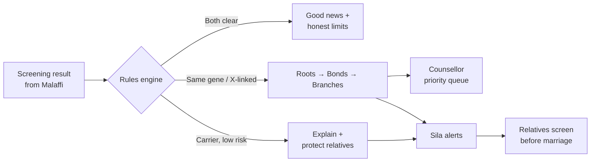

## Sila alerts: one result, a whole family protected

<p align="center">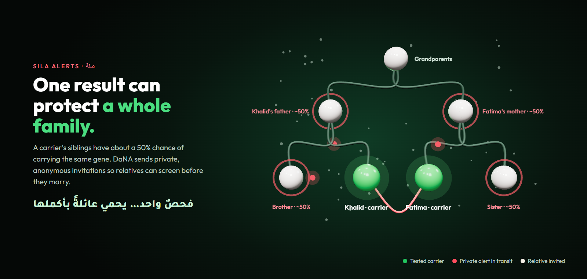</p>

*Sila* comes from **صلة الرحم**, the Islamic and Arab value of caring for your kin. When Khalid learns he's a carrier, his brother has about a 50% chance of carrying the same gene. With one tap, and only with consent, DaNA sends an anonymous invitation: *"Someone who cares about you recommends free genetic screening."* No names, no condition, no family details.

## What makes DaNA different

| | Typical approach | DaNA |
|---|---|---|
| Framing | "You are incompatible" | **"Compatible, with a plan"** |
| Time | Result day only | A **companion for years**, at every pregnancy decision |
| Reach | One couple | **The whole family**, including the next generation |
| Faith | Ignored, or AI answering religious questions | **Scholar-reviewed faith cards**; the AI never gives rulings |
| Decision-makers | The couple only | The couple + **parents and elders** |
| Deployment | Another app | Designed as a **module inside Sahatna**, with UAE PASS login and Malaffi records |
| Policy fit | One goal | **Fewer genetic diseases *and* more confident families** |

## See it

| English | العربية (RTL) |
|---|---|
| 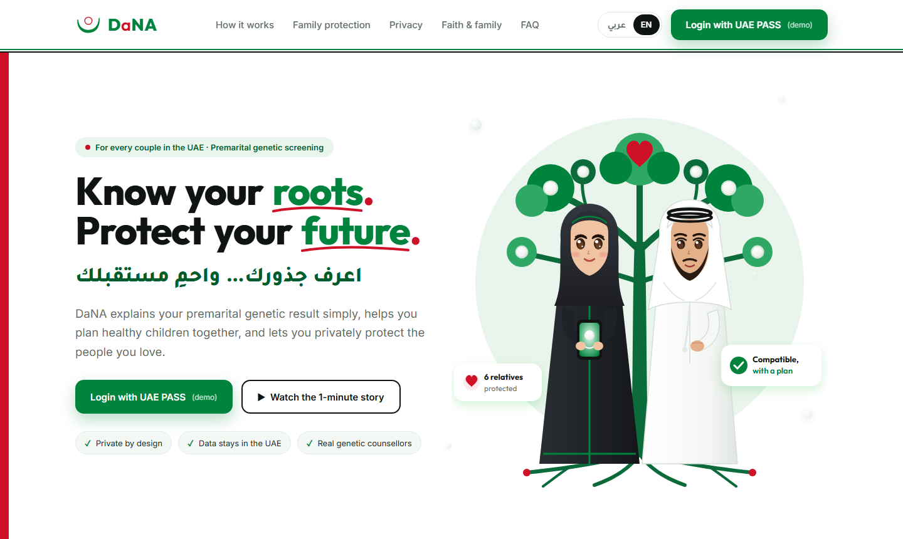 | 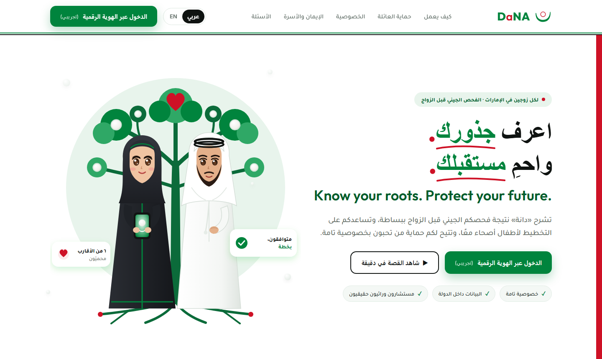 |

| Grow with DaNA | Your journey, together |
|---|---|
| 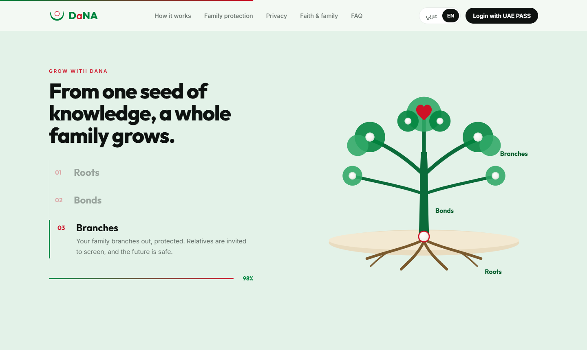 | 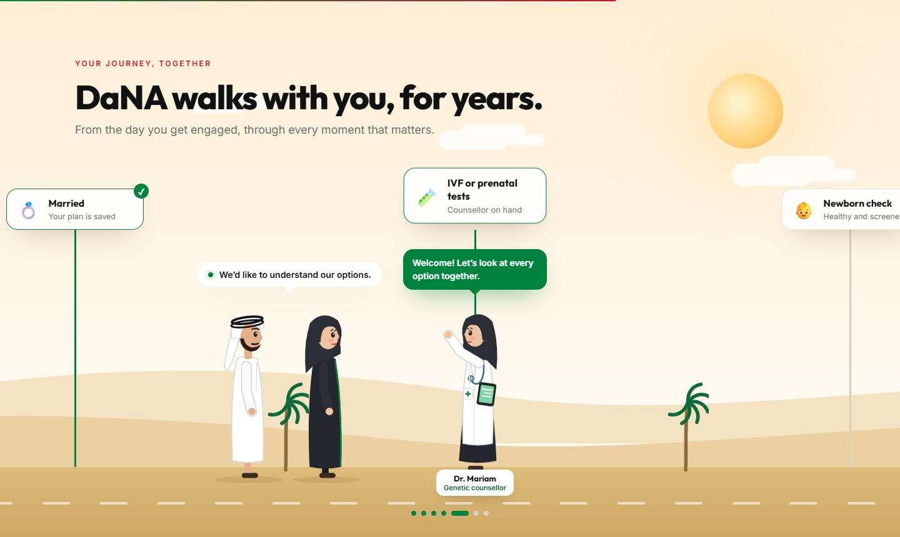 |

**Motion design, at a glance**

| Moment | What moves |
|---|---|
| 🦪 Intro | A pearl drops into the ن shell with a bounce and ripples; the wordmark springs in letter by letter |
| 🌀 Everywhere | Buttery smooth scrolling (Lenis); headings slide up from behind a mask; the nav hides on the way down and returns on the way up |
| 🌳 Hero | The title rises word by word, the tree draws itself and the heart beats; as you scroll away, the text lifts and the couple drifts back |
| 〰️ Marquee | Speeds up and reverses with your scroll velocity |
| 💬 Statement | Lights up word by word as you read |
| 🃏 Journeys | Roots, Bonds and Branches cards pin and stack as you scroll |
| 🌱 Grow | Scroll-driven: seed → roots → trunk → branches → leaves → family pearls → heart, synced with the story steps |
| 🚶 Walk | A scroll-driven gait (knees bend, arms swing, feet stay planted) through seven stops: **engaged → results → compatible, with a plan → married → counsellor → newborn → protected family**. They walk only while you scroll, turn around when you scroll back, keep a respectful distance until the wedding, and stop to meet Dr. Mariam, who waves and welcomes them |
| ✉️ Sila | The dark section opens to full width; red alerts travel the family tree; relatives glow; the counter updates |
| 🔚 Footer | A giant DaNA wordmark rises as the page ends |
| 🌐 Language | One tap switches English ⇄ Arabic, with full right-to-left layout |

## Architecture

<p align="center">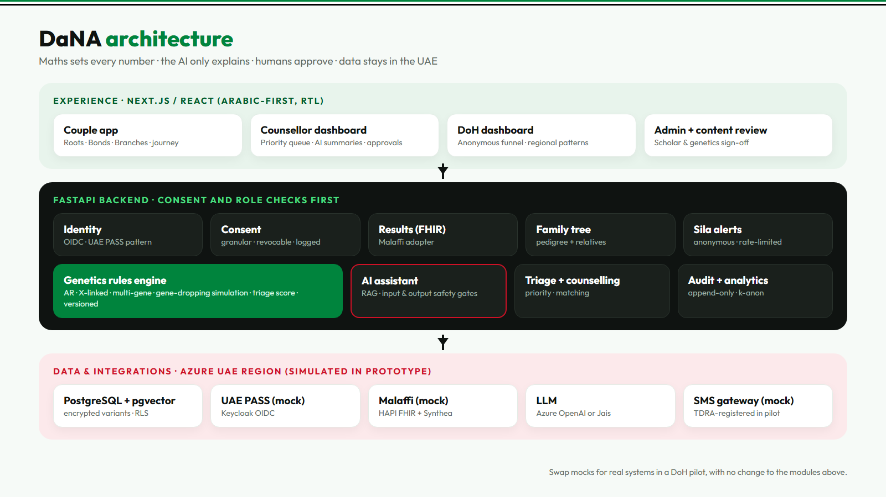</p>

**Design principles**

1. **Maths decides, AI explains.** Every risk number comes from a deterministic, versioned genetics engine.
2. **Humans approve.** Counsellors approve clinical plans; scholars and geneticists approve content.
3. **Consent before data.** Every read, share and alert needs a recorded, revocable consent.
4. **Data stays in the UAE.** UAE-region hosting; relatives' phone numbers are deleted after sending.
5. **Swap, don't rebuild.** UAE PASS, Malaffi and SMS sit behind adapters: mocked now, real in a pilot.

| Layer | Technology | Role |
|---|---|---|
| Web app | React 18 · Vite 6 · Framer Motion · hosted on **Vercel** | Landing page, couple app, counsellor portal, DoH admin; EN / AR / UR with full RTL |
| Database | **Supabase** (Postgres) · row-level security · security-definer functions | Every rule about who sees what lives *in the database*, not in the browser |
| API | **FastAPI** (Python) on **Render** | Malaffi (FHIR) import and parsing, rules engine, gene-panel benchmarks, voice |
| Rules engine | Deterministic, versioned (`rules-v0.2`) | Triage tier 1–4 and every risk number. No AI. |
| Voice | Browser speech (English) · **Gemini TTS** (Arabic, Urdu) via the API | The key stays on the server; signed-in users only, rate-limited, cached |
| Tests | **129 API tests** (pytest) | FHIR parsing, rules, benchmarks, gene panel, privacy paths |

## Safety, privacy and compliance

| Requirement | How DaNA meets it |
|---|---|
| Federal Law No. 2 of 2019 (ICT in health) | UAE data residency; Malaffi stays the system of record |
| Federal Decree-Law No. 49 of 2023 (human genome) | Explicit consent gates every genetic data read |
| UAE PDPL | Minimal data; phone numbers used once, then deleted |
| ADHICS (Abu Dhabi) | Encryption, role-based access, row-level security, append-only audit log |
| DoH Responsible AI Standard | Rules engine for numbers, human oversight, AI labelling, model card |
| Medical device readiness | ISO 14971 risk file and IEC 62304 practices; classification before pilot |

**Enforced in the working system today**

- **Row-level security on every table**: a couple sees only their own data and their partner's (with consent); staff see only what their role allows.
- **Sensitive actions go through checked database functions**: linking, consent, care-path updates and counsellor verification check the caller's role, and nobody can change their own role.
- **Partner search by exact DaNA ID only**, rate-limited, with masked names: strangers cannot find anyone.
- **Append-only audit log.** Every case view by staff is recorded and shown to the person.
- **Metrics are anonymous**: totals only, groups under 5 people are hidden.
- **No secrets in the browser**: API keys (Gemini, service keys) live only on the server.

> ⚠️ DaNA supports and explains; **it does not diagnose**. This prototype uses **synthetic data only**. UAE PASS, Malaffi and Sahatna integrations are **simulated**, and DaNA is not affiliated with or endorsed by any government entity.

## Measuring what matters

The DoH **Outcome metrics** page turns the challenge's sixth requirement into live numbers:

| Measure | How |
|---|---|
| **Understanding** | First-try score on the 3-question check, by result type |
| **What confuses people** | The statements answered wrong most often (e.g. *"If our first child has the condition, the next one will not"*), so the wording can be improved |
| **Access to counselling** | Couples who need counselling → booked → within 7 days; median days from result to booking |
| **Equity across languages** | Understanding and uptake side by side for English, Arabic and Urdu, with the gap flagged |
| **Privacy protection** | Consents given and withdrawn, staff views logged, blocks |

> Success means people **understand**, **reach a counsellor quickly**, and get the **same quality of help in every language**. A cancelled or continued marriage is never a success measure.

## Run it locally

```bash
# web app
cd web
npm install
npm run dev            # http://localhost:5173

# API (needed for the Malaffi import and Arabic/Urdu voice)
cd api
python -m venv .venv && .venv/Scripts/activate      # macOS/Linux: source .venv/bin/activate
pip install -r requirements.txt
uvicorn app.main:app --reload --port 8000           # docs at http://localhost:8000/docs
pytest                                               # 129 tests
```

Database: create a Supabase project, run `supabase/schema.sql`, then the numbered files in `supabase/` in order (see [supabase/SETUP.md](supabase/SETUP.md)). Keys go in `web/.env.local` and `api/.env`, which are never committed.

Open **http://localhost:5173**. Handy URL options:

| URL | Opens |
|---|---|
| `/?lang=ar` | Arabic, right to left |
| `/?nointro` | Skips the opening animation |
| `/#/login` | Demo login (simulated UAE PASS) |
| `/#/invite` | What a relative sees after a Sila alert |

### Demo logins

| Account | Role | What they can do |
|---|---|---|
| Khalid Al Mansoori · Fatima Al Hammadi | **Couple** | Read their result (Roots), choose a plan together (Bonds), send anonymous Sila alerts (Branches), book a counsellor, manage consent |
| Dr. Mariam Al Hosani | **Counsellor** | Case queue sorted by priority, case view, private notes, plan approval, schedule |
| Programme team | **DoH admin** | Programme overview, faith-content approval, append-only audit log |

Relatives never log in: they receive a private invite link. Everything is saved in the database, protected by row-level security, and every important action appears in the admin's append-only audit log. **Working as a team?** See [docs/TEAM.md](docs/TEAM.md) for who owns which module.

**Tech:** React 18 · Vite 6 · Framer Motion 11 · Lenis · Google Fonts (Outfit, Inter, Tajawal). The README visuals are real-time 3D scenes rendered with three.js (sources in [`docs/assets-src`](docs/assets-src)).

## Project structure

```
.
├── web/                    React app (Vercel)
│   └── src/
│       ├── App.jsx             Animated landing page (EN / AR)
│       └── app/
│           ├── onboarding/     Set-up before entering the app: UAE PASS, consent, details, Malaffi
│           ├── couple/         Home, My result, Bonds, Connections, Counsellor, Personal Tracker, Roots, Family Tree, Privacy
│           ├── counsellor/     Case queue, case view (care path, referrals, notes), schedule
│           ├── admin/          Overview, Outcome metrics, counsellors & areas, security console, content, audit
│           └── shared/         Rules engine, explanations, DaNA guide, care path, i18n (EN/AR/UR), data layer
├── api/                    FastAPI (Render): Malaffi FHIR import, benchmarks, gene panel, voice · 129 tests
├── supabase/               Database schema, row-level security and numbered migrations
├── demo/                   Scripted demo recorder (zoom, cursor, captions, voice)
└── docs/                   Images, benchmarks, security and engineering notes
```

## Roadmap

**Built and running**
- [x] Animated bilingual landing page and brand
- [x] Set-up gate: UAE PASS identity, consent per data group, details, Malaffi import (simulated)
- [x] Plain-language results for every result type, with a comprehension check
- [x] Partner linking by DaNA ID with notifications, accept, disconnect and block on both sides
- [x] Couple result, child chances, three options side by side, couple report
- [x] Automatic counsellor escalation, booking, counsellor calendar, care path and referrals
- [x] 7-stage Personal Tracker from screening to newborn
- [x] DaNA guide with voice; the whole app in English, Arabic and Urdu
- [x] Privacy centre: consents, who saw my data, withdraw consent
- [x] DoH outcome metrics, counsellor management, audit log, gene-panel benchmarks
- [x] Deterministic rules engine and 129 API tests

**Next, for a pilot**
- [ ] Real UAE PASS and Malaffi (FHIR) connections in place of the simulators
- [ ] ClinVar / ClinGen re-checks that flag reclassified variants for expert review
- [ ] Native-speaker clinical review of all Arabic and Urdu wording
- [ ] Usability testing with couples and counsellors; safety documentation pack

## Credits and licence

- **Licence:** see [LICENSE](LICENSE). The code is shared for evaluation by the challenge organizers and judges. Third-party components keep their own licences: [THIRD_PARTY_NOTICES.md](THIRD_PARTY_NOTICES.md).
- **Data credit:** city and country reference data from the [SimpleMaps World Cities Database](https://simplemaps.com/data/world-cities), licensed under [CC BY 4.0](https://creativecommons.org/licenses/by/4.0/).

---

<p align="center">
  <br>
  <b>DaNA · دانة</b><br>
  <sub>Know your roots. Protect your future. · اعرف جذورك… واحمِ مستقبلك</sub>
</p>
