<p align="center">
  <b>English</b> &nbsp;·&nbsp; <a href="README.ar.md">العربية</a>
</p>

<p align="center">
  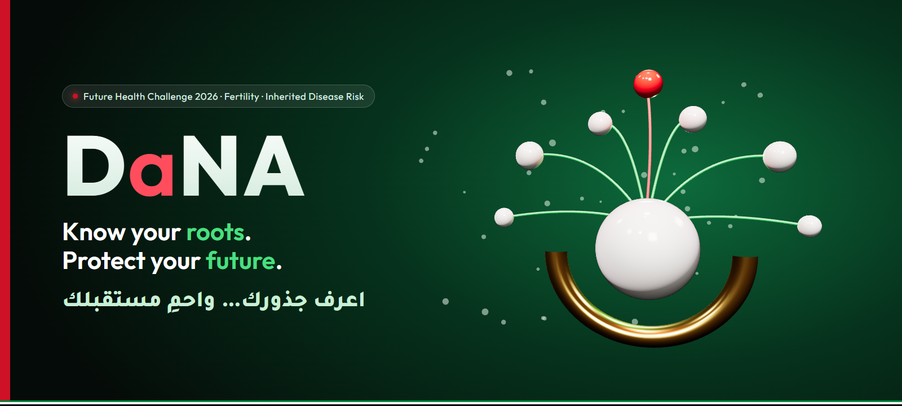
</p>

<p align="center">
  
  
  
</p>
<p align="center">
  
  
  
  
  
</p>

<h3 align="center">One test. A whole family protected.</h3>
<p align="center"><b>فحصٌ واحد… يحمي عائلةً بأكملها</b></p>

---

**DaNA** helps couples in the UAE turn a premarital genetic test result into understanding, a shared plan for healthy children, and private protection for their whole family.

Built for the **[Future Health Digital Innovation Challenge 2026](https://hack2skill.com/event/futurehealthchallenge/)**, Fertility theme, Statement 3: *Understanding and Reducing Inherited Disease Risk*.

> **Why the name?** *Dana* (دانة) is the Gulf's most precious pearl, the treasure pearl divers dreamed of. Look closer and **D-a-N-A** holds **DNA**, the most precious thing a family passes on.

## Watch it move

<table>
  <tr>
    <td width="50%" align="center">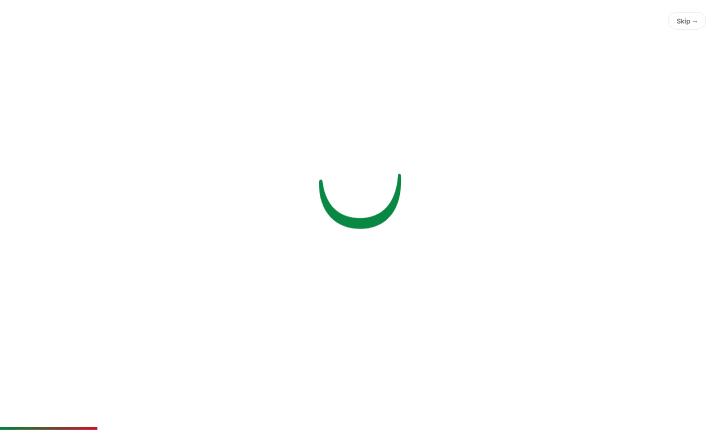<br><b>The pearl drops</b><br><sub>A pearl falls into the ن shell, ripples, and D·a·N·A springs in</sub></td>
    <td width="50%" align="center">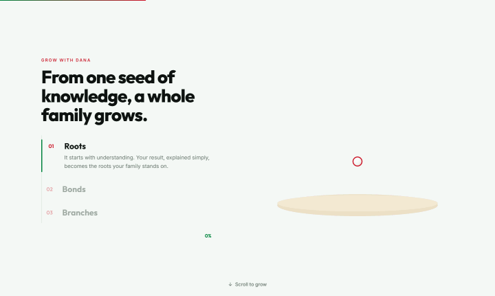<br><b>Grow with DaNA</b><br><sub>Scroll and a seed becomes a family tree: Roots → Bonds → Branches</sub></td>
  </tr>
  <tr>
    <td width="50%" align="center">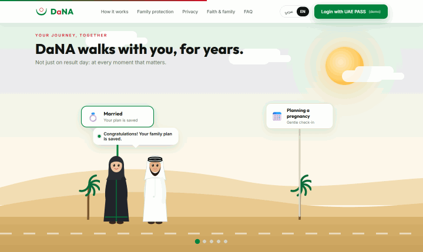<br><b>Your journey, together</b><br><sub>The couple walks past five milestones; a child joins at the newborn check</sub></td>
    <td width="50%" align="center">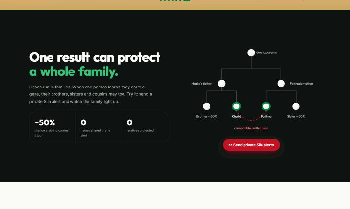<br><b>Sila alerts, live</b><br><sub>One tap sends private alerts and the family lights up</sub></td>
  </tr>
</table>

## Contents

- [Watch it move](#watch-it-move)
- [The problem](#the-problem)
- [Our idea: Roots · Bonds · Branches](#our-idea-roots--bonds--branches)
- [Sila alerts: one result, a whole family protected](#sila-alerts-one-result-a-whole-family-protected)
- [What makes DaNA different](#what-makes-dana-different)
- [See it](#see-it)
- [Architecture](#architecture)
- [Safety, privacy and compliance](#safety-privacy-and-compliance)
- [Run it locally](#run-it-locally)
- [Project structure](#project-structure)
- [Roadmap](#roadmap)

## The problem

Abu Dhabi already screens every Emirati couple's genes before marriage. What's missing is what happens **after the result**.

| | |
|---|---|
| 🧬 **570 genes** | screened in Abu Dhabi's mandatory premarital programme since October 2024 |
| 👫 **~1 in 10** | couples in the pilot carried at least one disease-causing variant |
| 💍 **63 of 79** | at-risk couples in Dubai's programme still married. That's their right, but often without a plan. |
| 🌳 **Relatives** | carriers' siblings and cousins usually never find out until their own engagement |

The UAE also has two goals that can pull apart: **fewer genetic diseases**, and **more marriages and births** (Year of Family 2026, National Family Growth Agenda 2031). Screening that frightens couples works against the second. **DaNA serves both.**

## Our idea: Roots · Bonds · Branches

<p align="center">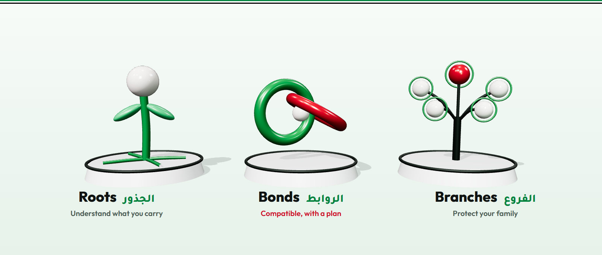</p>

| Journey | Promise | What happens |
|---|---|---|
| 🌱 **Roots** · الجذور | Understand what you carry | The result is explained gently in Arabic and English, with visuals and voice notes. Risk numbers come from a rules engine, never from AI. |
| 🤝 **Bonds** · الروابط | Compatible, with a plan | The couple sees every option side by side (IVF with embryo testing, prenatal testing, or proceeding fully informed) and decides together. **DaNA never says "marry" or "don't marry".** |
| 🌳 **Branches** · الفروع | Protect your family | A pearl family tree shows who may also carry the gene, and private **Sila alerts** invite relatives to screen *before* they marry. |

Every result type has a journey: **both clear**, **carrier with low couple risk**, and **compatible with a plan** (same gene). High-risk and pregnant couples go straight to a human genetic counsellor.

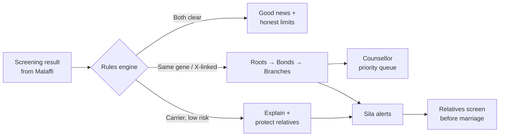

## Sila alerts: one result, a whole family protected

<p align="center">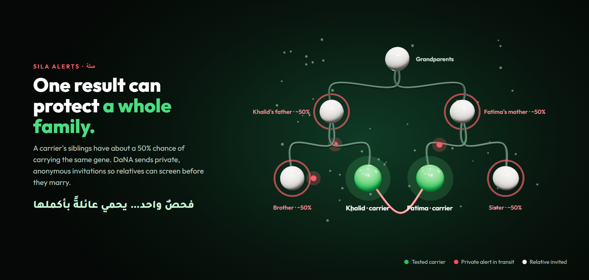</p>

*Sila* comes from **صلة الرحم**, the Islamic and Arab value of caring for your kin. When Khalid learns he's a carrier, his brother has about a 50% chance of carrying the same gene. With one tap, and only with consent, DaNA sends an anonymous invitation: *"Someone who cares about you recommends free genetic screening."* No names, no condition, no family details.

## What makes DaNA different

| | Typical approach | DaNA |
|---|---|---|
| Framing | "You are incompatible" | **"Compatible, with a plan"** |
| Time | Result day only | A **companion for years**, at every pregnancy decision |
| Reach | One couple | **The whole family**, including the next generation |
| Faith | Ignored, or AI answering religious questions | **Scholar-reviewed faith cards**; the AI never gives rulings |
| Decision-makers | The couple only | The couple + **parents and elders** |
| Deployment | Another app | Designed as a **module inside Sahatna**, with UAE PASS login and Malaffi records |
| Policy fit | One goal | **Fewer genetic diseases *and* more confident families** |

## See it

| English | العربية (RTL) |
|---|---|
| 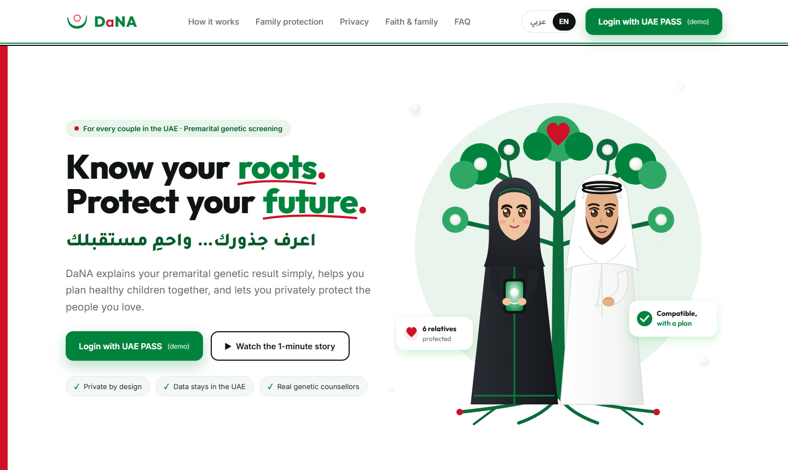 | 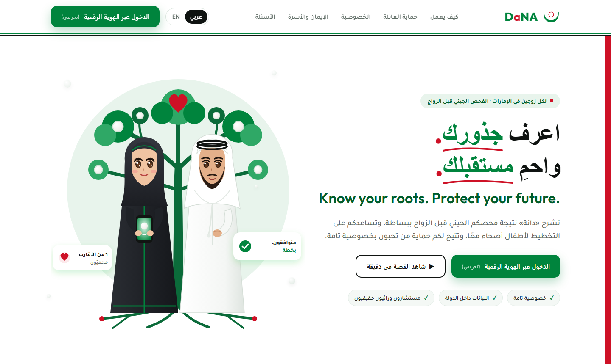 |

| Grow with DaNA | Your journey, together |
|---|---|
| 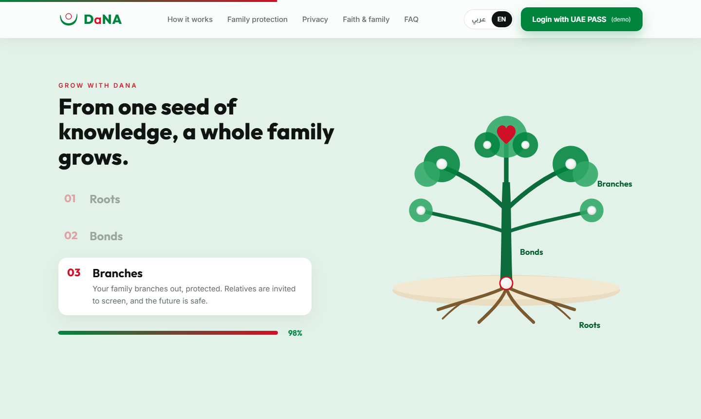 | 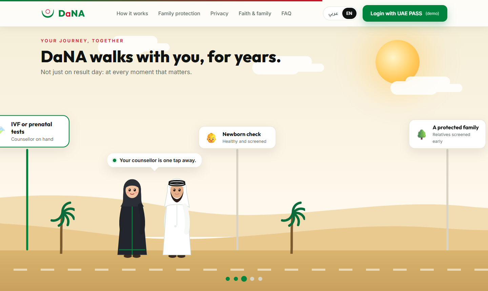 |

**Motion design, at a glance**

| Moment | What moves |
|---|---|
| 🦪 Intro | A pearl drops into the ن shell with a bounce and ripples; the wordmark springs in letter by letter |
| 🌳 Hero | Roots and branches draw themselves, leaves pop, pearls pulse, the heart beats, the couple blinks, leaves fall, and the scene follows your mouse |
| 🃏 Journeys | Roots, Bonds and Branches cards tilt in 3D toward the cursor |
| 🌱 Grow | Scroll-driven: seed → roots → trunk → branches → leaves → family pearls → heart, synced with the story steps |
| 🚶 Walk | Scroll-driven: the couple walks a desert road with layered dunes; milestones light up, DaNA speaks, a child joins |
| ✉️ Sila | Red alerts travel the family tree; relatives glow; the counter updates |
| 🌐 Language | One tap switches English ⇄ Arabic, with full right-to-left layout |

## Architecture

<p align="center">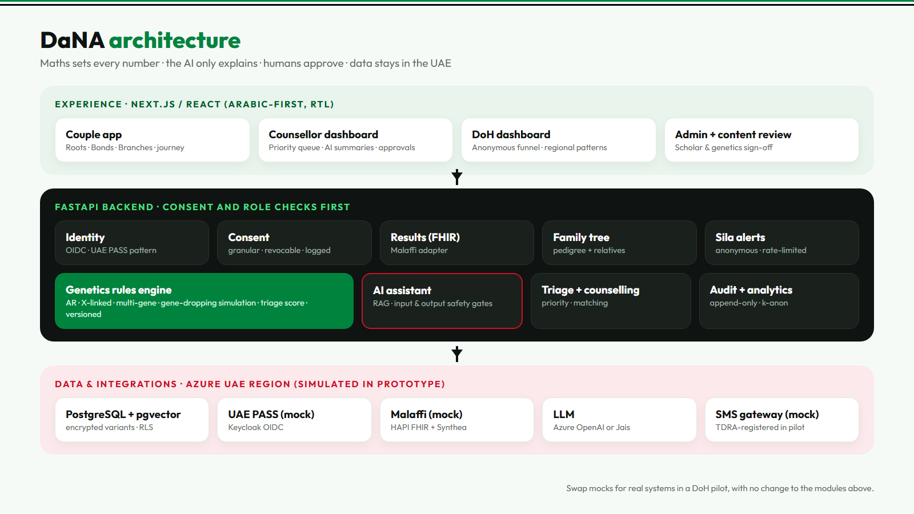</p>

**Design principles**

1. **Maths decides, AI explains.** Every risk number comes from a deterministic, versioned genetics engine.
2. **Humans approve.** Counsellors approve clinical plans; scholars and geneticists approve content.
3. **Consent before data.** Every read, share and alert needs a recorded, revocable consent.
4. **Data stays in the UAE.** UAE-region hosting; relatives' phone numbers are deleted after sending.
5. **Swap, don't rebuild.** UAE PASS, Malaffi and SMS sit behind adapters: mocked now, real in a pilot.

## Safety, privacy and compliance

| Requirement | How DaNA meets it |
|---|---|
| Federal Law No. 2 of 2019 (ICT in health) | UAE data residency; Malaffi stays the system of record |
| Federal Decree-Law No. 49 of 2023 (human genome) | Explicit consent gates every genetic data read |
| UAE PDPL | Minimal data; phone numbers used once, then deleted |
| ADHICS (Abu Dhabi) | Encryption, role-based access, row-level security, append-only audit log |
| DoH Responsible AI Standard | Rules engine for numbers, human oversight, AI labelling, model card |
| Medical device readiness | ISO 14971 risk file and IEC 62304 practices; classification before pilot |

> ⚠️ DaNA supports and explains; **it does not diagnose**. This prototype uses **synthetic data only**. UAE PASS, Malaffi and Sahatna integrations are **simulated**, and DaNA is not affiliated with or endorsed by any government entity.

## Run it locally

```bash
cd web
npm install
npm run dev
```

Open **http://localhost:5173**. Handy URL options:

| URL | Opens |
|---|---|
| `/?lang=ar` | Arabic, right to left |
| `/?nointro` | Skips the opening animation |

**Tech:** React 18 · Vite 6 · Framer Motion 11 · Google Fonts (Outfit, Inter, Tajawal). The README visuals are real-time 3D scenes rendered with three.js (sources in [`docs/assets-src`](docs/assets-src)).

## Project structure

```
.
├── web/                 Animated React landing page (EN / AR, RTL)
│   └── src/
│       ├── App.jsx          Sections, Sila alert demo, tilt cards, FAQ, language switch
│       ├── Intro.jsx        Opening animation: the pearl drops into the shell
│       ├── CoupleTree.jsx   Animated Emirati couple + family tree (hero)
│       ├── GrowSection.jsx  Scroll-driven tree growth (Roots → Bonds → Branches)
│       ├── JourneyWalk.jsx  Scroll-driven walking family with milestones
│       └── i18n*.js         English and Arabic copy
├── logo/                DaNA logo explorations (SVG + PNG)
├── landing/             Static HTML mockups
└── docs/
    ├── images/          README visuals (3D renders, screenshots, architecture)
    └── assets-src/      three.js / HTML sources for every visual
```

## Roadmap

- [x] Concept, research and policy alignment
- [x] Brand, logo and animated bilingual landing page
- [x] Scroll-driven storytelling: growing tree and walking family
- [ ] Genetics rules engine with full test suite
- [ ] Synthetic family simulator (500+ families with cousin marriages)
- [ ] Couple app: Roots, Bonds, Branches and pearl family tree
- [ ] Ask DaNA: retrieval-grounded AI with safety gates
- [ ] Counsellor and DoH dashboards
- [ ] Mock UAE PASS (Keycloak) and Malaffi (HAPI FHIR) integration
- [ ] User testing and safety documentation pack

---

<p align="center">
  <br>
  <b>DaNA · دانة</b><br>
  <sub>Know your roots. Protect your future. · اعرف جذورك… واحمِ مستقبلك</sub>
</p>
