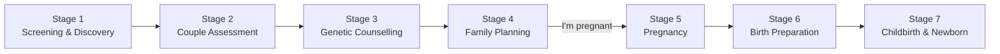

# DaNA Personalised Care Plan Tracker (مُتابِع الخطة الشخصية الشاملة)

## 1. Overview & Clinical Rationale
The **DaNA Personalised Care Plan Tracker** is an end-to-end longitudinal genomic lifecycle tracking engine. It guides couples from their initial individual genetic screening under the UAE National Premarital Screening Program through joint Mendelian risk evaluation, accredited clinical genetic counselling, reproductive decision-making, pregnancy monitoring, hospital delivery handover, and national newborn blood spot screening.

Unlike static checklists, the Personal Tracker is an **event-driven clinical state machine** integrated with:
- **Malaffi Health Information Exchange (HIE)** for lab ingest and diagnostic validation.
- **Accredited Clinical Counsellor CaseView** for consultation scheduling, care plan approval, and specialist referrals.
- **DoH UAE Newborn Screening Registry** for day-2 metabolic and hemoglobinopathy tracking.

---

## 2. The 7-Stage Longitudinal Care Journey

### Stage 1: Screening & Discovery (الفحص والاستكشاف الوراثي) — `Roots`
Focuses on individual carrier status identification, pedigree construction, and variant interpretation without social stigma.
- **Genetic screening** (`individual_screening`): Automated trigger — individual genetic report imported and verified via Malaffi.
- **Family history** (`medical_family_history`): Automated trigger — 3-generation medical and hereditary questionnaire completed.
- **Pedigree** (`pedigree_completion`): Automated trigger — pedigree visualizer generates verified family tree with consanguinity indicators.
- **Results and explanations** (`results_explanations`): Automated trigger — clinical variant classification (ACMG/AMP guidelines) and plain-language explanation generated.

### Stage 2: Couple Assessment (التقييم المشترك للزوجين) — `Bonds`
Evaluates joint reproductive risk based on mutual partner consent and shared autosomal recessive or X-linked variants.
- **Partner connection** (`partner_connection_consent`): Automated trigger — mutual dual-consent handshake accepted by both partners.
- **Joint risk assessment** (`joint_risk_assessment`): Automated trigger — Mendelian carrier intersection engine executes and detects shared conditions (e.g., *HBB* Beta-thalassaemia carrier pair, 25% child risk).
- **Reproductive options** (`reproductive_options`): Automated trigger — joint clinical briefing generated, outlining IVF/PGT-M, natural conception with prenatal diagnosis, and preconception care.

### Stage 3: Genetic Counselling (الاستشارة الوراثية المعتمدة) — `Clinical Mandate`
All 5 checkpoints are **strictly mandatory** for progression to Family Planning.
- **Appointment booking** (`appointment_booking`): Couple books consultation with dedicated counsellor (e.g., Dr. Mariam Al Hosani) via Find a Slot.
- **Counselling session** (`counselling_session`): Counsellor marks the teleconsultation or in-person clinic visit complete in the Schedule console.
- **Counsellor recommendations** (`counsellor_recommendations`): Counsellor records formal clinical notes and recommendations in CaseView.
- **Approved care plan** (`approved_care_plan`): Counsellor signs and approves the personalized reproductive care protocol.
- **Follow-up & referrals** (`follow_up_referrals`): Counsellor dispatches requisite clinical referral (e.g., Cleveland Clinic Abu Dhabi Fertility Center for IVF/PGT-M).

### Stage 4: Family Planning (تنظيم وبناء الأسرة) — `Active Preconception`
Translates counselling recommendations into a concrete reproductive pathway. While in Planning, Stages 5, 6, and 7 remain hidden to maintain cognitive clarity and reflect true preconception status.
- **Pathway selection** (`chosen_conception_pathway`): Triggered when any situation card is selected:
  1. *Planning to conceive*: Natural conception with preconception folic acid / iron supplementation.
  2. *I'm pregnant*: Activates pregnancy transition, unlocks Stage 5, and prompts obstetric baseline recording.
  3. *Not planning currently*: Retains longitudinal journey open for future family building.
  4. *Decision deferred*: Preserves counsellor notes until the couple is ready to proceed.
- **Preconception follow-ups** (`preconception_followups`): Recorded when baseline lab tests (CBC, ferritin, hemoglobin electrophoresis) are registered.
- **IVF / PGT-M coordination** (`pgtm_coordination`): Triggered when referral intake is confirmed by the IVF clinic.

### Stage 5: Pregnancy (مرحلة الحمل والمتابعة الجنينية)
Activated only upon pregnancy confirmation. Automatic CVS/amniocentesis triggers based solely on gestational age are eliminated in favor of verified clinical actions.
- **Pregnancy recorded** (`pregnancy_confirmation`): Mother or obstetrician submits gestational age and dating ultrasound info.
- **Gestational milestones** (`gestational_milestones`): Calculated from dating information (Weeks + EDD).
- **Pregnancy counselling** (`pregnancy_counselling`): Dedicated prenatal genetic counselling appointment booked and completed.
- **Prenatal genetic testing** (`prenatal_genetic_testing`): Ordered diagnostic tests (CVS at 11–14w or Amniocentesis at 15–20w) completed and recorded.
- **Specialist appointments** (`specialist_appointments`): Fetal medicine consultation completed at accredited center.

### Stage 6: Birth Preparation (الاستعداد للولادة ورعاية الأمومة)
Coordinates hospital admission and newborn diagnostic readiness.
- **EDD** (`expected_delivery_date`): Estimated date of delivery recorded.
- **Maternity coordination** (`maternity_care_coordination`): Delivery hospital recorded (e.g., Danat Al Emarat Hospital for Women & Children).
- **Birth preparation consultation** (`birth_prep_consultation`): Optional consultation completed.
- **Clinical handover** (`clinical_handover_consent`): Malaffi digital handover dossier and cord blood sampling kit transmitted with patient consent.
- **Newborn screening preparation** (`newborn_screening_prep`): Delivery ward notified of targeted testing requirement for known familial variant.

### Stage 7: Childbirth & Newborn Care (الولادة ورعاية المولود الجديد) — `Journey Milestone`
Culmination of the preventive care pathway.
- **Birth details** (`birth_details`): Childbirth event recorded with delivery timestamp and birth weight.
- **Child health record** (`child_health_record`): Separate child record initialized on the platform and connected to parents.
- **Newborn screening** (`newborn_screening_status`): UAE National Newborn Blood Spot Screening documented as completed.
- **Genetic follow-up** (`required_genetic_followup`): Specialist pediatric hematology / genetics follow-up created if clinically indicated.
- **Postnatal counselling** (`postnatal_counselling`): Postnatal review session completed with the family.

---

## 3. Checkpoint Triggers Reference Matrix

| Stage | Checkpoint ID | Checkpoint Label | Trigger Mechanism |
| :--- | :--- | :--- | :--- |
| **1** | `individual_screening` | Genetic screening | Verified lab report loaded into Malaffi |
| **1** | `medical_family_history` | Family history | Onboarding history form completed |
| **1** | `pedigree_completion` | Pedigree | Pedigree tree generated |
| **1** | `results_explanations` | Results and explanations | Genomic interpretation report available |
| **2** | `partner_connection_consent` | Partner connection | Mutual consent accepted by both users |
| **2** | `joint_risk_assessment` | Joint risk assessment | Mendelian calculation engine completed |
| **2** | `reproductive_options` | Reproductive options | Joint clinical report generated |
| **3** | `appointment_booking` | Appointment booking | Couple books slot via Find a Slot |
| **3** | `counselling_session` | Counselling session | Counsellor clicks Mark Complete in Schedule |
| **3** | `counsellor_recommendations` | Counsellor recommendations | Recommendations saved in CaseView |
| **3** | `approved_care_plan` | Approved care plan | Counsellor approves care plan in CaseView |
| **3** | `follow_up_referrals` | Follow-up & referrals | Referral dispatched to specialist facility |
| **4** | `chosen_conception_pathway` | Pathway selection | Couple selects any situation card |
| **4** | `preconception_followups` | Preconception follow-ups | Preconception health follow-up logged |
| **4** | `pgtm_coordination` | IVF / PGT-M coordination | IVF facility intake coordinated |
| **5** | `pregnancy_confirmation` | Pregnancy recorded | Mother submits pregnancy details & dating info |
| **5** | `gestational_milestones` | Gestational milestones | Calculated from submitted dating information |
| **5** | `pregnancy_counselling` | Pregnancy counselling | Prenatal counselling booked and marked completed |
| **5** | `prenatal_genetic_testing` | Prenatal genetic testing | CVS / Amniocentesis ordered & recorded |
| **5** | `specialist_appointments` | Specialist appointments | Fetal medicine appointment completed |
| **6** | `expected_delivery_date` | EDD | Estimated Delivery Date submitted |
| **6** | `maternity_care_coordination` | Maternity coordination | Delivery hospital provider recorded |
| **6** | `birth_prep_consultation` | Birth preparation consultation | Consultation booked & completed |
| **6** | `clinical_handover_consent` | Clinical handover | Digital dossier submitted with consent |
| **6** | `newborn_screening_prep` | Newborn screening preparation | Cord blood / newborn screening kit recorded |
| **7** | `birth_details` | Birth details | Childbirth details recorded |
| **7** | `child_health_record` | Child health record | Child record created in family dossier |
| **7** | `newborn_screening_status` | Newborn screening | Day-2 national blood spot verified |
| **7** | `required_genetic_followup` | Genetic follow-up | Created only when clinically indicated |
| **7** | `postnatal_counselling` | Postnatal counselling | Postpartum consultation completed |

---

## 4. Continuity & Inter-Stage Handovers
1. **Stage 1 ➔ Stage 2**: *Genetic Variants & Pedigrees* — Raw 570-gene variant data and family structures feed the Mendelian risk algorithm.
2. **Stage 2 ➔ Stage 3**: *Clinical Consultation Triage* — High-risk pairs (*HBB*, *SMN1*, *GJB2*) auto-assign to certified genetic counsellors.
3. **Stage 3 ➔ Stage 4**: *Approved Care Protocol* — Counsellor recommendations authorize the couple's preconception pathway.
4. **Stage 4 ➔ Stage 5**: *Conception & Gestational Trigger* — Selecting "I'm pregnant" transitions care into active pregnancy tracking.
5. **Stage 5 ➔ Stage 6**: *Prenatal Genomics & Hospital Alert* — Prenatal diagnostic results transmit handover data to the maternity hospital.
6. **Stage 6 ➔ Stage 7**: *Delivery & Newborn Blood Spot Protocol* — Childbirth activates the UAE DoH National Newborn Blood Spot Screening.
7. **Stage 7 ➔ Full Circle**: *Pedigree Update* — The new child is permanently linked as a new node in the multi-generational family tree.

---

## 5. UI Architecture & Features
- **Clean Aesthetic**: Light-mode healthcare palette adhering to DoH UAE design guidelines (Emerald `#00843D`, Slate `#0F172A`, Clean borders `#E2E8F0`).
- **Dynamic Progressive Disclosure**: Stages 5, 6, and 7 remain hidden while the couple is in Planning (Stage 4), preventing premature cognitive overload and ensuring checkboxes reflect verified clinical realities.
- **Counsellor Permanence**: A dedicated clinical counsellor (e.g., Dr. Mariam Al Hosani) is locked across all 7 stages.
- **Clinical Summary Slip**: Instant printable Malaffi HIE referral slip with QR verification for clinic visits.
