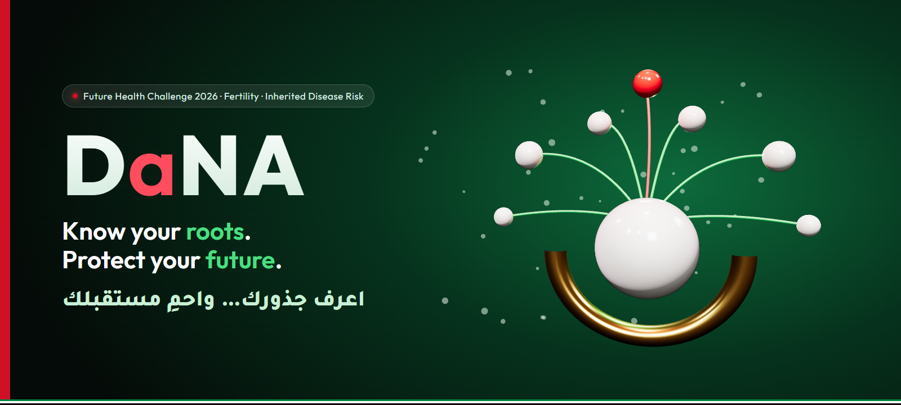
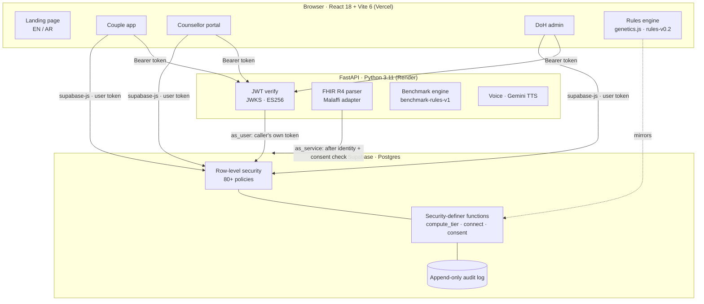
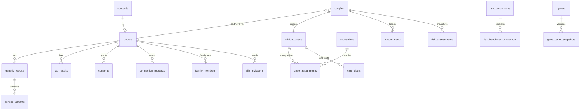
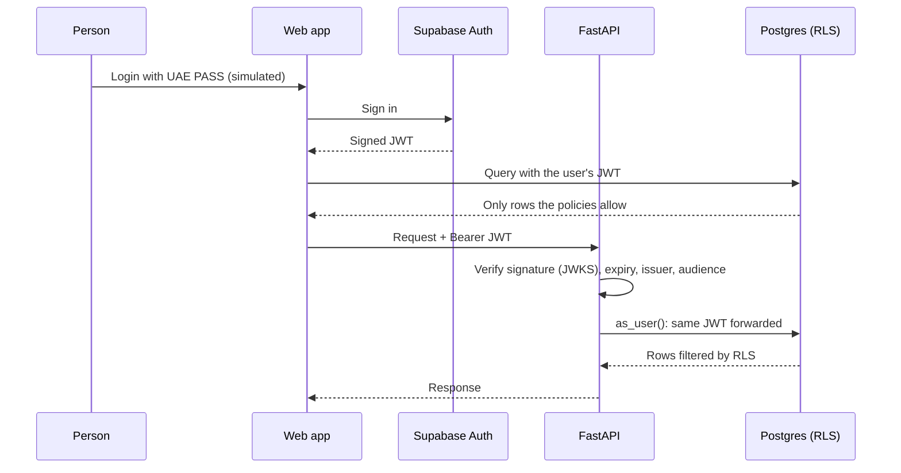
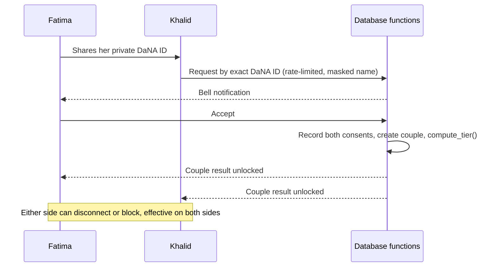
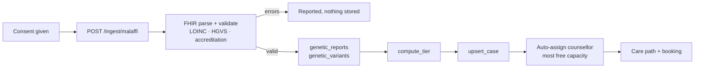

<p align="center"></p>

# DaNA: Technical Documentation

**Future Health Digital Innovation Challenge 2026 · Fertility · Statement 3: Understanding and Reducing Inherited Disease Risk**

Live app: https://dana-gamma-seven.vercel.app · API docs: https://dana-api-589n.onrender.com/docs · [Back to README](../README.md)

## Contents

1. [System at a glance](#system-at-a-glance)
2. [Design decisions that matter](#design-decisions-that-matter)
3. [Rules engine](#rules-engine-how-a-result-becomes-a-priority)
4. [Malaffi (FHIR R4) ingestion](#malaffi-fhir-r4-ingestion)
5. [API reference](#api-reference)
6. [Data model](#data-model)
7. [Security model](#security-model)
8. [Testing](#testing) · [Configuration](#configuration) · [Deployment](#deployment)
9. [Key flows](#key-flows) · [Frontend architecture](#frontend-architecture) · [Repository map](#repository-map)
10. [Run it locally](#run-it-locally) · [Compliance mapping](#compliance-mapping) · [Scope and limitations](#scope-and-honest-limitations)

> Everything below was checked against the code in this repository.

## System at a glance



| Layer | Technology | Responsibility |
|---|---|---|
| **Web** | React 18, Vite 6, Framer Motion 11, Lenis, supabase-js 2 | Landing, couple app, counsellor portal, admin; EN / AR / UR with full RTL; hash-routed SPA |
| **API** | FastAPI 0.115, Pydantic 2, httpx, PyJWT | Malaffi FHIR import, benchmark evaluation, gene panel, directory and locations, voice |
| **Database** | Supabase Postgres + PostgREST | Source of truth *and* the security boundary: every rule about who sees what is enforced here |
| **Auth** | Supabase Auth (JWT), UAE PASS simulated | Sign-in; the same token is forwarded to the database so privacy rules apply per user |
| **Voice** | Gemini TTS (server-side) | Arabic and Urdu read-aloud; the key never reaches the browser |
| **Hosting (today)** | Vercel · Render · Supabase | Prototype. Production plan: Azure UAE North / Central (see the README) |

## Design decisions that matter

| Decision | Why |
|---|---|
| **The database is the security boundary, not the API.** The API calls Postgres *as the signed-in user* (`as_user`), so row-level security decides every read. | A bug in the API or the browser cannot leak another family's data. |
| **The service key is used in one narrow place** (`as_service`, Malaffi ingestion), only after the caller's identity and consent are checked. | Least privilege; the secret lives only in the server environment. |
| **Two rules engines that must agree.** `compute_tier()` in SQL (migration `004`) is mirrored by `assess()` in `web/src/app/shared/genetics.js`. | The offline demo and the database always give the same answer. |
| **No AI for numbers.** Risk comes from versioned, deterministic code (`rules-v0.2`, `benchmark-rules-v1`). | Auditable, reproducible, explainable to a clinician. |
| **Nothing is assumed normal.** Missing lab values are reported as missing, never filled in. | Safe failure for a clinical product. |
| **Adapters for external systems.** UAE PASS, Malaffi and SMS sit behind interfaces. | Swap simulators for real services without touching the UI. |

## Rules engine: how a result becomes a priority

Implemented twice and kept in sync: SQL `compute_tier(couple_id)` and JS `assess(couple)`.

| Tier | Priority | Trigger | Result type |
|---|---|---|---|
| **1** | urgent | Pregnant **and** a shared pathogenic finding (or X-linked) | counsellor immediately |
| **2** | high | Both partners carry the **same autosomal-recessive gene** (each pregnancy: 1 in 4), or an X-linked female carrier (each son: 1 in 2) | `plan` · `xlinked` |
| **3** | moderate | A variant of uncertain significance (**no number is given** until a specialist reviews it), or a single carrier (same as the general population) | `uncertain` · `carrier` |
| **4** | routine | Nothing relevant found | `clear` |

Only `pathogenic` and `likely_pathogenic` variants count towards a match. `upsert_case()` creates the clinical case and assigns it to the active counsellor with the most free capacity (`max_caseload - active_caseload`).

**Benchmark engine** (`api/app/benchmark.py`, `benchmark-rules-v1`): cross-checks both partners' blood panels (Hb, MCV, MCH, HbA2, HbF, Hb variant, ferritin with inflammation flag, G6PD, rubella, RhD, infections) against thresholds stored in the `risk_benchmarks` table, **never hard-coded**. Every threshold has a cited source, a review status and a full version history, and each assessment stores a snapshot so a past result can always be reproduced. See [docs/BENCHMARKS.md](BENCHMARKS.md).

## Malaffi (FHIR R4) ingestion

`api/app/fhir.py` reads a FHIR Bundle exactly as Malaffi would send it: `DiagnosticReport`, variant `Observation`s, `Organization` and `Provenance`. It validates; it does not guess.

| Check | Detail |
|---|---|
| Terminology | LOINC codes (`51969-4` genetic report, `48018-6` gene, `48004-6` c.HGVS, `48005-3` p.HGVS, `53034-5` zygosity, `53037-8` significance) |
| Significance | LOINC answer list `LL4034-6` → pathogenic · likely pathogenic · VUS · likely benign · benign |
| Variant syntax | HGVS patterns for `c.` and `p.` notation |
| Provenance | Laboratory accreditation must match `CAP-NNNNNNN` or `ISO15189-…` |
| Output | Rows for `genetic_reports` / `genetic_variants`, plus explicit `errors` and `warnings`. Anything missing or unrecognised is reported, never filled in |

Consent is checked before ingestion runs; the person can later withdraw it and optionally delete the fetched results.

## API reference

Interactive docs: **https://dana-api-589n.onrender.com/docs** (OpenAPI). 40+ endpoints; the main groups:

| Group | Endpoints | Access |
|---|---|---|
| **system** | `GET /health` | public |
| **account** | `GET /me`, `GET/PUT /me/location` | signed-in |
| **results** | `POST /ingest/validate`, `POST /ingest/malaffi`, `GET /me/report`, `GET/POST /people/{id}/labs` | signed-in, consent-gated |
| **care** | `GET /cases`, `POST /cases/{couple}/benchmark-check`, `GET /cases/{couple}/assessments` | counsellor / admin |
| **benchmarks** | `GET /benchmarks`, `POST /benchmarks/evaluate`, `GET /benchmarks/mismatches`, `GET/PATCH /benchmarks/{sex}`, snapshots, restore | read: staff · edit: admin, reason required |
| **gene panel** | `GET /panel`, `PATCH /panel/{symbol}`, `GET /panel/{symbol}/snapshots` | read: staff · edit: admin |
| **connections** | `POST /invite/email` | signed-in |
| **places and locations** | `GET /places`, `/places/{id}/counsellors`, `/locations/countries`, `/regions`, `/cities` | signed-in |
| **admin** | `GET /admin/accounts` (+ `/summary`, `/filters`), `/admin/locations/*`, `PUT /admins/{id}/scope`, `POST /counsellors/{id}/manage` | admin (role-checked) |
| **analytics** | `GET /analytics/aggregate` | anonymous totals, groups under 5 hidden |
| **guide** | `POST /tts`, `GET /tts/status` | signed-in, 60 calls per hour per user, cached |

**Authentication:** `Authorization: Bearer <Supabase JWT>`. The API verifies signature (JWKS, ES256 / RS256, keys cached for 1 hour), expiry, issuer and audience `authenticated`, so no shared secret is needed. `require_role()` then enforces RBAC for `couple`, `counsellor`, `admin`, `clinical_supervisor`, `content_reviewer`, `doh_viewer` and `system_service`, and rejects suspended accounts.

## Data model

40+ Postgres tables, built by numbered, re-runnable migrations (`supabase/002` … `036`). Core entities:



| Area | Tables |
|---|---|
| Identity and access | `accounts`, `people`, `uaepass_identity`, `staff_codes`, `counsellors`, `person_blocks` |
| Genetics | `genetic_reports`, `genetic_variants`, `genes`, `gene_panel_snapshots`, `lab_results`, `medical_records` |
| Couple and care | `couples`, `connection_requests`, `partner_consents`, `clinical_cases`, `case_assignments`, `care_plans`, `referrals`, `appointments`, `consultation_requests`, `counsellor_availability`, `notes` |
| Family | `family_members`, `family_conditions`, `sila_alerts`, `sila_invitations` |
| Benchmarks | `risk_benchmarks`, `risk_benchmark_snapshots`, `benchmark_sources`, `risk_assessments` |
| Governance | `consents`, `audit_log` (append-only), `comprehension_checks`, `content_cards` |
| Reference | `countries`, `regions`, `cities`, `locations` (SimpleMaps, CC BY 4.0) |

## Security model

| Control | Implementation |
|---|---|
| **Row-level security** | Policies across the schema (80+); couples see only their own and a consenting partner's rows; staff see only what their role allows |
| **Checked database functions** | Linking, consent, care-path updates and counsellor verification run as `security definer` functions with `search_path` pinned, and check the caller's role |
| **No self-promotion** | Nobody can change their own role; a counsellor cannot verify themself (migration `033`) |
| **Discovery** | Partner lookup by exact DaNA ID only, rate-limited, masked names; a directory leak was closed in `034` |
| **Consent** | Per data group, revocable, with optional deletion; a connection never implies data access |
| **Audit** | Append-only log; every staff case view is recorded and shown to the person (*Who saw my data*) |
| **Metrics** | Aggregates only; groups under 5 people are suppressed |
| **Secrets** | Service and Gemini keys exist only in the server environment; CORS limited to configured origins |
| **Live verification** | `scripts/verify_authorization_live.mjs` and `scripts/verify_live_database_security.mjs` probe the deployed database |

Reports: [authorization model](security/DANA_AUTHORIZATION_MODEL.md) · [permission matrix](security/DANA_PERMISSION_MATRIX.md) · [consent model](security/DANA_CONSENT_MODEL.md) · [final security audit](security/DANA_FINAL_SECURITY_AUDIT.md) · [security test report](security/DANA_COMPLETE_SECURITY_TEST_REPORT.md).

## Testing

| Suite | Command | Covers |
|---|---|---|
| **API** | `cd api && pytest` | **129 tests pass**: FHIR parsing, benchmark rules (with SQL golden data), gene panel, locations, invites, places, API contracts |
| **Web and security** | `cd web && npm install && npm test` | Authorization, complete authorization security, connections, care plans, consultation flow, counsellor matcher, couple report, family IDs, security console, location scope. The location suite runs the real migrations in an in-memory Postgres (`@electric-sql/pglite`) |

## Configuration

| Variable | Where | Purpose |
|---|---|---|
| `SUPABASE_URL` | API · web (`VITE_SUPABASE_URL`) | Project URL |
| `SUPABASE_ANON_KEY` | API · web (`VITE_SUPABASE_ANON_KEY`) | Public key; calls run as the user |
| `SUPABASE_SERVICE_ROLE_KEY` | **API only, secret** | Server-side ingestion |
| `ALLOWED_ORIGINS` | API | CORS allow-list |
| `GEMINI_API_KEY` | **API only, secret** | Arabic and Urdu voice |

Template: `api/.env.example`. Real `.env` files are git-ignored.

## Deployment

| Part | Target | How |
|---|---|---|
| Web | Vercel, plus GitHub Pages via `.github/workflows/deploy.yml` | `npm ci && npm run build` on push to `main` |
| API | Render (`render.yaml` blueprint) | `pip install -r requirements.txt`, `uvicorn app.main:app`, health check `/health`, auto-deploy |
| Database | Supabase | `supabase/schema.sql`, then the numbered migrations; see [SETUP.md](../supabase/SETUP.md) |

**Pilot path:** Azure UAE North / Central (Static Web Apps, Container Apps, PostgreSQL, Health Data Services for FHIR, Entra External ID, AI Speech). Real UAE PASS and Malaffi replace the simulators behind the existing adapters.

## Key flows

### Sign-in and every request



### Partner connection (consent before data)



### Malaffi import to counsellor



## Frontend architecture

| Area | Location | Notes |
|---|---|---|
| Landing | `web/src/App.jsx` | Scroll-driven animation, EN / AR |
| Routing | `web/src/app/routes.jsx` | Hash-routed SPA; role decides which portal opens |
| Set-up gate | `web/src/app/onboarding/` | Identity, consent per data group, details, Malaffi import; nobody enters the app before it is complete |
| Couple app | `web/src/app/couple/` | Home, My result, Bonds, Connections, Counsellor, Personal Tracker, Roots, Family Tree, Privacy |
| Counsellor portal | `web/src/app/counsellor/` | Queue, case view, schedule, clinic slots |
| Admin | `web/src/app/admin/` | Overview, outcome metrics, content, audit, security console (`admin/security/`) |
| Settings | `web/src/app/settings/` | Benchmarks and gene panel editors (admin edits, counsellors read) |
| Shared | `web/src/app/shared/` | Rules engine (`genetics.js`), explanations, DaNA guide, care path, data layer (`db.js`, `api.js`), services (connections, care plans, consultations, counsellor matcher, locations) |
| Internationalisation | `shared/i18n.js`, `i18n_dict.js` | English, Arabic, Urdu; right-to-left layout; Arabic and Nastaliq fonts |

Business logic is kept in plain service modules (`connectionsService.js`, `carePlanService.js`, `consultationService.js`, `counsellorMatcher.js`) so it can be unit-tested with Node without a browser.

## Repository map

```
.
├── web/            React app (Vercel / GitHub Pages)
├── api/            FastAPI service: app/ (auth, db, fhir, benchmark, panel, places, locations, tts) and tests/
├── supabase/       Schema, RLS, functions: numbered migrations 002 to 036, SETUP.md
├── test/           Node authorization, security and service tests
├── scripts/        Seeding, world-cities import, live security verification
├── data/           World-cities reference data
├── docs/           Engineering notes, security reports, benchmarks, API contract, slides
├── render.yaml     Render blueprint for the API
└── .github/        Deploy workflow
```

## Run it locally

```bash
# Web
cd web && npm install && npm run dev            # http://localhost:5173

# API
cd api
python -m venv .venv && .venv/Scripts/activate  # macOS/Linux: source .venv/bin/activate
pip install -r requirements.txt
cp .env.example .env                            # fill in the Supabase values
uvicorn app.main:app --reload --port 8000       # http://localhost:8000/docs
pytest                                          # 129 tests

# Database: create a Supabase project, run supabase/schema.sql,
# then the numbered files in supabase/ in order (see supabase/SETUP.md)
```

## Compliance mapping

| Requirement | How the design addresses it |
|---|---|
| Federal Law No. 2 of 2019 (ICT in health) | UAE data residency in the production plan; Malaffi remains the system of record |
| Federal Decree-Law No. 49 of 2023 (human genome) | Explicit, revocable consent gates every genetic data read |
| UAE PDPL | Data minimisation; relatives' phone numbers used once, then deleted |
| ADHICS | Role-based access, row-level security, append-only audit log |
| DoH Responsible AI Standard | Deterministic rules for numbers, human oversight, AI labelled and limited to explanation |

## Scope and honest limitations

- **Synthetic data only.** No real patient data is used anywhere.
- **Simulated integrations:** UAE PASS, Malaffi and SMS are simulators behind adapters. The FHIR parser is real; the data source is a generated bundle.
- **Prototype hosting** (Vercel, Render free tier, Supabase), not UAE-resident. The Azure UAE plan is documented but not deployed.
- **Not a medical device.** DaNA explains and supports; it does not diagnose. Classification and a safety file are pilot prerequisites.
- **Pending expert review:** benchmark thresholds are flagged *Needs expert review* until verified for the UAE, and Arabic and Urdu wording needs native-speaker clinical review.

## Further reading

[Architecture](engineering/ARCHITECTURE.md) · [Database schema](engineering/DATABASE_SCHEMA.md) · [API reference](engineering/API_REFERENCE.md) · [Authorization rules](engineering/AUTHORIZATION_RULES.md) · [Benchmarks](BENCHMARKS.md) · [Security reports](security) · [Project brief](DaNA_PROJECT_BRIEF.md)
