# DaNA — System Architecture Specification

## 1. Architectural Principles

1. **Maths decides, AI only explains:** Every clinical risk percentage and Mendelian compatibility metric is computed by a deterministic, versioned genetics engine (`genetics.js`). Generative AI is restricted to language translation, plain-language patient explanations, and drafting clinical notes—never diagnosing or computing risks.
2. **Humans approve:** Clinical plans, high-risk triage, and scholar-reviewed religious/faith guidance are verified and signed off by licensed genetic counsellors and accredited panels.
3. **Consent before data:** A social connection establishes a relationship, **never** implicit access to private health or genomic data. Every read, share, and cascade alert requires an active, recorded, revocable consent record.
4. **Data stays in the UAE:** Strict compliance with Federal Law No. 2 of 2019 (ICT in Health), Federal Decree-Law No. 49 of 2023 (Human Genome), UAE PDPL, and Abu Dhabi ADHICS standards.
5. **Adapter-driven modularity:** External services (UAE PASS OIDC, Malaffi HAPI FHIR, SMS Gateway, PostgreSQL) operate behind clean interface adapters: mocked for prototype stability, swappable for pilot deployment without rewriting user interfaces.

---

## 2. Multi-Tier Architecture Diagram

```mermaid
flowchart TD
    subgraph PresentationTier["Presentation Layer (web/)"]
        UI_Shared[Shared UI Kit: Page, Card, Badge, Toggle, Avatar]
        UI_Couple[Couple App: Roots · Bonds · Branches · Connections]
        UI_Counsellor[Counsellor Portal: Queue · CaseView · Schedule]
        UI_Admin[DoH Dashboard: Overview · Content · Audit]
        Nav[Top Bar & Notification Bell · Sidebar Nav]
    end

    subgraph AccessTier["Access & Security Layer (/api/v1/)"]
        Auth[UAE PASS OIDC / Session Guard]
        RBAC[Role-Based Access Control]
        FieldGuard[Field-Level Privacy & Consent Guard]
        AuditEngine[Immutable Append-Only Audit Logger]
    end

    subgraph ServiceTier["Core Domain Services"]
        GenEngine[Genetics Rules Engine: AR / XL / AD / Mendelian]
        ConnEngine[Connections & Invitation Engine]
        ConsentService[Granular Consent & Revocation Service]
        SilaEngine[Privacy-Preserving Sila Cascade Alerts]
        NotifService[In-App Notification Dispatcher]
    end

    subgraph PersistenceTier["Data & Integration Layer"]
        DB[(PostgreSQL / SQLite Storage)]
        MalaffiAdapter[Malaffi Health Information Exchange - FHIR]
        UaePassAdapter[UAE PASS National Identity Provider]
        SMSAdapter[UAE Telecom Gateway - Temporary Dispatch]
    end

    PresentationTier --> AccessTier
    AccessTier --> ServiceTier
    ServiceTier --> PersistenceTier
```

---

## 3. Layer Breakdown

### A. Presentation Layer (`web/src/`)
- Built on React 18, Vite 6, and Framer Motion.
- Pure CSS module design system (`app.css`) adhering to UAE health design aesthetics.
- Responsive, accessibility-compliant components (`web/src/app/shared/ui.jsx`).
- Client-side navigation powered by hash router (`router.js`) and top-level guard (`Root.jsx`).

### B. Access & Security Layer
- **Authentication:** Simulated UAE PASS OIDC flow generating trusted session tokens.
- **Role-Based Access Control (RBAC):**
  - `couple`: Roots, Bonds, Branches, Connections, Privacy settings.
  - `counsellor`: Case queue, clinical notes, plan approvals, appointments.
  - `admin`: DoH programme analytics, faith-card reviews, global audit trail.
  - `invitee`: Tokenized, anonymous invitation views (`/#/invite`).
- **Field-Level Access Control:** Strict filter decoupling discoverable identity markers (`id`, `name`, `avatar`, `role`) from clinical genetic markers (`carrier`, `gene`, `risk`, `clinical_notes`).
- **Audit Logging:** Every connection request, acceptance, consent grant, and consent revocation is timestamped and written to an immutable audit ledger.

### C. Core Domain Services
1. **Genetics Rules Engine (`genetics.js`):**
   - Implements deterministic autosomal recessive (AR) and X-linked (XL) risk logic.
   - Assigns triage priority: `urgent` (pregnant + same gene), `high` (same gene / X-linked), `low` (single carrier), `routine` (both clear).
2. **Connections Service (`connectionsService.js`):**
   - Manages the lifecycle of partner invitations and connections: `PENDING`, `ACCEPTED`, `REJECTED`, `CANCELLED`, `EXPIRED`.
   - Handles mutual simultaneous requests (auto-resolves into active connection).
   - Manages blocking, unblocking, and connection removals.
3. **Consent Engine:**
   - Enforces purpose-specific, versioned consent records.
   - Immediate access revocation upon user withdrawal.
4. **Sila Cascade Alerts Engine:**
   - Anonymous cascade notification service for at-risk relatives.
   - Deletes phone numbers immediately upon dispatch.

### D. Data & Storage Layer
- Relational schema defined in `database/schema.sql`.
- Canonical indexing (`user_a < user_b`) prevents duplicate connection edges.
- Unlinkable medical tables ensure that medical records belong strictly to the patient, never to the couple record.

