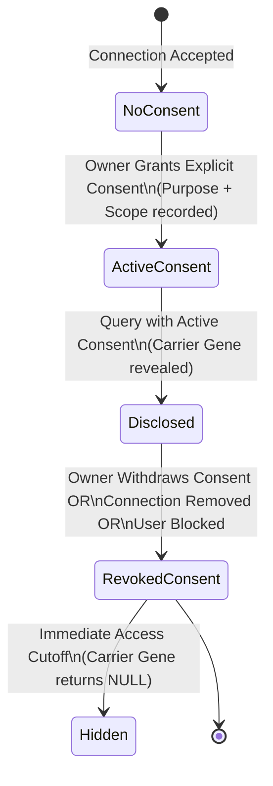

# DaNA — Authorization & Field-Level Access Control Rules

## 1. Role-Based Access Control (RBAC) Matrix

| Resource / Action | Couple / Individual | Counsellor | DoH Admin | Relative Invitee |
| :--- | :---: | :---: | :---: | :---: |
| **View Own Genetic Report** | ✓ (Own only) | — | — | ✓ (Own once registered) |
| **Discover Eligible Users** | ✓ | ✓ | ✓ | ✕ |
| **Send Connection Request** | ✓ | ✕ | ✕ | ✕ |
| **Accept / Reject Request** | ✓ (Designated receiver) | ✕ | ✕ | ✕ |
| **View Connected Peer Identity** | ✓ (Connected peers) | — | — | ✕ |
| **View Peer Carrier Gene** | **Consent Required** | **Consent Required** | ✕ (De-identified) | ✕ |
| **Grant / Revoke Own Consent**| ✓ (Granter only) | ✕ | ✕ | ✕ |
| **Review Case Queue** | ✕ | ✓ (Assigned/Unassigned)| ✕ | ✕ |
| **Sign Off Clinical Plans** | ✕ | ✓ (Licensed) | ✕ | ✕ |
| **Review Faith Content** | ✕ | ✕ | ✓ (Approved Scholar) | ✕ |
| **View Global Audit Log** | ✕ (Own events only) | ✕ (Case events only) | ✓ (Full audit) | ✕ |
| **Open Sila Invite Link** | — | — | — | ✓ (Anonymous token) |

---

## 2. Field-Level Authorization Matrix

> [!IMPORTANT]
> **Strict Clinical Decoupling:**
> Identity data and medical data are evaluated under separate authorization rules.

| Field Name | Data Classification | Visible to Public / Search | Visible to Connected Peer | Visible Under Active Consent |
| :--- | :--- | :---: | :---: | :---: |
| `id` / `short_name` | Non-Credible Identity | ✓ | ✓ | ✓ |
| `full_name` | Verified Identity | ✓ | ✓ | ✓ |
| `sex` | Demographic | ✓ | ✓ | ✓ |
| `role` / `title` | System Role | ✓ | ✓ | ✓ |
| `connected_at` | Relationship Metadata | ✕ | ✓ | ✓ |
| `carrier_gene` | **Protected Genomic Data** | **✕ STRICTLY OMITTED** | **✕ NULL BY DEFAULT** | **✓ DISCLOSED (Verified)** |
| `condition_name` | **Protected Clinical Data** | **✕ STRICTLY OMITTED** | **✕ NULL BY DEFAULT** | **✓ DISCLOSED (Verified)** |
| `reproductive_risk` | **Protected Clinical Data** | **✕ STRICTLY OMITTED** | **✕ NULL BY DEFAULT** | **✓ DISCLOSED (Verified)** |
| `clinical_notes` | **Counsellor Confidential**| **✕ STRICTLY OMITTED** | **✕ NULL** | **✕ Counsellor Only** |
| `malaffi_record_id` | **HIE Identifier** | **✕ STRICTLY OMITTED** | **✕ NULL** | **✕ System Adapter Only** |

---

## 3. Resource Ownership Rules (IDOR Prevention)

1. **Invitation Operations:**
   - Only the designated `receiver_id` can execute `/accept` or `/reject`.
   - Only the designated `sender_id` can execute `/cancel`.
   - Any attempt to manipulate another user's request ID returns `403 Forbidden`.
2. **Consent Operations:**
   - Only the user whose medical data is being shared (`granter_id`) can grant or revoke consent.
   - **No Proxy Consent:** A partner, spouse, or family elder can **never** grant consent on behalf of another individual.
3. **Connection Operations:**
   - Either participant (`user_a` or `user_b`) has authority to sever the connection or block the other user.
   - Connection removal or blocking triggers immediate cascading revocation of all active consents.

---

## 4. Consent Verification Lifecycle

1. **State: NoConsent**
   - Both users are actively connected.
   - When User A requests User B's profile, the backend evaluates active consents.
   - Finding none, User B's profile is returned with `carrierGene: null` and `consentRequired: true`.
2. **State: ActiveConsent**
   - User B submits `POST /api/v1/connections/:id/consents` specifying `purpose` and `dataScope`.
   - The consent status is set to `ACTIVE` with an immutable timestamp.
   - An in-app notification alerts User A.
   - When User A requests User B's profile, the active consent is validated, and authorized fields (`carrierGene`) are populated.
3. **State: Revocation**
   - User B calls `POST /api/v1/consents/:id/revoke`.
   - Consent status transitions to `REVOKED` with `revoked_at` timestamp.
   - Future queries immediately evaluate to `hasActiveConsent === false`.
   - No cached or lingering medical records remain accessible.

