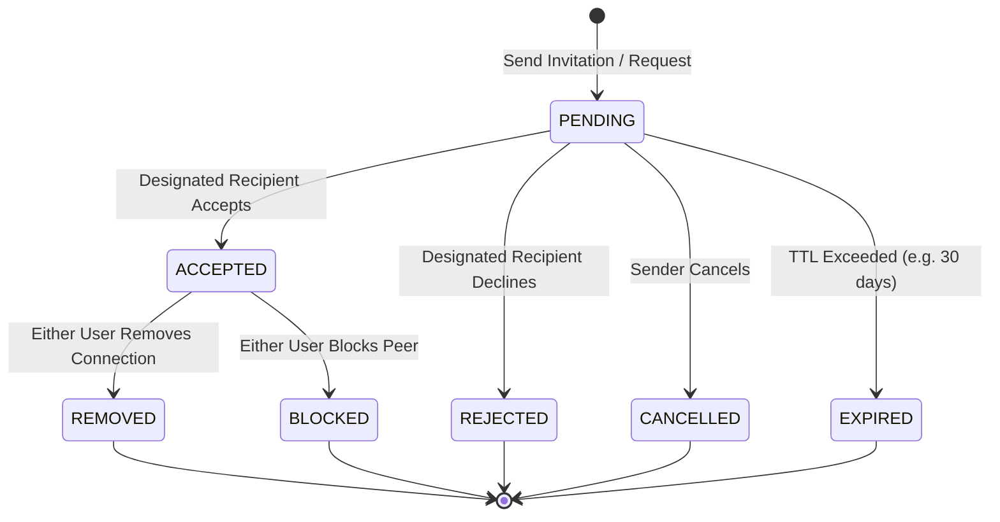
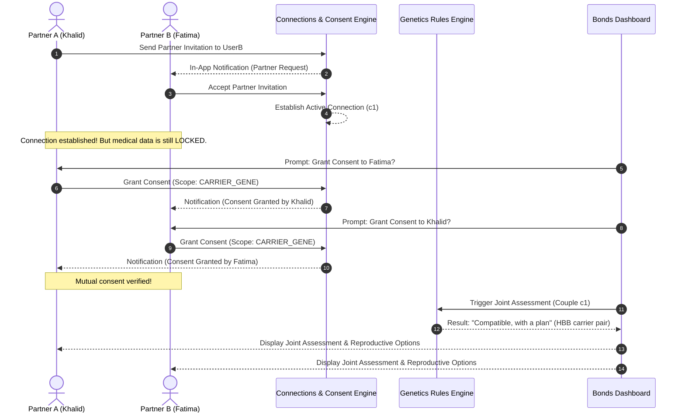

# DaNA — Connection & Invitation Module Specification

## 1. The Three Connection Categories

DaNA maintains three distinct connection workflows to prevent clinical and social boundary conflation:

```
                          ┌─────────────────────────────────────┐
                          │    UNIFIED INVITATION FOUNDATION    │
                          └──────────────────┬──────────────────┘
                                             │
         ┌───────────────────────────────────┼───────────────────────────────────┐
         │                                   │                                   │
         ▼                                   ▼                                   ▼
┌──────────────────┐               ┌──────────────────┐               ┌──────────────────┐
│    CATEGORY A    │               │    CATEGORY B    │               │    CATEGORY C    │
│ PARTNER (Bonds)  │               │ FAMILY (Branches)│               │ CASCADE (Sila)   │
└────────┬─────────┘               └────────┬─────────┘               └────────┬─────────┘
         │                                   │                                   │
• Premarital / Married             • Private family tree              • Anonymous Sila Alert
• Mutual Consent Gate              • Kinship modeling                 • No medical disclosure
• Joint Risk Assessment            • Voluntary invitation             • Independent Roots journey
```

### Category A: Partner Connection (Bonds)
* **Target:** Premarital fiancé(e) or spouse.
* **Objective:** Establish mutual relationship, enable joint premarital risk assessment, coordinate counsellor consultations, and formulate informed reproductive plans.
* **Security Rule:** Mutual, independent consent is mandatory before any shared risk calculation or carrier comparison can occur.

### Category B: Family Connection (Branches)
* **Target:** Immediate and extended relatives (Parents, Siblings, Cousins, Aunts/Uncles).
* **Objective:** Construct a private pearl family tree to trace inheritance patterns and familial risk factors.
* **Security Rule:** Does not require the relative to have an active account. Does not expose medical findings to other family members.

### Category C: Family Screening Invitation (Roots / Branches Cascade)
* **Target:** At-risk relatives who may benefit from cascade genetic screening (e.g., 50% carrier probability for siblings).
* **Objective:** Deliver anonymous **Sila alerts** (*صلة الرحم*) inviting relatives for free premarital screening.
* **Security Rule:** **Absolute anonymity.** The alert never names the index patient, never specifies the condition, and never reveals genetic markers.

---

## 2. Request State Machine & Transitions



### State Machine Rules:
1. **Self-Request Prevention:** `sender_id !== receiver_id`. Violations throw `400 Bad Request`.
2. **Duplicate Prevention:** A partial unique index on `(sender_id, receiver_id) WHERE status = 'PENDING'` ensures no duplicate pending requests can exist.
3. **Mutual Simultaneous Request Resolution:**
   - If User A sends a request to User B while User B *already has a pending request* to User A, the system automatically marks the existing request as `ACCEPTED` and creates the active connection immediately.
4. **Invalid Transitions:**
   - Attempting to accept a `REJECTED`, `CANCELLED`, or `EXPIRED` request throws `409 Conflict`.
5. **Connection Removal:**
   - Either user can remove the connection. Removal cascades to all active consents between the two users, transitioning them to `REVOKED`.

---

## 3. Mutual Consent & Joint Assessment Workflow (Bonds)



