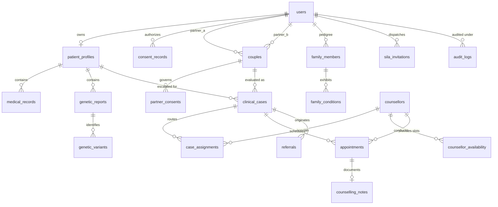

# DaNA — Database Schema & Data Integrity Reference (Version 3.0)

**Governance Alignment:** Autonomy-First, Clinically Escalated, Zero Certificate Gating  
**Standard Compliance:** UAE Health Data Law (Federal Law No. 2 of 2019), UAE Human Genome Decree-Law No. 49 of 2023, Abu Dhabi ADHICS, UAE PDPL

---

## 1. The 19 Core Tables

```
1.  users (id, identity_ref, role, status, created_at, updated_at)
2.  patient_profiles (id, user_id, date_of_birth, sex, preferred_language, phone_number_hash, created_at, updated_at)
3.  consent_records (id, user_id, consent_type, scope, version, status, granted_at, revoked_at, ip_address, user_agent)
4.  medical_records (id, patient_id, source, resource_type, external_reference, terminology_system, clinical_code, display_name, status, recorded_date, raw_payload)
5.  genetic_reports (id, patient_id, report_id, source, laboratory_name, accreditation_id, test_methodology, panel_coverage, report_date, validation_status, digital_signature, file_storage_path, created_at)
6.  genetic_variants (id, report_id, gene_symbol, ncbi_gene_id, transcript_id, hgvs_c, hgvs_p, genome_build, zygosity, inheritance_pattern, clinical_significance, significance_source, review_status, disease_association, created_at)
7.  couples (id, partner_a_id, partner_b_id, relationship_status, created_at)
8.  partner_consents (id, couple_id, owner_id, recipient_id, scope, status, granted_at, expires_at, revoked_at)
9.  family_members (id, owner_id, display_name, relationship, gender, parent_ids, is_deceased, evidence_status, created_at)
10. family_conditions (id, member_id, condition_name, age_at_onset, source, verification_status)
11. clinical_cases (id, couple_id, patient_id, case_type, workflow_status, clinical_urgency, is_pregnant, gestational_weeks, triage_tier, case_status, rule_version_id, created_at, updated_at)
12. counsellors (id, user_id, name, gender, languages, specialties, employment_type, location, max_caseload, active_caseload, credentials_verified, status)
13. counsellor_availability (id, counsellor_id, slot_start, slot_end, is_booked, is_emergency_buffer)
14. case_assignments (id, case_id, counsellor_id, assigned_by, assignment_reason, assigned_at, status)
15. appointments (id, case_id, counsellor_id, scheduled_time, meeting_type, status, created_at)
16. counselling_notes (id, appointment_id, ai_draft_note, final_note, clinical_summary, approved_by, approved_at, created_at)
17. referrals (id, case_id, destination, priority, reason, status, created_at)
18. sila_invitations (id, sender_id, token_hash, status, expires_at, created_at)
19. audit_logs (id, actor_id, action, resource_type, resource_id, metadata, ip_address, created_at)
```

---

## 2. Entity-Relationship Overview



---

## 3. Data Integrity & Security Architecture

1. **Zero-Trust Access & Row-Level Security (RLS):**
   - Individual users access exclusively their own `patient_profiles` and `genetic_reports`.
   - Cross-partner evaluation requires an explicit, active record in `partner_consents`.
   - Asymmetric accounts: Partner A and Partner B maintain distinct, independent profiles; no shared monolithic "couple medical record".
2. **Canonical Ordering:**
   - In `couples`, constraint `partner_a_id < partner_b_id` and unique index `idx_unique_active_couple` guarantee that `(A, B)` and `(B, A)` cannot produce duplicate active edges.
3. **Zero-Retention Ephemeral Sila Buffers (UAE PDPL):**
   - Relative phone numbers and email addresses are held in volatile memory only during gateway transmission.
   - `sila_invitations` stores only `token_hash` (SHA-256), expiring in 14 days with zero recipient contact or medical information persisted.
4. **Append-Only Clinical Audit:**
   - `audit_logs` captures every consent change, report ingestion, and status transition with actor IDs and network metadata.
