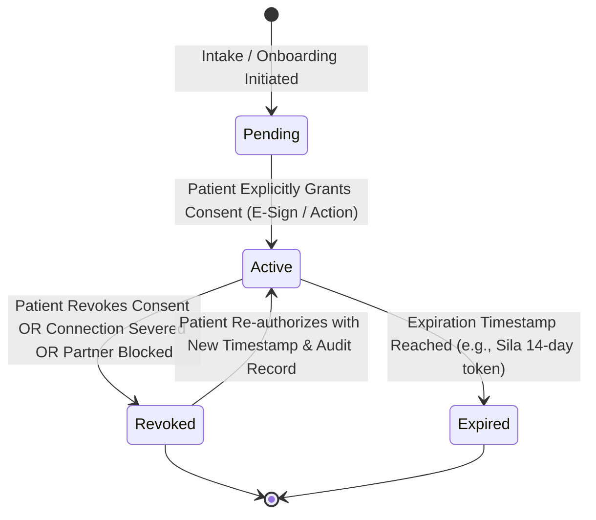

# DaNA — Healthcare Consent & Privacy Lifecycle Model

**Document Version:** 1.0.0  
**Classification:** Confidential — Healthcare Privacy Standard  
**Legal Framework:** UAE Federal Law No. 2 of 2019 (Health Data Law), Decree-Law No. 49 of 2023 (Human Genome Law), ADHICS Standard 4.1.

---

## 1. Architectural Principles

1. **Individual Autonomy:** Consent is personal. No partner, family member, guardian, or healthcare provider can grant proxy consent on behalf of a competent adult candidate.
2. **Separation of Individual Processing vs. Partner Sharing:**
   - **Individual Data Processing Consent:** Governs whether DaNA and laboratory adapters can fetch, store, and interpret the individual's records. Managed via `public.consents` and `public.consent_records`.
   - **Partner Sharing Consent:** Governs purpose-specific disclosure to a linked partner. Managed via `public.partner_consents` and `connectionConsents`.
3. **Purpose-Specific Granularity:** Blanket consent is prohibited. Each consent grant is bound to an unambiguous clinical purpose, version, and scope.
4. **Immediate Revocability Without Retroactive Clinical Erasure:**
   - Revocation takes immediate effect, preventing any future optional processing or disclosure.
   - Per UAE medical retention mandates, audit logs, completed clinical reports, and historical sign-offs are retained for legal defensibility.

---

## 2. Supported Consent Purposes

| # | Consent Purpose Identifier | Database Representation (`kind` / `purpose`) | Description & Scope |
| :-: | :--- | :--- | :--- |
| **1** | **Genetic Data Processing** | `genetic_processing` (`consents`) | Authorizes NGS targeted panel interpretation and carrier status extraction from laboratory data. |
| **2** | **Medical Data Processing** | `malaffi_access` / `medical_processing` | Authorizes syncing verified clinical and lab observations from the Malaffi Health Information Exchange. |
| **3** | **Family History Processing** | `family_history_processing` | Authorizes recording qualitative pedigree data and multi-generational hereditary conditions. |
| **4** | **Couple Assessment Participation** | `couple_assessment` | Authorizes running the Genetic Intelligence Engine to evaluate carrier overlap between partners. |
| **5** | **Sharing Combined Assessment** | `share_partner` / `share_combined_assessment` | Authorizes displaying the combined risk tier and reproductive guidance to the linked partner. |
| **6** | **Counsellor Clinical Access** | `share_counsellor` / `counsellor_access` | Authorizes licensed genetic counsellors to review variant tables and lab values for clinical care. |
| **7** | **Optional Family Notification** | `faith_cards` / `family_notification` | Authorizes sending anonymous, zero-retention Sila notification alerts to at-risk relatives. |

---

## 3. Data Model Attributes

Every consent record in DaNA tracks the following mandatory attributes:

```typescript
interface ConsentRecord {
  id: string;                      // Unique UUID
  owner_id: string;                // Person ID of the data subject (the granter)
  recipient_id?: string | null;    // Specific recipient (e.g. Partner person ID or Counsellor)
  consent_type: 'individual' | 'partner' | 'sila';
  purpose: string;                 // One of the 7 supported purposes
  scope: 'default' | 'result_summary' | 'full_report' | 'plan' | 'carrier_gene';
  version: string;                 // Legal text version, e.g. 'malaffi-consent-v1'
  status: 'active' | 'revoked' | 'expired';
  granted_at: string;              // ISO 8601 UTC timestamp
  expires_at?: string | null;      // Optional expiration timestamp (null = until revoked)
  revoked_at?: string | null;      // Immutable timestamp when revocation occurred
  ip_address?: string | null;      // Audit provenance
  user_agent?: string | null;      // Audit provenance
}
```

---

## 4. Consent Lifecycle State Machine



### Lifecycle Rules:
1. **Validation Rule:** A consent is valid **only** if:
   $$\text{status} = \text{'active'} \land \text{revoked\_at IS NULL} \land (\text{expires\_at IS NULL} \lor \text{expires\_at} > \text{now()}) \land \text{purpose matches requested operation}$$
2. **Cascading Severance Rule:** When a couple relationship is disconnected, removed, or blocked, all active `partner_consents` between those two individuals are immediately set to `status = 'revoked'` with `revoked_at = now()`.
3. **Zero Retention for Sila Alerts:** When family notification alerts are dispatched, contact details (phone, email) are ephemeral and held in volatile memory only during SMS/SMTP dispatch. The database stores only `token_hash`, expiring automatically in 14 days.

---

## 5. Audit & Compliance

All consent transactions (`grant`, `update`, `revoke`) generate an immutable row in `public.audit_log`:
- Actor ID & Display Name
- Action: "Gave consent to fetch results from Malaffi" / "Revoked partner sharing consent"
- Resource Type: `consents` / `partner_consents`
- Resource ID: Record UUID
- Permitted Metadata (Scope, Purpose, Version)
- **Zero Sensitive Data:** Raw genomic sequences, tokens, and passwords are never logged into audit metadata.

