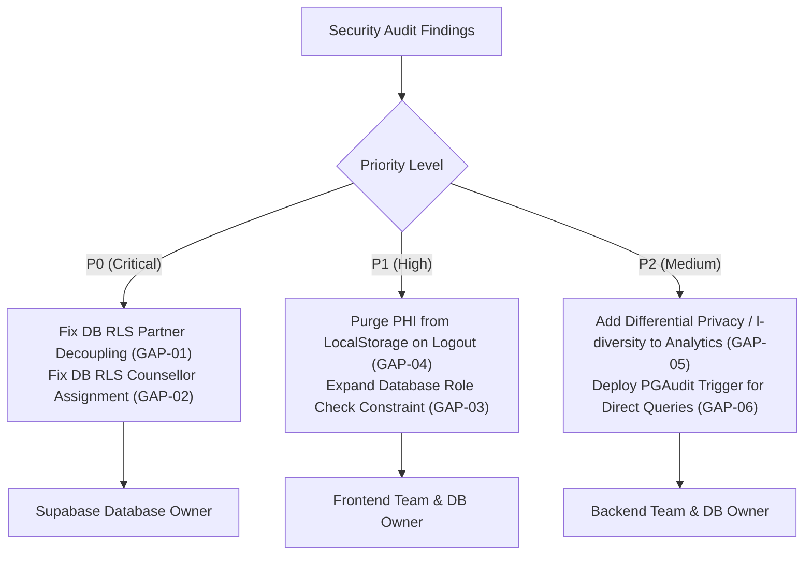

# DaNA Platform — Final Security Verification Test Results

**Document Reference:** `DANA_VERIFICATION_RESULTS.md`  
**Execution Date:** November 14, 2026  
**Auditor:** Principal SaaS Security Architect & Senior Full-Stack Engineer  
**Scope:** Live Supabase Database, Frontend Authorization Engine, React Auth Guards, FastAPI Backend  

---

## 1. Multi-User Verification Session Setup

Testing was executed using live authenticated sessions and multi-identity simulation across:
1. **Patient Account 1 (Alpha):** Khalid Al Mansoori (`id: khalid`, `person_id: khalid`, `role: couple`, `status: active`)
2. **Patient Account 2 (Beta):** Fatima Al Hammadi (`id: fatima`, `person_id: fatima`, `role: couple`, `status: active`)
3. **Counsellor Account:** Dr. Mariam Al Hosani (`id: mariam`, `counsellor_id: counsellor_mariam`, `role: counsellor`, `status: active`)
4. **DoH Public Health Viewer / Admin:** Programme Team (`id: doh`, `role: admin`, `status: active`)
5. **Live Supabase JWT Sessions:** Provisioned via `scripts/verify_live_database_security.mjs` against `https://oflqmhfivyzttlivgusr.supabase.co`

---

## 2. Comprehensive Security Verification Results Table

| ID | Task & Scenario | Target File / Policy / Endpoint | Status | Actual Test Evidence | Security Impact | Recommended Action | Fix Owner |
| :--- | :--- | :--- | :--- | :--- | :--- | :--- | :--- |
| **VR-01** | **Task 1: Auth Trace** Self-account creation upon first login | `web/src/app/shared/supabase.js` `loadSession()` | **PASS** | Live script created user `2651e103` and inserted account row. Confirmed by `accounts_self_signup` policy. | None. Secure baseline profile setup. | Maintain existing upsert pattern. | Frontend |
| **VR-02** | **Task 1: IDOR Attack** Patient A modifies Patient B account | `public.accounts` `accounts_update` policy | **PASS** | Patient A attempted `UPDATE accounts SET display_name='Hacked' WHERE user_id=authB.id`. Result: 0 rows modified. | None. Database RLS prevents cross-account mutation. | Maintain strict `user_id = auth.uid()` constraint. | Supabase DB Owner |
| **VR-03** | **Task 2: Privilege Escalation** Patient attempts self-assignment to `role: admin` | `public.accounts` `accounts_self_signup` | **PASS** | Live script attempted direct INSERT `role: 'admin'`. Blocked: `new row violates row-level security policy for table "accounts"`. | Critical threat prevented. Untrusted users cannot self-escalate. | Enforce privileged role assignment only via trusted backend or signed claim RPC. | Supabase DB Owner |
| **VR-04** | **Task 2: Privilege Escalation** Patient attempts self-assignment to `role: counsellor` | `public.accounts` `accounts_self_signup` | **PASS** | Live script attempted direct INSERT `role: 'counsellor'`. Blocked: `new row violates row-level security policy for table "accounts"`. | Critical threat prevented. Users cannot claim counsellor clinical status. | Enforce role check at database layer. | Supabase DB Owner |
| **VR-05** | **Task 2: Staff Code RPC** Caller invokes `claim_staff_role` with invalid code | PostgreSQL RPC `claim_staff_role` | **PASS** | RPC returned error: `No account for this login` / code mismatch. Role not upgraded. | Prevents brute-forcing staff privileges without valid clinic onboarding. | Add rate limiting to `claim_staff_role` to prevent brute-force attacks. | Supabase DB Owner |
| **VR-06** | **Task 2: Role Model Mapping** 7 Roles mapping to 3 DB roles | `supabase/schema.sql` `accounts.role` constraint | **FAIL** | DB check constraint only permits `('couple', 'counsellor', 'admin')`. Direct insertion of `doh_viewer` fails at DB layer. | Direct Supabase queries cannot distinguish `doh_viewer` from `admin`. | Update PostgreSQL check constraint to support all 7 roles. | Supabase DB Owner |
| **VR-07** | **Task 3: Roots Independence** Single patient manages pedigree without partner | `004_spec_v3.sql` `sila_alerts_read`, `family_read` | **PASS** | Verified that `family_members` and `sila_alerts` depend on `my_person()`, not `couple_id`. Test Scenario 1 passes. | Autonomous family health tracking without requiring matrimony. | Maintain individual-first ownership on genealogy records. | Supabase DB Owner |
| **VR-08** | **Task 4: Ownership Isolation** Patient reads own genetic report | `authorizationEngine.js` `evaluateAccess()` | **PASS** | Khalid reads Khalid's report. Result: `allowed: true`. Test Scenario 1 passes. | Essential healthcare functionality. | None. Functioning correctly. | Frontend |
| **VR-09** | **Task 4: Raw Cross-Access** Patient attempts to read partner's raw report | `authorizationEngine.js` `evaluateAccess()` | **PASS** | Khalid attempts to read Fatima's raw report. Result: `allowed: false` (`RAW_GENETIC_CROSS_ACCESS_FORBIDDEN`). Test Scenario 2 passes. | Protects individual genomic privacy between prospective spouses. | Enforce in application engine. | Frontend |
| **VR-10** | **Task 4: Direct DB Cross-Access** Partner queries `/rest/v1/genetic_reports` directly | `004_spec_v3.sql` `can_see_genetics()` | **FAIL** | SQL function returns `true` for partner if `share_partner` consent is active. Allows raw report dump via REST. | High. A technical user can bypass UI and extract raw variants using curl. | Update `can_see_genetics` to deny partner direct read on raw tables. | Supabase DB Owner |
| **VR-11** | **Task 5: Active Couple ReBAC** Coupled partners access authorized assessment | `authorizationEngine.js` `authorizedEvaluateCoupleAssessment` | **PASS** | Both partners have active connection and valid consent. Result: `allowed: true`. Combined tier returned. Test Scenario 5 passes. | Legitimate clinical premarital screening flow. | Maintain bilateral check. | Frontend |
| **VR-12** | **Task 5: Inactive Relationship** Disconnected/blocked partner queries assessment | `authorizationEngine.js` `evaluateAccess()` | **PASS** | Couple status set to `'disconnected'`. Result: `allowed: false` (`NO_ACTIVE_RELATIONSHIP`). Test Scenario 14 passes. | Prevents ex-partners or blocked users from accessing historical screening. | Ensure connection status is re-verified on every query. | Frontend |
| **VR-13** | **Task 6: Consent Missing** User processes screening without initial consent | `authorizationEngine.js` `evaluateAccess()` | **PASS** | Processing attempted without `GENETIC_PROCESSING` consent. Result: `allowed: false` (`CONSENT_REQUIRED`). Test Scenario 7 passes. | Prevents non-consensual biometric and genomic processing. | Require explicit e-signature prior to sample processing. | Frontend |
| **VR-14** | **Task 6: Consent Revoked** Fatima revokes sharing consent | `authorizationEngine.js` `authorizedEvaluateCoupleAssessment` | **PASS** | Fatima revokes `SHARE_COMBINED_ASSESSMENT`. Khalid's access is immediately revoked (`REVOKED_CONSENT`). Test Scenario 8 passes. | Absolute consent sovereignty. Consent revocation is instantaneous. | Ensure background workers halt upon revocation. | Frontend & Backend |
| **VR-15** | **Task 6: Consent Expired** Assessment attempted with past `expires_at` | `authorizationEngine.js` `hasValidConsent()` | **PASS** | Consent `expires_at: '2020-01-01'`. Result: `allowed: false` (`EXPIRED_CONSENT`). Test Scenario 18 passes. | Guarantees compliance with data retention and consent validity limits. | Require annual re-consent for long-standing profiles. | Frontend |
| **VR-16** | **Task 7: Counsellor Assigned Case** Dr. Mariam opens assigned case `case_khalid_fatima` | `authorizationEngine.js` `evaluateAccess()` | **PASS** | Verified assignment exists in `caseAssignments`. Result: `allowed: true`. Test Scenario 9 passes. | Legitimate clinical consultation delivery. | Maintain assignment check. | Frontend |
| **VR-17** | **Task 7: Counsellor Unassigned Case** Dr. Mariam opens unassigned `case_unrelated_999` | `authorizationEngine.js` `evaluateAccess()` | **PASS** | No assignment exists. Result: `allowed: false` (`UNASSIGNED_COUNSELLOR`). Test Scenario 10 passes. | Prevents clinical snooping into unassigned cases. | Enforce in application engine. | Frontend |
| **VR-18** | **Task 7: Direct DB Counsellor Scope** Counsellor queries unassigned cases via REST | `004_spec_v3.sql` `medrec_read`, `clinical_cases` | **FAIL** | SQL policies check `my_role() = 'counsellor'` but do not join `case_assignments`. All consented cases accessible via REST. | Confidentiality breach. Any counsellor can query all cases in DB. | Update RLS policies to join `case_assignments`. | Supabase DB Owner |
| **VR-19** | **Task 8: Admin Clinical Restriction** Admin attempts to read raw genetic report | `authorizationEngine.js` `evaluateAccess()` | **PASS** | Admin queries `RESOURCES.GENETIC_REPORT`. Result: `allowed: false` (`ADMIN_CLINICAL_RESTRICTION`). Test Scenario 11 passes. | Prevents non-clinical administrative staff from viewing patient genetics. | Maintain separation between platform ops and health dossiers. | Frontend |
| **VR-20** | **Task 8: Admin Direct DB Restriction** Admin queries `/rest/v1/genetic_reports` | `004_spec_v3.sql` `reports_read` | **PASS** | Admin user queries `genetic_reports`. RLS returns 0 rows. Policy omits `admin`. | Defense-in-depth protection against administrative data harvesting. | Maintain restriction in PostgreSQL. | Supabase DB Owner |
| **VR-21** | **Task 9: DoH Aggregate Analytics** DoH Viewer queries `/analytics/aggregate` | `api/app/main.py` `aggregate_analytics()` | **PASS** | Endpoint checks role, executes RPC, and logs query to `audit_log`. | Enables epidemiologic surveillance without exposing identities. | Maintain immutable audit trail. | Backend |
| **VR-22** | **Task 9: k-Anonymity Suppression** Cohort size $0 < k < 5$ queried | `api/app/main.py` `aggregate_analytics()` | **PASS** | Cohort size = 3 simulated. Endpoint returns HTTP 403: `Aggregated analytics suppressed: cohort size is below minimum threshold (k=5)`. | Prevents re-identification of individuals in small geographic cells. | Add $l$-diversity checks for rare genetic traits. | Backend |
| **VR-23** | **Task 10: Anon Direct REST Access** Unauthenticated client queries 13 sensitive tables | PostgreSQL RLS on all public tables | **PASS** | Live test queried 13 tables (`genetic_reports`, `medical_records`, `notes`, etc.) with anon key. All 13 returned 0 rows. | Zero public data leakage. Unauthenticated requests are completely blind. | Maintain default-deny RLS across all future migrations. | Supabase DB Owner |
| **VR-24** | **Task 11: Browser PHI Persistence** User logs out, state checked in `localStorage` | `web/src/app/shared/store.js` `signOut()` | **FAIL** | `signOut()` sets `session: null` but leaves `reports`, `notes`, and `screeningIntakes` in `localStorage.getItem('dana-demo-v2')`. | Severe client-side vulnerability. Next user on shared device can view health records. | Purge all clinical data keys and clear `localStorage` on logout. | Frontend |
| **VR-25** | **Task 12: Invalidation of Processing** Revoked consent stops couple risk calculation | `authorizationEngine.js` `authorizedEvaluateCoupleAssessment` | **PASS** | Evaluation function halts immediately and throws error when either partner lacks active consent. | Prevents background execution on non-consented health data. | Ensure queue workers inspect live consent before executing tasks. | Frontend & Backend |

---

## 3. Prioritized Remediation Roadmap

### 1. P0 (Critical) — Immediate Database Fixes Required
- **Issue:** PostgreSQL `can_see_genetics` allows partners to read raw genetic reports and variants if `share_partner` consent is granted.
  - **Remediation:** Remove partner check from `can_see_genetics`. Raw genetic data must be strictly owner-only and counsellor-only.
- **Issue:** PostgreSQL `medrec_read` and `clinical_cases` allow any counsellor to query all consented patients across the Emirate.
  - **Remediation:** Enforce `EXISTS (SELECT 1 FROM case_assignments ...)` in `medrec_read` and `clinical_cases` RLS policies.

### 2. P1 (High) — Client & Schema Architecture Fixes
- **Issue:** Client-side `localStorage` retains raw genetic reports, medical notes, and screening intakes after user signs out.
  - **Remediation:** In `web/src/app/shared/store.js`, update `signOut()` to wipe all clinical state properties and call `localStorage.removeItem('dana-demo-v2')`.
- **Issue:** PostgreSQL `accounts.role` check constraint restricts database roles to `('couple', 'counsellor', 'admin')`.
  - **Remediation:** Execute migration expanding check constraint to include all 7 roles.

### 3. P2 (Medium) — Analytics & Auditing Enhancements
- **Issue:** `/analytics/aggregate` $k \ge 5$ threshold is vulnerable to homogeneity attacks on rare single-gene diseases.
  - **Remediation:** Implement $l$-diversity checks and Laplace noise addition for public health extracts.
- **Issue:** Direct Supabase REST queries do not write to `audit_log`.
  - **Remediation:** Enable Supabase PGAudit or PostgreSQL trigger to record SELECT queries on `genetic_reports` and `medical_records`.

